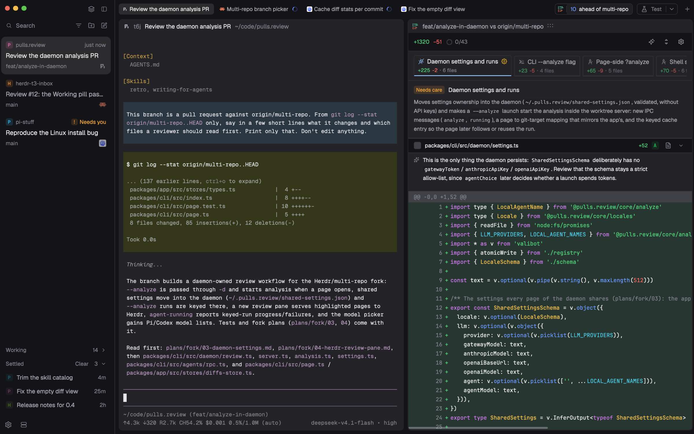

# Herdr T3

English · [中文](README.zh-CN.md)

A [T3 Code](https://github.com/pingdotgg/t3code)-like layout for Herdr App: an Inbox sidebar with T3-style Settle or Lists (Spaces + Agents), slim tabs, framed panes and Actions, plus an optional Review bar for pulls.review.



Only want the Settle sidebar? It is also published alone: [herdr-t3-inbox](https://github.com/JinJieBeWater/herdr-t3-inbox).

## Philosophy

**Save human attention.**

You can keep adding agents, but your attention doesn't grow with them. Everything in Herdr T3 is designed around this.

> It's so nice to have 14 threads running and zero visible. Why let working threads get in the way of things that need your attention?
>
> — [Theo](https://x.com/theo/status/2114131018575962496)

The Inbox follows [T3 Code](https://github.com/pingdotgg/t3code).

## Features

- **Two sidebars, one key apart** (`cmd-shift-b`): Lists, or Inbox.
  - Spaces: repo, branch and ahead/behind only when they're unusual; worktrees folded under their repo, checkout open or not; grouped by machine once there's more than one.
  - Agents: grouped by space or by priority, pins, sub-agents nested under their parent.
  - Inbox: T3-style Settle. Agents that need you stay up top as cards; finished ones are settled by hand into a quiet list and come back on new work. Busy agents fold into a Working shelf. Snooze hides any agent that doesn't need you until a time you pick.
- **One name everywhere**: Inbox cards, the agents list, tabs and pane headers name a terminal the same way: its Pi session while Pi runs in it, then a tab you named, then a telling terminal title, else the program. Two Pis in one tab read as their own sessions; lazygit started where Pi was reads as lazygit, not the old session.
- **The same status marks everywhere**: a spinner while working, `!` when blocked or its turn failed, a dot when done. While Inbox shows, a settled or snoozed agent's done dot leaves the pane headers too, and the tabs show no marks at all: what needs you is the sidebar's to say.
- **Slim tabs, framed panes**: 24px tabs, as T3's panel tabs; rounded panes with a 28px header (name, folder, status; split, zoom and close on hover).
- **New**: the tab bar's `+` opens a terminal tab in the current space; the sidebar's New tab, in Lists and Inbox alike, picks a space first. Its New space asks which machine once there is more than one; `cmd-n` doesn't ask and uses the current space's machine. No agent picker: start agents in the terminal.
- **Home**: settling or snoozing the agent in view lands on one quiet place, not the next card, so what to look at next stays yours. Its buttons, or `cmd-]`, `cmd-p` and `cmd-t`, say what's next; Undo brings the agent back. `cmd-shift-h` or the house in the sidebar's top bar goes there anytime. It takes no number among your spaces, and its panes are yours to fill: split in any mod or program, and it's kept.
- **Go to** (`cmd-p`, or Inbox's Search): a row for every pane, agents and programs alike, named and marked as its pane header is (a tab's name counts only if you gave it), so typing `lazygit` lands on its pane, beside an agent or not, in any space. The first row goes back to the pane your last jump from here left, so `cmd-p`, Enter goes back and forth.
- **Actions**, as T3 Code's run button: at the tab bar's top right, `▶` runs the action you ran last, `▾` lists them all (click one to run it), with a gear to edit each and Add action. Each action is a command run in a new tab, or split right/down, in the focused terminal's folder or its own. Edited in the app, not in a file. It is the `t3-actions` mod, installed with the layout and also published [on its own](https://github.com/JinJieBeWater/herdr-t3-actions) for other layouts.
- **Other machines**: spaces group by machine once there is more than one, and Inbox cards from elsewhere carry a server mark that names the machine on hover. Add a machine from the server icon in the sidebar footer; a rebuilt one offers Connect, and New space asks which machine.
- **Project icons**: a space shows its repo's favicon, found on its own machine, else a monogram in one of T3's colors.
- **Closing asks first**: a tab's or pane's ×, `cmd-w` and `cmd-shift-w` confirm while a program is running in it, and close at once when none is.
- **Review** (optional, [see Extras](#pullsreview)): a bar in the tab row counts what there is to review in the focused worktree, and a click opens that review in a pane beside the agent. Its pane header (and in Lists its tab) show the analysis with the layout's marks, and the Inbox gives a review in a tab of its own a card.

## Install

Ask your Herdr agent to add `herdr.dev/layouts/JinJieBeWater/herdr-t3`. By hand: copy `layouts/herdr-t3.json`, `layouts/herdr-t3.svg`, every `mods/t3-*` into `~/.config/herdr-app/`, and merge `keys.json` into yours. How it should look and behave: [RECIPE.md](RECIPE.md).

## Quick start

- **Sidebar**: the button at the top right of the sidebar (or `cmd-shift-b`) switches between Lists and Inbox; the one next to it hides the sidebar.
- **Inbox**: hover a finished card and click `✓ Settle` to put it away; new work brings it back, or click the undo arrow on its row. `cmd-shift-s` settles the agent in view and lands on Home, or brings it back if it is settled; `cmd-]` then opens the top card, so you can work down them one at a time. Drag a card or row, as in T3: move it 6px to lift it; the `Pinned` and `Active` labels open, the lifted row says what letting go will do (Pin, Unpin, Settle, Un-settle) and the list opens a gap where it will land. Pinned keeps your order; Active and Settled keep their own. Esc or leaving the sidebar sideways puts it back; leaving off the top or bottom lands it where the badge says; Working cards don't lift. Press a card's `✓ Settle` (or a settled row's undo) and move across rows to settle (or bring back) the whole run. The agents list shares these pins. A review in a tab of its own has a card of its own, on Working while it analyzes and back in Active when that ends: click it to get back from anywhere, and Settle closes it (it reopens from the Review bar, with your marks and analysis).
- **Focus ring** (off by default): in `~/.config/herdr-app/layouts/herdr-t3.json`, set the pane's `focus.color` from `"background"` to `"accent"` (or any theme color) to ring the focused pane. It applies on save.
- **Snooze**: hover a card (working ones too, not one that needs you), click the clock and pick a time. It waits on the Snoozed shelf and wakes where it was, marked `Woke` until you look at it or click that. It shows meanwhile while it needs you; a failed turn, new work you give it in view, a pin or Settle ends the snooze. `Undo` takes it back for 5 seconds; on the shelf, hover a row for the crossed-out alarm clock (press and move across rows to wake the run), or drag it out.

## Keys

The layout's own, in the `layout:herdr-t3` section of `keys.json` (an install merges them):

| Key | Command | Does |
| --- | --- | --- |
| `cmd-shift-b` | `t3-chrome.sidebar` | Switches the sidebar between Lists and Inbox |
| `cmd-shift-s` | `t3-inbox.settle` | Settles the agent in view and goes to Home, or brings it back if it's settled. Only while Inbox shows; a busy or pinned agent stays |
| `cmd-shift-h` | `t3-tabs.home` | Goes to Home |
| `cmd-t`, `ctrl-alt-c` | `t3-tabs.new` | A new tab here; at Home, New, which picks the space first |
| `ctrl-1…9`, `ctrl-alt-shift-1…9` | `t3-tabs.space:<n>` | Your nth space, not counting Home |
| `cmd-alt-]` / `cmd-alt-[`, `ctrl-alt-shift-]` / `ctrl-alt-shift-[` | `t3-tabs.space-next` / `t3-tabs.space-prev` | The next or previous space, going around Home |
| `cmd-1…9`, `ctrl-alt-1…9` | `t3-tabs.tab:<n>` | The nth tab the bar shows |
| `cmd-shift-]` / `cmd-shift-[`, `ctrl-tab` / `ctrl-shift-tab`, `ctrl-alt-]` / `ctrl-alt-[` | `t3-tabs.tab-next` / `t3-tabs.tab-prev` | The next or previous tab the bar shows |
| `cmd-p` | `mod.open:t3-picker` | Go to any pane by its name or program, or back (the same as Inbox's Search) |
| `cmd-]` / `cmd-[` | `t3-tabs.next` / `t3-tabs.prev` | The next or previous agent. With Inbox showing, as T3's: the rows it draws, in its order (a folded shelf only its row in view), stopping at either end. With Lists showing or the sidebar hidden, Herdr's `agent.next` / `agent.prev` |
| `cmd-w`, `ctrl-alt-shift-x` | `t3-tabs.close-tab` | Closes the tab, asking first if a program is running in it |
| `cmd-shift-w`, `ctrl-alt-x` | `t3-tabs.close-pane` | Closes the pane, asking first if a program is running in it |

Otherwise tabs, spaces and panes keep Herdr's own keys. Pinning, dragging and Clear in Inbox are by mouse.

## Update

Herdr doesn't update mods or layouts from others, and adding this again would install a renamed second copy (`t3-inbox-2`), since an install never overwrites. Update by overwriting instead:

- Tell your Herdr agent: "Update Herdr T3 from github.com/JinJieBeWater/herdr-t3: overwrite my installed `mods/t3-*` and `layouts/herdr-t3.*` with the repo's latest, then run `herdr-app check` on each mod." If the first install renamed something because of a clash, overwrite under that name.
- By hand: copy the same files over the old ones. Mods reload by themselves on save; no restart.
- Kept: pins, folds, sort, the Settled shelf and settled agents. They live in `data/`, `shared.json` and terminal labels, not in the mod folders. Lost: your own edits to the overwritten files, including the focus ring color; set it again after overwriting the layout.
- `keys.json` and the extras stay as they are; compare them with the repo only if the commit log mentions them. Commits marked `!` rename things (for example `refactor!: rename the layout and theme to herdr-t3`); follow what they rename.
- With Inbox showing, the tab bar holds the agent in view and what's around it: add the `cmd-1…9`, `ctrl-alt-1…9`, `ctrl-tab`, `ctrl-shift-tab`, `cmd-shift-]`, `cmd-shift-[`, `ctrl-alt-]` and `ctrl-alt-[` lines from the repo's `keys.json` to your `layout:herdr-t3` section, or those keys will count tabs the bar hides.
- Home is new: `mods/t3-home` comes with the other `mods/t3-*`, and the layout turns it on. Add the keys above to your `layout:herdr-t3` section, or `ctrl-1…9` will count Home. To keep moving on to the next card instead, remove `"home"` from `t3-inbox`'s props in the layout.
- From before Focus became Inbox (`t3-focus` → `t3-inbox`): rename `data/t3-focus` to `data/t3-inbox` (the cards' order and shelves), in `keys.json` change `t3-focus.settle` to `t3-inbox.settle`, then delete `mods/t3-focus`.
- Actions and the Review bar moved out of `t3-tabs`: copy the new `mods/t3-actions` too (your actions are kept: they live in `shared.json`), and for Review overwrite `mods/pulls-review` with this repo's `extras/mods/pulls-review` and add `extras/mods/review` (below).
- Go to is the layout's own now (`t3-picker`): copy the new `mods/t3-picker` too, and add `"cmd-p": "mod.open:t3-picker"` to your `layout:herdr-t3` section; it wins over `mod.open:picker` in `global`.
- `cmd-]` / `cmd-[` are the layout's own now (`t3-tabs.next` / `.prev`, once `t3-chrome.next` / `.prev`): set them in your `layout:herdr-t3` section; they win over `agent.next` in `global`.
- Closing a tab or pane asks first: add the `cmd-w`, `ctrl-alt-shift-x`, `cmd-shift-w` and `ctrl-alt-x` lines from the repo's `keys.json` to your `layout:herdr-t3` section; they win over `tab.close` and `pane.close` in `global`.
- The agent view is removed (last in commit `a8cbcd4`): after overwriting, delete `"cmd-shift-a": "t3-tabs.view"` from `keys.json`.

## What it runs

- `t3-spaces`: read-only `git status` / `git rev-parse` in your spaces' folders, watches those repos for changes (`watchFolder`), and `hc machine ls --json`. Clicking Connect on a rebuilt machine runs `hc machine rm` and `hc machine add`.
- `t3-inbox`: `hc label <agent> settled=<ms>:<turn>` when an agent is settled or unsettled.
- `t3-inbox`: `hc label <agent> snoozed=<ms>` when an agent is snoozed or wakes.
- `t3-spaces`, `t3-agents`, `t3-inbox`, `t3-new-menu`: for each space's icon, `git rev-parse --show-toplevel`, `sh` file tests and `base64` where the space is (on its machine); a found icon is copied into `cache/t3-icons/`.

No network requests.

## Extras (optional)

Not part of the layout and not copied by an install; add them by hand if you want them.

### pulls.review

`extras/mods/pulls-review` and `extras/mods/review`: a Review bar and a review pane, for [my pulls.review fork](https://github.com/JinJieBeWater/pulls.review/tree/multi-repo) (its CLI is `jin.review`). The bar counts what there is to review in the focused worktree (the branch's commits past the default branch, uncommitted files, commits to push and pull), and a click opens that review in a pane beside the agent. Also published alone as [herdr-pulls-review](https://github.com/JinJieBeWater/herdr-pulls-review): install it as [its README](https://github.com/JinJieBeWater/herdr-pulls-review#install) says (`herdr.dev/mods/JinJieBeWater/herdr-pulls-review`, or copy both folders into `~/.config/herdr-app/mods/`), then ask your Herdr agent to put its block in this layout's `tabs-row` row, right after `tabs`. `scripts/sync.sh` keeps that block when it syncs the layout. The pane's tab and header show its analysis with this layout's marks: `t3-tabs` and `t3-pane` read `shared("review.status")`.

### Theme export for Pi

`extras/mods/t3-theme-export` is the Herdr half of [pi-herdr-theme](https://github.com/JinJieBeWater/pi-stuff/tree/main/packages/pi-herdr-theme), a Pi extension in [my Pi setup](https://github.com/JinJieBeWater/pi-stuff) that makes Pi's colors follow Herdr's. The mod has no UI: whenever the colors Herdr draws with change (a pick in Settings, a layout's theme, the system's light or dark mode, a built-in preset), it writes `{ "name", "colors" }` to `~/.cache/herdr-app-theme.json`; the extension watches that file and regenerates Pi's theme. The two only share that path and format, so change them together. Install both: copy the folder into `~/.config/herdr-app/mods/`, then ask your Herdr agent to add `{ "id": "theme-export", "type": "block", "size": { "px": 0 }, "content": { "mod": "t3-theme-export" } }` at the end of this layout's `work` column, once. Leave it shown: a hidden block never starts. It only runs in a layout that has it: switch to another and Pi keeps its colors, so add the block there too if you want Pi to follow. `scripts/sync.sh` keeps that block when it syncs this layout.

### Theme and settings

The layout sets no theme: yours stays. `extras/themes/` holds two light and dark pairs if you want them:

- `catppuccin-mocha` and `catppuccin-latte`: [Catppuccin](https://catppuccin.com)'s official palette, terminal colors as its spec gives them and the panels in Catppuccin's own surfaces (mantle behind, base for cards, surface0 for selection and borders), with blue as the accent.
- `t3-code-dark` and `t3-code-light`: the colors T3 Code's web app draws by default, a true black canvas with accent `#346bf1` and a `#fcfcfc` canvas with accent `#1b4ed8`, with the VS Code terminal palette T3 Code uses. Terminal text takes the chat's 90% foreground, so an agent's replies read like T3 Code's.

Copy the files you want into `~/.config/herdr-app/themes/` and pick one in Settings, or set a pair in `settings.json` so it follows the system's light and dark mode, for example `"theme": { "light": "catppuccin-latte", "dark": "catppuccin-mocha" }`. The preview's other settings:

```json
{
  "font": "Geist Mono",
  "ui_font": "Geist",
  "font_size": 12,
  "zoom": 1.1,
  "minimum_contrast": 3
}
```

## Credits and license

`t3-chrome`, `t3-spaces`, `t3-agents`, `t3-tabs`, `t3-pane`, `t3-new-menu`, `t3-picker` and the layout start from Herdr App's shipped `workspace-chrome`, `spaces`, `agents`, `tabs`, `pane`, `new-menu`, `picker` and `main`. Settle follows T3 Code's design. The Catppuccin themes use the [Catppuccin](https://github.com/catppuccin/catppuccin) palette (MIT License, Copyright (c) 2021 Catppuccin); the T3 Code themes take [T3 Code](https://github.com/pingdotgg/t3code)'s default colors (MIT License, Copyright (c) 2026 T3 Tools Inc.). Icons are [Lucide](https://lucide.dev)'s (ISC License, Copyright (c) Lucide Contributors). Apache-2.0, as Herdr App.

## More

- [herdr-t3-inbox](https://github.com/JinJieBeWater/herdr-t3-inbox): this layout's Inbox sidebar as a standalone mod.
- [herdling](https://github.com/JinJieBeWater/herdling): a macOS menu bar companion for Herdr.
- [pi-stuff](https://github.com/JinJieBeWater/pi-stuff): my Pi extensions and skills.
