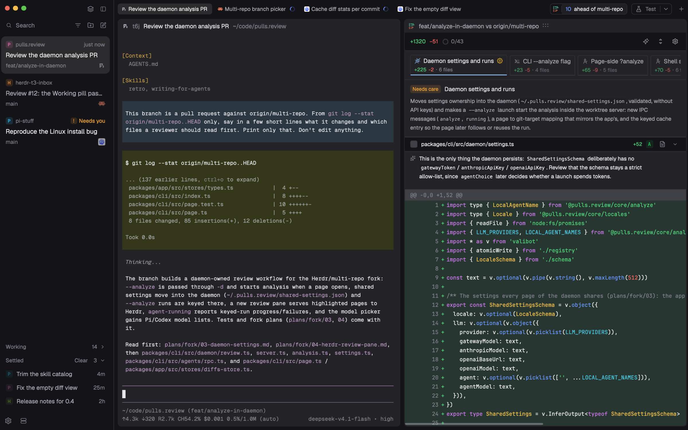

# Herdr T3

[English](README.md) · 中文

给 Herdr App 用的 [T3 Code](https://github.com/pingdotgg/t3code) 风格布局。侧栏可以在带 T3 式 Settle 的 Inbox 和 Lists（Spaces + Agents）之间切换，另有窄标签栏、带圆角边框的窗格和动作按钮，还可选配合 pulls.review 的 Review 栏。



只想要 Settle 侧栏？它也单独发布了一份：[herdr-t3-inbox](https://github.com/JinJieBeWater/herdr-t3-inbox)。

## 理念

**节约人类的注意力。**

窗口只在需要你时才出声，下一步看什么由你决定。遇到取舍时，行为看哪个更省注意力，外观照 T3 Code：[行为模型](docs/layout-model.md)。

agent 可以越开越多，人的注意力却不会跟着变多。Herdr T3 的整个设计都围绕这一点。

> It's so nice to have 14 threads running and zero visible. Why let working threads get in the way of things that need your attention?
>
> —— [Theo](https://x.com/theo/status/2114131018575962496)

Inbox 的做法来自 [T3 Code](https://github.com/pingdotgg/t3code)。

## 功能

- **两种侧栏，一键切换**（`cmd-shift-b`）：Inbox 按注意力组织，Lists 按项目组织，关闭、切换和 Settle 的规则相同，只有标签栏不同。
  - Spaces：只在不寻常时显示仓库、分支和领先/落后；worktree 折叠在所属仓库下，checkout 开没开都一样；机器多于一台时按机器分组。
  - Agents：按 space 或按优先级分组，可置顶，子 agent 缩进在父级下。
  - Inbox：T3 式 Settle。需要你的 agent 以卡片留在上方；结束的由你手动 Settle 进底部的安静列表，有新工作时自动回来。工作中的 agent 折叠进 Working 收纳区。Snooze 把任何不需要你的 agent 藏到你选的时间。
- **各处同一个名字**：Inbox 卡片、agents 列表、标签和窗格标题用同一条规则给终端取名：Pi 在跑时用 Pi 会话名，其次是你命名过的标签，再其次是有意义的终端标题，最后是程序名。同一个标签里的两个 Pi 各自显示自己的会话名；Pi 退出后在原处启动的 lazygit 显示为 lazygit，不沿用旧会话名。
- **各处同一套状态标记**：工作中转圈，blocked 或这一轮失败时显示 `!`，done 显示圆点。已 Settle 或 Snooze 的 agent 在各处都不再显示 done 圆点，Lists 也一样。显示 Inbox 时，标签上不显示任何标记：什么需要你由侧栏来说。
- **窄标签、带框窗格**：24px 标签，照 T3 的面板标签；圆角窗格带 28px 标题栏（名字、目录、状态；悬停时出现分屏、缩放、关闭）。
- **新建**：标签栏的 `+` 直接在当前 space 开终端标签；侧栏的 New tab（Lists 和 Inbox 都有）先选 space。侧栏的 New space 在机器多于一台时先问建在哪台；`cmd-n` 不问，直接用当前 space 的机器。不选 agent：在终端里启动。
- **Home**：Settle 或 Snooze 当前查看的 agent 后，回到一个安静的固定位置，不再跳到下一张卡片，下一步看什么由你决定。用这里的按钮或 `cmd-]`、`cmd-p`、`cmd-t` 决定下一步，Undo 能带回刚才的 agent。`cmd-shift-h` 或侧栏顶部的房子按钮可随时进入。它不占 space 序号，窗格也由你安排：分屏放入任意 mod 或程序，都会保留。
- **跳转**（`cmd-p`，或 Inbox 的 Search）：每个窗格一行，agent 和程序都在，名字和图标与窗格标题相同（标签名只有你命名过才算），所以输入 `lazygit` 就能直接跳到那个窗格，不管它旁边有没有 agent、在哪个 space。第一行回到上次从这里跳走前的窗格，所以 `cmd-p`、回车就能来回切换。
- **动作**，类似 T3 Code 的运行按钮：标签栏右上角的 `▶` 运行上次用过的动作，`▾` 列出全部动作（点一个就运行），每项有齿轮可编辑，底部可 Add action。每个动作是一条命令，在新标签或右/下分屏里运行，目录默认用当前终端的，也可以单独指定。在界面里编辑，不用改文件。它是 `t3-actions` mod，随布局一起安装，也[单独发布](https://github.com/JinJieBeWater/herdr-t3-actions)给其他布局用。
- **其他机器**：机器多于一台时 Spaces 按机器分组，来自其他机器的 Inbox 卡片带服务器标记，悬停显示机器名。从侧栏底部的服务器图标添加机器；重建过的机器会提供 Connect，New space 会先问建在哪台机器上。
- **项目图标**：space 显示其仓库的 favicon（在它所在的机器上查找），没有时显示 T3 配色的首字母图标。
- **关闭前确认**：标签或窗格的 ×、`cmd-w`、`cmd-shift-w` 和右键菜单的 Close 在有程序运行时先询问，没有程序运行时直接关闭。
- **Review**（可选，[见扩展](#pullsreview)）：标签栏里的 Review 栏统计当前 worktree 待评审的内容，点击后打开：每个 space 一个，可以是分屏或独立标签，已经开着就跳过去。切换 commit 在窗格自己的顶栏。它的窗格标题（显示 Lists 时还有标签）用布局的状态标记显示分析进度，在 Inbox 里也有一张卡片。

## 安装

让你的 Herdr agent 添加 `herdr.dev/layouts/JinJieBeWater/herdr-t3`。手动安装：把 `layouts/herdr-t3.json`、`layouts/herdr-t3.svg`、所有 `mods/t3-*` 复制进 `~/.config/herdr-app/`，把 `keys.json` 合并进你自己的。外观和行为见 [RECIPE.zh-CN.md](RECIPE.zh-CN.md)。

## 快速上手

- **侧栏**：侧栏右上角的按钮（或 `cmd-shift-b`）在 Lists 和 Inbox 之间切换；旁边那个按钮隐藏侧栏。
- **Inbox**：鼠标移到已结束的卡片上，点 `✓ Settle` 收起；有新工作时它会自己回来，也可以点那一行的撤销箭头拿回来。`cmd-shift-s`（Lists 和隐藏侧栏时也能用）Settle 当前查看的 agent 并回到 Home，已 Settle 的则取回；接着按 `cmd-]` 打开最上面的卡片，可以逐张处理。卡片和行可以像 T3 一样拖动：移动 6px 即拿起；`Pinned` 和 `Active` 标签展开，拿起的行标出松开后的动作（Pin、Unpin、Settle、Un-settle），列表在落点让出位置。Pinned 保留你排的顺序，Active 和 Settled 按各自的排序。按 Esc 或从侧栏左右两侧拖出放回原处，从上下边缘拖出则按标记落下；Working 卡片拿不起来。按住卡片的 `✓ Settle`（或已 Settle 行的撤销箭头）划过多行，可以一次 Settle（或取回）整段。和 Agents 列表共用同一份置顶。Review 有自己的卡片，分析时在 Working，结束后回到 Active：从任何地方点它都能回去，Settle 就是关闭并回到打开它之前的地方（从 Review 栏可以重开，已审标记和分析结果都还在）。
- **聚焦边框**（默认关闭）：把 `~/.config/herdr-app/layouts/herdr-t3.json` 里窗格的 `focus.color` 从 `"background"` 改成 `"accent"`（或其他主题色），聚焦的窗格就会有边框。保存即生效。
- **Snooze**：鼠标移到卡片上（工作中的也可以，需要你的不行），点时钟选时间。它进 Snoozed 收纳区等待，到点回到原位并标 `Woke`，直到你看过它或点一下这个标记。其间需要你时它会出现；这一轮失败、你在查看时给了新工作、置顶或 Settle 都会结束 Snooze。5 秒内可以点 `Undo` 撤回；在收纳区里，悬停一行出现划掉的闹钟（按住划过多行可以一次叫醒整段），也可以把它拖出来。

## 快捷键

布局自带的，写在 `keys.json` 的 `layout:herdr-t3` 里（安装时会合并进去）：

| 快捷键 | 命令 | 作用 |
| --- | --- | --- |
| `cmd-shift-b` | `t3-tabs.sidebar` | 侧栏在 Lists 和 Inbox 之间切换 |
| `cmd-shift-s` | `t3-tabs.settle` | Settle 当前查看的 agent 并回到 Home，已 Settle 的则取回。两个侧栏下都能用，显示或隐藏都一样；忙着的不动，置顶的会取消置顶 |
| `cmd-shift-h` | `t3-tabs.home` | 回到 Home |
| `cmd-t`、`ctrl-alt-c` | `t3-tabs.new` | 在当前位置新建标签；在 Home 时打开新建菜单，先选 space |
| `ctrl-1…9`、`ctrl-alt-shift-1…9` | `t3-tabs.space:<n>` | 第 n 个 space，不算 Home |
| `cmd-alt-]` / `cmd-alt-[`、`ctrl-alt-shift-]` / `ctrl-alt-shift-[` | `t3-tabs.space-next` / `t3-tabs.space-prev` | 下一个或上一个 space，跳过 Home |
| `cmd-1…9`、`ctrl-alt-1…9` | `t3-tabs.tab:<n>` | 标签栏显示的第 n 个标签 |
| `cmd-shift-]` / `cmd-shift-[`、`ctrl-tab` / `ctrl-shift-tab`、`ctrl-alt-]` / `ctrl-alt-[` | `t3-tabs.tab-next` / `t3-tabs.tab-prev` | 标签栏显示的下一个或上一个标签 |
| `cmd-p` | `mod.open:t3-picker` | 按名字或程序跳到任一窗格，或回到上一处（和 Inbox 顶栏的 Search 相同） |
| `cmd-]` / `cmd-[` | `t3-tabs.next` / `t3-tabs.prev` | 下一个或上一个 agent：按选中的侧栏画出来的行的顺序走（折叠的组只算当前查看的那一行），到两端停住，显示或隐藏都一样 |
| `cmd-w`、`ctrl-alt-shift-x` | `t3-tabs.close-tab` | 关闭标签，里面有程序在运行时先确认 |
| `cmd-shift-w`、`ctrl-alt-x` | `t3-tabs.close-pane` | 关闭窗格，里面有程序在运行时先确认 |

其他标签、space 和窗格操作沿用 Herdr 自己的快捷键。Inbox 里的置顶、拖动和 Clear 用鼠标。

## 更新

Herdr 不会更新别人做的 mod 和布局。再添加一次也不行：安装从不覆盖已有文件，只会装出一份改了名的副本（如 `t3-inbox-2`）。更新要靠覆盖：

- 对你的 Herdr agent 说：「从 github.com/JinJieBeWater/herdr-t3 更新 Herdr T3：用仓库最新的文件覆盖我已安装的 `mods/t3-*` 和 `layouts/herdr-t3.*`，然后对每个 mod 跑 `herdr-app check`。」如果首次安装时因为重名改过名字，就覆盖改名后的那份。
- 手动更新：把同样的文件复制过去覆盖旧的。mod 保存后自动重载，不用重启。
- Lists 和 Inbox 现在用同一套规则，一些键的效果变了：见更新日志。`keys.json` 没有变化。复制 `mods/t3-*`，用 Review 的话再复制 `extras/mods/pulls-review` 和 `extras/mods/review`，并删掉已移除的文件（`rsync -a --delete`）。以前每个标签各开了一个 Review 窗格的，把多余的关掉：Review 栏优先用当前标签里的那个。
- 会保留：置顶、折叠、排序、Settled 收纳区和已 Settle 的 agent。这些存在 `data/`、`shared.json` 和终端标签里，不在 mod 目录中。会丢掉：你自己对被覆盖文件的修改，包括聚焦边框颜色；覆盖布局后重新设置即可。
- `keys.json` 和可选扩展保持原样；只有提交记录提到它们时，再和仓库对比。带 `!` 的提交会改名（例如 `refactor!: rename the layout and theme to herdr-t3`），按提交里的改名同步调整。
- 新增 Home：`mods/t3-home` 随其他 `mods/t3-*` 一起覆盖，布局会启用它。把上面新增的按键加进你的 `layout:herdr-t3` 分区，否则 `ctrl-1…9` 会把 Home 算进去。如果想继续跳到下一张卡片，从布局里 `t3-inbox` 的 props 删掉 `"home"`。
- `cmd-shift-b` 和 `cmd-shift-s` 现在在布局显示的任何时候都可用：把你 `layout:herdr-t3` 分区里的这两项改成 `t3-tabs.sidebar` 和 `t3-tabs.settle`（以前是 `t3-chrome.sidebar` 和 `t3-inbox.settle`），否则会提示未知命令。
- 显示 Inbox 时，标签栏只放当前 agent 和它周边的标签：把仓库 `keys.json` 里 `cmd-1…9`、`ctrl-alt-1…9`、`ctrl-tab`、`ctrl-shift-tab`、`cmd-shift-]`、`cmd-shift-[`、`ctrl-alt-]`、`ctrl-alt-[` 这几行加进你的 `layout:herdr-t3` 分区，否则这些键会算上被隐藏的标签。
- 从 Focus 改名为 Inbox 之前的版本升级（`t3-focus` → `t3-inbox`）：把 `data/t3-focus` 改名为 `data/t3-inbox`（卡片顺序和收纳区状态），把 `keys.json` 里的 `t3-focus.settle` 改成 `t3-inbox.settle`，再删掉 `mods/t3-focus`。
- 动作和 Review 栏已移出 `t3-tabs`：把新的 `mods/t3-actions` 也复制过去（动作会保留，它们存在 `shared.json` 里）；用 Review 的话，用本仓库的 `extras/mods/pulls-review` 覆盖 `mods/pulls-review`，再加上 `extras/mods/review`（见下文）。
- 跳转现在归布局自己（`t3-picker`）：把新的 `mods/t3-picker` 也复制过去，并把 `"cmd-p": "mod.open:t3-picker"` 加进你的 `layout:herdr-t3` 分区，会覆盖 `global` 里的 `mod.open:picker`。
- `cmd-]` / `cmd-[` 现在归布局自己（`t3-tabs.next` / `.prev`，以前是 `t3-chrome.next` / `.prev`）：在你的 `layout:herdr-t3` 分区里设置它们，会覆盖 `global` 里的 `agent.next`。
- 关闭标签和窗格现在会先确认：把仓库 `keys.json` 里的 `cmd-w`、`ctrl-alt-shift-x`、`cmd-shift-w`、`ctrl-alt-x` 四行加进你的 `layout:herdr-t3` 分区，会覆盖 `global` 里的 `tab.close` 和 `pane.close`。
- Agent 模式已移除（最后包含它的提交是 `a8cbcd4`）：覆盖后删掉 `keys.json` 里的 `"cmd-shift-a": "t3-tabs.view"`。

## 它会运行什么

- `t3-spaces`：在各 space 的目录里运行只读的 `git status` / `git rev-parse`，监听这些仓库的变化（`watchFolder`），运行 `hc machine ls --json`。点重装机器的 Connect 时运行 `hc machine rm` 和 `hc machine add`。
- `t3-inbox`：Settle 或取消 Settle 时运行 `hc label <agent> settled=<ms>:<turn>`。
- `t3-inbox`：Snooze 或唤醒时运行 `hc label <agent> snoozed=<ms>`。
- `t3-spaces`、`t3-agents`、`t3-inbox`、`t3-new-menu`：为每个 space 的图标，在 space 所在的位置（它的机器上）运行 `git rev-parse --show-toplevel`、`sh` 文件检测和 `base64`；找到的图标复制到 `cache/t3-icons/`。

不发网络请求。

## 可选扩展

不属于布局本身，安装时也不会被复制；需要的话手动添加。

### pulls.review

`extras/mods/pulls-review` 和 `extras/mods/review`：Review 栏和评审窗格，配合[我的 pulls.review fork](https://github.com/JinJieBeWater/pulls.review/tree/multi-repo)（CLI 叫 `jin.review`）使用。Review 栏统计当前焦点所在工作树有什么可评审的（当前分支上默认分支没有的提交、未提交的文件、要推送和要拉取的提交），点一下打开那份评审，每个 space 一个：窗格设置里的 `Open in` 决定是 agent 旁边的窗格还是独立标签。窗格自己的顶栏负责在这份 diff 的 commit 之间切换。Analyze automatically 只对点计数生效。它也单独发布为 [herdr-pulls-review](https://github.com/JinJieBeWater/herdr-pulls-review)：按[它的 README](https://github.com/JinJieBeWater/herdr-pulls-review/blob/main/README.zh-CN.md) 安装（`herdr.dev/mods/JinJieBeWater/herdr-pulls-review`，或者把两个目录复制进 `~/.config/herdr-app/mods/`），然后让你的 Herdr agent 把它的块放进这个布局的 `tabs-row` 这一行、紧跟在 `tabs` 后面。`scripts/sync.sh` 同步布局时会保留这个块。评审窗格所在的标签和窗格标题栏用这个布局的标记显示分析状态：`t3-tabs` 和 `t3-pane` 读取 `shared("review.status")`。

### 给 Pi 用的主题导出

`extras/mods/t3-theme-export` 是 [pi-herdr-theme](https://github.com/JinJieBeWater/pi-stuff/tree/main/packages/pi-herdr-theme) 在 Herdr 这一侧的部分。pi-herdr-theme 是[我的 Pi 配置](https://github.com/JinJieBeWater/pi-stuff)里的一个 Pi 扩展，让 Pi 的配色跟着 Herdr 走。这个 mod 没有界面：Herdr 实际显示的颜色一变（设置页点选、布局主题、系统明暗、内置预设都算），它就把 `{ "name", "colors" }` 写到 `~/.cache/herdr-app-theme.json`；扩展监听这个文件，重新生成 Pi 主题。两边只靠这个路径和格式对接，改的时候要一起改。两边都要装：把目录复制进 `~/.config/herdr-app/mods/`，再让你的 Herdr agent 在这个布局的 `work` 列末尾加一次 `{ "id": "theme-export", "type": "block", "size": { "px": 0 }, "content": { "mod": "t3-theme-export" } }`。不要设成隐藏，隐藏的块不会启动。它只在放了这个块的布局里运行：切到其他布局后 Pi 保持原来的颜色，想跟随就在那个布局里也加上。`scripts/sync.sh` 同步这个布局时会保留这个块。

### 主题和设置

布局不指定主题，沿用你自己的。`extras/themes/` 里附带两对明暗主题，需要的话可以用：

- `catppuccin-mocha` 和 `catppuccin-latte`：[Catppuccin](https://catppuccin.com) 官方色板，终端色按官方规范，界面用 Catppuccin 自己的层次色（底层 mantle、卡片 base、选中和边框 surface0），强调色为 blue。
- `t3-code-dark` 和 `t3-code-light`：T3 Code 网页端默认绘制的颜色，深色 canvas 为纯黑、accent 为 `#346bf1`，浅色 canvas 为 `#fcfcfc`、accent 为 `#1b4ed8`，终端用 T3 Code 采用的 VS Code 终端配色。终端文字取对话正文的 90% 前景色，让 agent 的回复读起来和 T3 Code 一样。

把想要的文件复制进 `~/.config/herdr-app/themes/`，在设置页选上；或者在 `settings.json` 里写一对，跟随系统明暗切换，例如 `"theme": { "light": "catppuccin-latte", "dark": "catppuccin-mocha" }`。预览图里的其余设置：

```json
{
  "font": "Geist Mono",
  "ui_font": "Geist",
  "font_size": 12,
  "zoom": 1.1,
  "minimum_contrast": 3
}
```

## 致谢与许可证

`t3-chrome`、`t3-spaces`、`t3-agents`、`t3-tabs`、`t3-pane`、`t3-new-menu`、`t3-picker` 和布局本身，分别基于 Herdr App 自带的 `workspace-chrome`、`spaces`、`agents`、`tabs`、`pane`、`new-menu`、`picker` 和 `main` 修改。Settle 参照 T3 Code 的设计。Catppuccin 主题使用 [Catppuccin](https://github.com/catppuccin/catppuccin) 色板（MIT 许可证，Copyright (c) 2021 Catppuccin）；T3 Code 主题取自 [T3 Code](https://github.com/pingdotgg/t3code) 的默认配色（MIT 许可证，Copyright (c) 2026 T3 Tools Inc.）。图标来自 [Lucide](https://lucide.dev)（ISC 许可证，Copyright (c) Lucide Contributors）。许可证与 Herdr App 相同，为 Apache-2.0。

## 更多

- [herdr-t3-inbox](https://github.com/JinJieBeWater/herdr-t3-inbox)：本布局的 Inbox 侧栏，单独作为 mod 发布。
- [herdling](https://github.com/JinJieBeWater/herdling)：Herdr 的 macOS 菜单栏伴侣。
- [pi-stuff](https://github.com/JinJieBeWater/pi-stuff)：我写的 Pi 扩展和 Skills。
