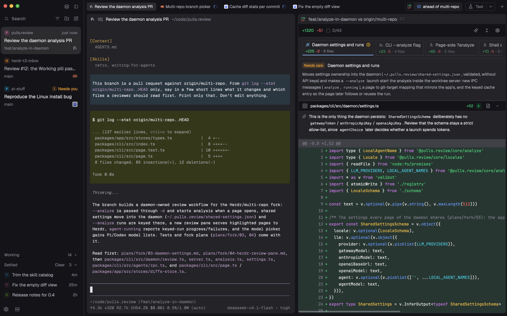

# Herdr T3

[English](README.md) · 中文

给 [Herdr App](https://herdr.dev) 用的一套布局：同时开着很多 agent，只看需要你的那几个。



## 为什么做它

> It's so nice to have 14 threads running and zero visible. Why let working threads get in the way of things that need your attention?
>
> —— [Theo](https://x.com/theo/status/2114131018575962496)

我在 T3 Code 里用过这种工作方式：在跑的看不见，需要我的才出现，看完收起，有新动静它自己回来。我想在 Herdr 里也这样工作，所以把 T3 Code 的 Inbox 和外观搬了过来，并让它适应 Herdr 的标签、窗格和多台机器。

## 功能

- **Inbox 搜索**：输入名字，侧栏显示紧凑的结果列表。用 ↑、↓ 选择，Enter 打开。
- **Inbox 和 Lists**：用 `cmd-shift-l` 或在布局设置里切换。Inbox 按注意力排列 agent，支持 Settle、Snooze 和 Mark unread（从右键菜单把已读空闲 agent 标回 Done）。**Settled** 收纳已收起的 agent，**Filter by space** 只列出有 Inbox 条目或已在筛选中选中的 space。Lists 列出 space 和其中的 agent。
- **切换 space** 或从 Home 返回 space 时，目标标签栏、终端和上次打开的右侧面板一起出现。
- **Home**：收起正在看的 agent 后，回到一个安静的页面，不会自动跳到下一张卡片。下一步看什么由你决定。也可以在设置（`cmd-shift-,`）里改成跳到下一张卡片，或者把 Home 换成终端或你自己的 mod。
- **同一个名字，同一套标记**：卡片、列表、标签和窗格标题用同样的方式给终端取名、标状态。
- **跳转**（`cmd-p`）：按名字跳到任何窗格，agent 和普通程序都行。最近访问顺序变化时，Enter 仍跳到你选中的窗格。
- **Clean up**（`cmd-shift-r`／`ctrl-alt-r`，或侧栏底栏的垃圾桶图标）不离开 Inbox 回收用完的终端：已 Settle 的 agent 和空闲 shell 折成一块，点 **Close** 一起关掉；所在 space 已没有在工作的 agent、却还在运行的程序各是一张卡片，可以跳过去或点 **Stop** 停掉。
- **New** 先列出打开的 space，再列出记住的项目。项目的最后一个终端关闭后仍可选中，在原来的机器和目录重新打开。
- **详情**（`cmd-shift-b`）：locked 电脑／目录、Open in、全局 Actions，下面的 Review 行一点就显示 Review，箭头选范围。已装T3编辑器（含VSCodium／JetBrains）与Files共用偏好，菜单只选择，主按钮才打开；右键卡片可选择显示哪些项。
- **窄标签、带框窗格**，照 T3 Code 的外观。在 Inbox 下，点标签栏面包屑里的 space 名打开菜单，可新建标签页或直接切到当前 space 下的其他 agent、子 agent 和终端程序。
- **子 agent 菜单**：数量入口只打开原顺序的树；点行或方向键加 Enter 来 peek，右键打开侧栏同一份 agent 菜单，含 Send back、Copy address。每行用 Agents 行同样的标记：空闲显示闲了多久，Failed 是红色，完成圆点看过就消失。
- **其他机器**：它们的 space 按机器分组，Inbox 卡片带机器标记；Lists 中悬停 Agents 行查看机器名。
- **断连警告**：机器上的 agent 会在断开后停止时，机器标题显示警告；点它打开 Herdr 的修复说明，不自动执行提权命令。
- **Files**：照 T3 的只读文件树，与 Review 的同一种，每文件一个标签。搜索仍是树，目录面包屑保留返回路径，Preview／Code 切换时头部控件固定占位。隐藏保留，关闭释放；大树取消过时展开，只画可见行。 可把文件或文件夹行拖进终端插入路径，不按 Enter；跨机器复制与拒绝遵循 Herdr 的规则，菜单里的 Insert into terminal 保留。
- **Review**（可选）：每 space 最多一个可关闭标签，独立保留范围和阅读位置；切换保留，关闭重加回默认范围。文件／文件夹行可拖进终端或用 Files 同一份右键菜单；已删除文件只能 Copy path、不能拖动，子组行两者都没有。右键不改当前文件和已看勾选。

每项的详细说明见[使用指南](docs/user/guide.zh-CN.md)。

## 安装

需要 Herdr 0.1.16 或更新版本。

让你的 Herdr agent 添加 `herdr.dev/layouts/JinJieBeWater/herdr-t3`。手动安装：把 `layouts/herdr-t3.json`、`layouts/herdr-t3.svg` 和所有 `mods/t3-*` 复制进 `~/.config/herdr-app/`，再把 `keys.json` 合并进你自己的。

只想要 Inbox？它也单独发布了一份：[herdr-t3-inbox](https://github.com/JinJieBeWater/herdr-t3-inbox)。

## 快速上手

1. `cmd-shift-l` 切换 Inbox 和 Lists；`cmd-shift-b` 打开详情。
2. 在 Inbox 里，鼠标移到已结束的卡片上，点 `✓ Settle` 把它 Settle；有新工作时它会自己回来。`cmd-shift-s` Settle 当前查看的 agent 并回到 Home。
3. 在 Home 按 `cmd-]` 打开最上面的卡片，可以逐张处理。
4. 鼠标移到卡片上，点时钟，可以把它 Snooze 到你选的时间。

拖动、划过多行、置顶等用法见[日常用法](docs/user/guide.zh-CN.md#日常用法)。

## 快捷键

| 快捷键 | 作用 |
| --- | --- |
| `cmd-shift-b` | 切换详情 |
| `cmd-shift-s` | Settle 当前查看的 agent 并回到 Home，已 Settle 的则取回 |
| `cmd-]` / `cmd-[` | 按侧栏的顺序到下一个或上一个 agent |
| `cmd-p` | 跳到任一窗格 |
| `cmd-shift-r`／`ctrl-alt-r` | 打开 Clean up |
| `cmd-shift-h` | 回到 Home |
| `cmd-shift-,` | 布局的设置 |
| `cmd-alt-b` | 打开或关闭 space 面板，停在上次的页面 |
| `cmd-shift-g` | 打开 Review；面板正显示 Review 时关闭面板（Review 扩展） |
| `cmd-t` | 在当前位置新建标签；在 Home 时先选 space |

完整列表见[快捷键](docs/user/guide.zh-CN.md#快捷键)。

## 更新

```sh
git clone --depth 1 https://github.com/JinJieBeWater/herdr-t3 && herdr-t3/scripts/update.sh
```

脚本先检查配置和必需 mod 的加载入口，再更新布局和 mod，合并 `keys.json`。你的置顶、已收起的 agent、动作、主题、聚焦边框和已安装 Review 栏的配置都会保留。已卸载扩展的布局块会移除。详见[更新](docs/user/guide.zh-CN.md#更新)。

## 它会运行什么

- `t3-spaces`：在各 space 的目录里运行只读的 `git status` / `git rev-parse`，监听这些仓库的变化（`watchFolder`），运行 `hc machine ls --json`。点重装机器的 Connect 时运行 `hc machine rm` 和 `hc machine add`。
- `t3-inbox`：Settle 或取消 Settle 时运行 `hc label <agent> settled=<ms>:<turn>`。
- `t3-inbox`：Snooze 或唤醒时运行 `hc label <agent> snoozed=<ms>`。
- `t3-inbox` 在窗格所在机器的工作目录中用 `git rev-parse` 和 `git worktree list --porcelain -z` 识别链接工作树。
- `t3-tabs`：关闭终端前运行 `hc get`，看里面有没有程序在跑。用 `cmd-shift-s` Settle 或取回 agent、用 Mark unread 写 `herdr.seen` 并清除 `settled` 或 `snoozed` 时运行 `hc label`；Herdr 显示了你没选的标签、清掉了未读的 done（`herdr.seen`）或 Woke 标记（`snoozed`）时，也用它还回去；这一轮失败或查看时有新工作结束 Snooze 时，运行 `hc label <agent> snoozed=`。
- `t3-tabs`：用 `hc get` 检查 shell 是否空闲、能否纳入 **Clean up**，以及运行中的终端前台是什么进程。
- `t3-agents`：置顶一个 Snooze 中的 agent、结束它的 Snooze 时，运行 `hc label <agent> snoozed=`。
- `t3-actions`：读取 ComputerName，用 `open -Ra` 检测编辑器，通过 `open` 打开所选目录；Review 行异步复用Review页的只读Git范围助手，不执行Git写操作。
- `t3-chrome`：macOS 上缩放变化时，改写已安装的 `layouts/herdr-t3.json` 里的窗口按钮位置，让按钮留在品牌栏的中线上；同时改写其中侧栏的最小宽度，让侧栏不窄过它的顶行。
- `t3-files`：只读，在 space 所在的机器上执行：`git rev-parse`、`git status`、`git check-ignore` 和 `git ls-files`（带 `--no-optional-locks`，不会往 `.git` 里写东西），用 `sh` 列文件夹，在其他机器上也用它查文件大小、搜路径；不在 Git 里时用 `find`；其他机器上的图片用 `base64` 传回。显示的图片复制到 `cache/t3-files/`，mod 停止时删掉。macOS 上的右键菜单：Open、Reveal in Finder 和 Open with 执行 `open`；Insert into agent terminal 借剪贴板粘贴进本标签最后活动的终端，然后恢复你原来的剪贴板。
- `t3-spaces`、`t3-agents`、`t3-inbox`、`t3-tabs`、`t3-new-menu`、`t3-picker`、`t3-actions`：为每个 space 的图标，在 space 所在的位置（它的机器上）运行 `git rev-parse --show-toplevel`、`sh` 文件检测和 `base64`；找到的图标复制到 `cache/t3-icons/`。
- `t3-menu`：在 space 的目录里（它的机器上）运行 `git rev-parse`，为菜单区分链接工作树和仓库自己的 checkout。`t3-chrome`、`t3-tabs`、`t3-files`：在标签所在的目录里（本机）运行 `git rev-parse --show-toplevel`，判断 Review 能不能读。`t3-chrome`：`ls` 已安装的 `mods` 目录，列出设置里可选的 Home。

布局不发送遥测；可选Review扩展使用它配置的分析服务。

## 可选扩展

- **pulls.review**：面板里的 Review 标签；Review 栏布局默认没有，可以自己加。
- **给 Pi 用的主题导出**：让 Pi 的配色跟着 Herdr 走。
- **asciicn 壁纸**：Home 换成一张主题配色的静止画：自带4张，自己的图片可选 Dots、Braille、Blocks 或 Quadrants，从 `+` 选或直接拖到 Home 上。任何画都能用滚轮、触控板或拖动取景；浅色主题下图片像墨画在纸上。见[可选扩展](docs/user/extras.zh-CN.md#asciicn-壁纸)。
- **主题**：Catppuccin 和 T3 Code，各有明暗两套。

安装方法见[可选扩展](docs/user/extras.zh-CN.md)。

## 致谢与许可证

`t3-chrome`、`t3-spaces`、`t3-agents`、`t3-tabs`、`t3-pane`、`t3-new-menu`、`t3-picker` 和布局本身，分别基于 Herdr App 自带的 `workspace-chrome`、`spaces`、`agents`、`tabs`、`pane`、`new-menu`、`picker` 和 `main` 修改。Settle 参照 T3 Code 的设计。Catppuccin 主题使用 [Catppuccin](https://github.com/catppuccin/catppuccin) 色板（MIT 许可证，Copyright (c) 2021 Catppuccin）；T3 Code 主题取自 [T3 Code](https://github.com/pingdotgg/t3code) 的默认配色（MIT 许可证，Copyright (c) 2026 T3 Tools Inc.）。图标来自 [Lucide](https://lucide.dev)（ISC 许可证，Copyright (c) Lucide Contributors）。Files 和 Review 的文件树以及面板标签使用 [T3 Code](https://github.com/pingdotgg/t3code)（MIT）和 [Pierre](https://github.com/pierrecomputer/trees)（Apache-2.0）的原图形，由当前主题着色。Review 用 [get-east-asian-width](https://github.com/sindresorhus/get-east-asian-width) 的表计算字符宽度（MIT 许可证，Copyright (c) Sindre Sorhus）。许可证与 Herdr App 相同，为 Apache-2.0。

## 更多

- [herdr-t3-inbox](https://github.com/JinJieBeWater/herdr-t3-inbox)：本布局的 Inbox 侧栏，单独作为 mod 发布。
- [herdling](https://github.com/JinJieBeWater/herdling)：Herdr 的 macOS 菜单栏伴侣。
- [pi-stuff](https://github.com/JinJieBeWater/pi-stuff)：我写的 Pi 扩展和 Skills。
