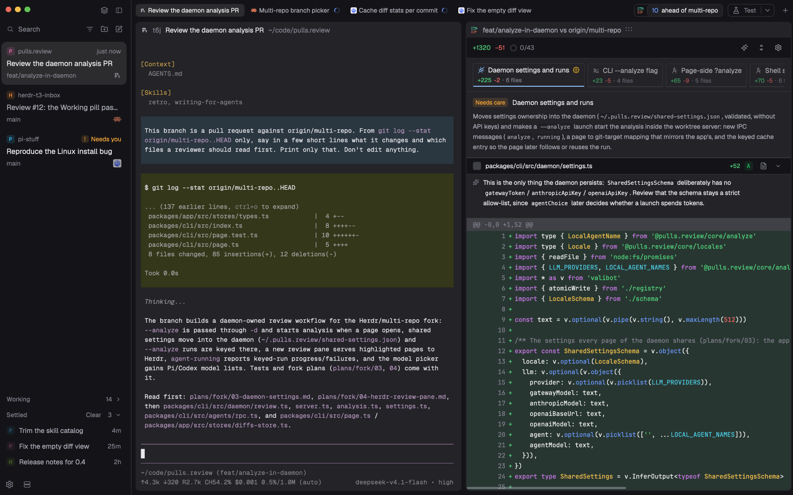

# Herdr T3

A calm, T3 Code-like window for Herdr App that saves your attention as agents multiply. The default Inbox keeps agents that need you as cards, folds busy ones into Working, and waits for you to Settle finished ones; new work brings them back. Lists offers Spaces + Agents instead. Both include your other machines and share names, pins and status marks. Slim tabs, framed panes and an Actions run button surround the work. Files and the optional pulls.review page share a right-hand space panel.



## What you see

Exact sizes, timings and edge rules for each part live in [docs/internals/specs/](docs/internals/specs/), one file per surface; shared tokens (buttons, menus, tooltips, radii, alignment rules) in [t3-tokens](docs/internals/t3-tokens.md). This brief names the values a rebuild must get right first.

### Window and surfaces

Built with Herdr's layout JSON and mod API, in T3 Code's proportions. The person's theme, layout UI font and window code font are kept. The preview's Geist/Geist Mono, font size 12, zoom 1.1 and minimum contrast 3 are examples, not installed settings.

| Part | Geometry and surface |
| --- | --- |
| Sidebar | 256 logical px, min 208, max 480; outer edge draggable; `chrome` |
| Brand / tabs / panel head | 40px high, window-drag regions |
| Sidebar footer | 44px |
| Spaces / Agents in Lists | Equal share, each at least 90px |
| Work area | `chrome`, including the gaps behind panes; 8px horizontal inset, 8px pane gaps and bottom inset |
| Pane | `background`, radius 8, 2px border also in `background`; framed even alone |
| Pane header | Always present outside Home, 28px, inside the pane |
| Space panel | Rightmost full-height column; initially hidden, initially equal weight to work, min 480px; draggable outside divider; no card: head and pages one `chrome` surface from the top to the window's bottom, set apart from work by the divider; their content 12 in from the column's edges |
| Dividers | 1px `border` |

There is no title bar; terminal opacity is 0 and terminal padding `[8, 0]`. A pane's 2px focus border defaults to `background`, invisible without changing the terminal's size; setting the layout's `focus.color` to `accent` shows it. In a split, unfocused headers fade to 50% until hovered. The shipped `workspace-status` bar exists but is hidden.

### Sidebar frame

The brand bar leaves room for macOS's window buttons, then shows Herdr's own mark and `Herdr`; together they are a button that goes Home. At its right, two touching 28px buttons switch mode (the icon names the destination, `inbox` or `layout-list`) and hide the sidebar. The traffic lights are moved to sit centred on this bar. The footer holds Herdr Settings and the layout's settings (sliders) as two 32px buttons 4 apart; its free space shows the Undo notice, and a downloaded update adds an `Update` pill. Spec: [sidebar](docs/internals/specs/sidebar.md).

### Inbox

Inbox is selected at first. Its top row has a Search button drawn like a field (it opens Go to), then the space filter, New space and New tab. Below, Pinned and Active cards fill the top; Working, Snoozed and Settled are folded shelves anchored to the bottom, each with a count, joining the cards' scroll when space runs out. A folded shelf still shows the row in view. Settled pages with Show more and offers Clear.

A card (78px with all three lines) shows the space and the state or time (Working with its duration, Needs you, Done, else age), the agent's title, and an optional branch ended by the program icon and a remote-machine mark. Viewed, needs-you and done titles are medium `foreground`, others `muted`; working cards (pinned ones) sit at 70% until hovered or viewed. Working, Settled and Snoozed entries are slim 36px rows whose time becomes the snooze clock, Un-settle or Wake on hover; Working rows show a `working` spinner with the run's duration, Snoozed rows an `accent` alarm clock, and `Woke` is `blocked` text. Hovering a card or Agents row opens a details card at its right. Spec: [inbox](docs/internals/specs/inbox.md).

### Lists

Lists splits the sidebar into Spaces and Agents, each with a 32px heading aligned with the Inbox's top row. Spaces are 32px rows with a 16px mark and medium name, grouped by machine when there is more than one (an empty machine offers `New space here`). Unusual git facts show beside the name (`repo · branch ↑2 ↓1`; `main` and `master` left out), and worktrees nest under their repository with tree lines.

A machine reported as unable to keep agents running after logout has a warning in its heading, even while connected. Click it for Herdr's Add machine fix instructions; never run privileged commands automatically. A missing report shows no warning.

Agents are 36px rows with a program icon, time in state (`<1m`, `5m`, `3h`, `2d`) that becomes a pin on hover, and the status mark; viewed and attention-needing agents stand out. Sort by space or priority, Pinned a group in both. Sub-agents fold under their parent; blocked or failed ones stay visible. Spec: [lists](docs/internals/specs/lists.md).

### Tab bar

In Lists, the bar shows every tab of the space: 24px tabs, radius 6, 12px text, the active one on `foreground` 7% (hovered 4%), each with an icon that `×` covers on hover (as the panel head's tabs, one shared tab), the name and an end state slot that stays; middle-click closes as `×` does; crowded tabs shrink, then scroll.

In Inbox, the left side is a breadcrumb, space / parent / viewed agent (14px medium), the agent the sidebar lights. The right side holds compact tool tabs without state: panes hidden by zoom, the agent family's other tabs, tabs with no agent. Focus on a program keeps the agent in the breadcrumb, dimmed; clicking it returns.

A tab under Herdr's native zoom becomes a dashed group, one segment per pane. After the tabs sits one group of 28px buttons 4 apart: Lists' new-terminal `+`, Details (`square-menu`), and the closed panel's `panel-right` in the corner; on Windows and Linux, window buttons follow 8 apart. With the panel open, the panel and window buttons move to its head; the toggle stays on the same screen point, and the frame that opens or closes the panel already has Details where it ends up. Spec: [tab bar](docs/internals/specs/tab-bar.md).

### Details

Details (`cmd-shift-b`) is a native popup under its button, 280 wide, up to 420 high, radius 16. It lists the locked computer name (folder path as tooltip); Open in, a split row for Finder or an installed T3 editor; the global Actions; and Review, a split row ending in the range a live Review tab shows, whose chevron offers Review's ranges. Right-clicking the card picks which rows show. It works from the keyboard: opened by keys, its first control is ringed; ↑/↓ move between rows (not the computer's), ←/→ between a split's halves, and Escape closes it, back to its terminal. Spec: [details](docs/internals/specs/details.md).

### Panes and sub-agents

A pane header shows the program icon, a meaningful name (left out when it is just the program's name, or when the Inbox breadcrumb already says it), the folder, the sub-agent button, the state, then split, zoom and close controls that appear on hover or keyboard focus. Inbox headers mark a settled agent with a `dim` check and a snoozed one with an alarm clock and time left. The sub-agent button reads `3 ⌄` for live descendants, tinted `blocked` when one needs you, with the working spinner before the count while one is at work and the agent itself isn't (a header has one spinner at most); it opens a 280px list of descendants in tree order with their status marks. Spec: [pane](docs/internals/specs/pane.md).

### Space panel

One right panel follows the space across its tabs; each space keeps its own surface tabs and open and maximized state. The head is T3's panel tab strip (a tab per file, at most one generic Files and one Review, then `+`, maximize, `panel-right`); an empty panel offers "Open a surface". Head and pages are one `chrome` surface, every row's ends 12px inside its column. As everywhere, a ghost button or tab lights at `foreground` 4% hovered and 7% on, in every theme. No rules run across the pages: only the tree column's left rule, at 60% of `border`. Spec: [space panel](docs/internals/specs/space-panel.md).

### Files

Drag a file or folder row into a terminal to paste its path without Enter. Herdr handles quoting, copying local files to remote terminals and rejecting unsupported drops; ordinary clicks and the Insert menu entry remain.

Files shows the space's folder on its machine, read-only: a full-width tree, or with a file open the content on the left and the tree in a resizable column on the right. The file header has breadcrumbs (`›` opens one folder menu that moves through folders in place, Back on top, as T3's), the Open in split, and Preview/Code, Wrap and Tree toggles, their icons 14px as T3's file toolbar. Open in is T3's header split: 24 high, one `input` outline round the icon and the chevron with a full-height rule between them, no fill at rest, each half filling on its own when hovered; Actions' `▶ | ⌄` in a bar is the same control (`shared/button.js` `split()` `xs`), while Details' split rows stay borderless, as T3's panel. The content is on the theme's `background`, the header and the tree's column on the panel's `chrome`, a faint rule where they meet, as T3's code beside its file explorer. The tree has no chevrons: open and closed folder icons, Pierre file icons in theme colours, ignored entries dim. Search filters the same tree. Content is a Markdown preview, the native read-only `Editor`, or an image. Herdr colours code on the UI thread, about 1.5ms per KB, and a new editor starts at the top, so a file up to 256KB is coloured as it opens; over 16KB, text rewritten while it shows goes in plain and is coloured once it has held 10s, Wrap switched after 300ms, never once scrolled while plain until it's opened again; over 256KB it stays plain under an amber notice with **Highlight anyway**. Spec: [files](docs/internals/specs/files.md).

### Optional Review

Review is for the [pulls.review fork](https://github.com/JinJieBeWater/pulls.review/tree/multi-repo) (CLI `jin.review`), on local repositories only, reading the repository where the tab works. Its 32px toolbar (as Files' file header, its centre level with the work column's pane header) has the range menu (Changes, Uncommitted, Outgoing, Incoming with counts, then Commits), the branch comparison target or a commit's SHA with `‹ ›`, Analyze, a fold menu, settings and the navigation toggle. Its buttons' icons are 14px; the diff is on `background`, the toolbar and the navigation column on `chrome`, as in Files; nothing on the page is ruled or outlined: no rule under the toolbar, file headers or summary, hunk rows on `foreground` 5%, note cards on 4%. With two or more groups, a row of group tabs runs under the toolbar, the current one lit as the panel's tabs; the navigation column lists the current group's files as Files' tree rows, with reviewed boxes, drag-to-terminal and Files' shared right-click menu. Deleted files only copy their path and cannot drag; subgroups have neither action. Right-click preserves the current file and reviewed state. Without a repository, or remote, it says `Review`; an empty range says `No changes`. Spec: [review](docs/internals/specs/review.md).

### Popups, dialogs and Home

New and Go to are top-centred popups, 576 wide, radius 16, with 48px two-line rows and a footer of keycaps. Menus, tooltips and buttons follow [t3-tokens](docs/internals/t3-tokens.md). The Actions editor and confirmations are 512px, radius 16; a confirmation's action is red text on a raised button, after Cancel. Layout Settings follows Herdr's own Settings dialog (880×620). Spec: [dialogs](docs/internals/specs/dialogs.md).

Home is one framed pane without a header: centred Next agent, Go to and New tab buttons with keycaps, no names or counts. On Home the tab row has no panel toggle and folds from 40 to 8px unless it must hold window buttons or the hidden sidebar's controls. Spec: [home](docs/internals/specs/home.md).

## How it behaves

### Names and status marks

Cards, Agents rows, tabs and headers use one naming rule: Pi's `pi.session` while Pi runs; then an explicitly named tab for a top-level agent, unless another top-level agent shares it; then a meaningful terminal title with only that program's decorations removed (Pi's `π - … - <folder>`, OpenCode's `OC | `); else the program name. Titles that are only a path, `user@host`, the program or the folder are rejected, as are agent-decorated leftovers on a terminal no longer running an agent. Sub-agents don't inherit their tab's name. An unnamed tab reads as its agent, else its focused pane.

A parent's status rolls up its live descendants: any blocked or error first; then its own unread done; then working if it or a descendant works; else its own state. A sub-agent's own row shows an error as Failed with the same `!` in `ansi1`. A live terminal is an agent if it reports status or its program is marked agent; a command shell isn't, but agents started through one count. Working uses the shipped spinner in `working`; blocked a rounded `!` on 15% `blocked`; done a 6px `done` dot (green `Done` in Inbox); idle a ring in Agents and nothing elsewhere.

Space marks are the project's favicon, else the name's first letter in a name-hashed T3 colour.

### Inbox versus Lists

The brand button switches mode, even with the sidebar hidden, leaving it hidden. Both modes share names, pins and what Settle and Snooze mean; attention rules apply only with Inbox selected, visible or hidden:

| Rule | Inbox | Lists |
| --- | --- | --- |
| Settle / Snooze controls | Available under their eligibility rules | Absent; Settle key does nothing |
| Snoozed working agent | Hidden in Snoozed and from working count | Still working in its existing row/order |
| Settled/snoozed unread done | Suppressed | Suppressed |
| Close viewed agent's whole tab / last pane | Home | Space's last-viewed tab |
| Agent navigation | Drawn rows; folded shelves only viewed row | All groups, including folded |
| Space filter | Can widen when a hidden agent is brought into view | Left alone |
| Tab bar | Agent breadcrumb + family/tools, no tool status | All space tabs with status |

Failure anywhere in a snoozed tree, or a new turn given in view, ends Snooze in both modes, even before Inbox has first started. A new busy or blocked state, or a finished turn, after Settle makes the label lapse everywhere at once.

### Settle, pins and Undo

Active sorts blocked agents first, then by when work returned to the person; the shelves sort by time. Looking at a card never reorders it; clicking runs `agent.focus` without zooming a split.

Settle is always explicit: hover a finished card (pinned ones too) for `✓ Settle`, or press `cmd-shift-s` on the viewed agent. It removes the pin, writes a terminal label and moves the agent to Settled; new work brings it back on its own. Un-settle, the Settle key again, or dragging it out returns it to the top of Active. Clear closes settled agents' eligible terminals after asking, sparing the tab in view.

Pins are one hand-made order shared with Agents; pinning ends Snooze. Settle, Snooze and Unpin show `Settled, Undo` (and the like) in the footer for 5s; Undo restores position, labels and pin. `cmd-z` stays the terminal's.

Dragging a card or slim row previews its result on a badge (Pin, Unpin, Settle, Un-settle, Wake); Esc cancels. Pressing Settle or Un-settle and sweeping across rows acts on the whole run. Rows slide and fade when order changes.

### Snooze

Any card or Working row that doesn't need the person offers a clock: In 1 hour, In 3 hours, This evening, Tomorrow, Next week, or Custom (a date and time, or a duration). The agent waits in Snoozed, wakes where it was (at the top of Active if a run finished meanwhile) and carries `Woke` until viewed. A permission prompt shows it as Needs you meanwhile. Failure in its tree, a new turn in view, Wake, pin or Settle ends it.

### Viewed rows and mod cards

The viewed row stays visible through folds and beyond the Settled page; a sub-agent without a row lights its nearest listed ancestor. Bringing a filtered-out agent into view widens the Inbox filter to all spaces.

A pane mod gets its own card only by opting in with `shared("<mod>.program") = { icon, tint, name, inbox: true }`, with its title in `<mod>.titles` and state in `<mod>.status`. Its card belongs to the space, lights only on its own focus, and Settle closes its pane instead of shelving it. Nothing in Home gets a card.

### Tabs, navigation and closing

Clicking a tab selects it, double-click renames, right-click opens its menu, dragging reorders (in Inbox only tabs without agents). The Inbox breadcrumb's space reuses a lone shell tab before creating one; `cmd-t` always creates. A no-agent tab entered from the strip keeps the space's last agent dimmed in the breadcrumb; after the space crumb or `cmd-t`, the breadcrumb shows only the space until another agent is viewed.

Agent next/previous walks the selected mode's rows without wrapping; tab next/previous wraps through the displayed tabs. Closing the viewed agent's whole tab or last pane lands on Home in Inbox, on the space's last-viewed tab in Lists; background closes never navigate. Every layout close asks `hc get` first and closes at once only when the terminal holds its own shell; otherwise it asks `Close terminal "<name>"?` (`This stops the running process and clears its history.`).

Context menus don't select or switch what was right-clicked; impossible items are left out, and groups go destination, state, names and copies, worktrees, ending:

| Target | Available actions |
| --- | --- |
| Agent, including breadcrumb parent/sub-agent row | Pin/Unpin for top-level; in Inbox Settle/Un-settle when tree not busy, Snooze/Wake when eligible; Rename for a lone tab-named non-Pi agent; Copy address; Send back to parent; Close its pane |
| Space, including group/breadcrumb/filter row | New tab; Rename; Copy current path; New/Open worktree in repository; Remove worktree in linked worktree (`ansi1`); Close |
| Synthetic unopened checkout | Open, Copy path |
| Connected/rebuilt machine | New space here, Connect |
| Tab | New tab, Rename, Close |
| Terminal/pane header/zoom segment/mod card | Split right/down, Zoom; Copy address for terminal; right-click to program or back; Send back; Close pane |

Menu rules: [menus spec](docs/internals/specs/menus.md).

### Spaces and Agents

Clicking a space switches to it; dragging reorders it within its machine (`space.move`), a checkout with its expanded worktrees. With a checkout closed, two or more worktrees gather under a dim synthetic checkout that opens it on click. Clicking a top-level agent runs `agent.focus`; a sub-agent row peeks. Pins are the Inbox's; Lists has no Settled group and only hides unread done.

### Go to, New and Actions

Go to (`cmd-p`, or Inbox's Search) lists every pane, recent first, opening on the previous pane so `cmd-p`, Enter toggles back; Enter focuses across spaces, `ctrl-d` closes safely. New lists spaces, current first; `1…9` pick, and its footer creates a space, asking which machine when there are several.

Actions are global. `▶` reruns the last action, its menu runs another and makes it primary, and a gear edits. An action has a Name, a Command, an optional Folder and icon, and opens in a new Tab, Split right or Split down via `terminal.open { argv: ["sh", "-c", command], name, place, folder? }`; the shell stays after it ends. Without a Folder it runs in the focused terminal's cwd, else the space folder.

### Home and Settings

Putting away the viewed agent (Settle, Snooze, drag, sweep) goes Home by default, leaving the next choice to the person; Layout Settings can make it walk to the next card instead. Closing a viewed agent's whole tab still lands Home. `cmd-shift-h` or the brand mark goes Home.

Home is one local hidden space shared across projects and machines, created on demand, found only by its remembered id or the exact name `Home\u200b`, and left out of every list. It holds one mod (`t3-home` by default) or a shell; if that shell starts an agent, the space becomes an ordinary one in place and the next Home is fresh.

Layout Settings (footer sliders or `cmd-shift-,`) has exactly two preferences:

| Preference | Choices and effect |
| --- | --- |
| After putting away | Home (default), Next card; applies to Settle/Snooze/drag/sweep, not closing |
| Home shows | Default, Terminal, installed mods with `"home": true` in `mod.json`, sorted by title else folder name; include selected mod even if no longer self-offered |

### Optional asciicn wallpaper Home

Installing `extras/mods/asciicn-wallpaper` and choosing it in Home shows makes Home a static, theme-coloured ASCII picture. Built-ins come from [asciicn](https://asciicn.dev) (MIT). A switcher at the bottom right, shown on hover, steps between pictures, frames the current one and adds more through `+`: choose an image (not on Windows), or open the wallpaper folder; dropping an image on Home works too. A new picture opens a framing card with modes (Dots, Braille, Blocks, Quadrants), Fill/Fit, zoom and Apply/Cancel. Home never blanks: the last picture stays until the next has loaded, the other appearance's picture is ready before a light/dark switch, and waits over 150ms show progress. Spec: [wallpaper](docs/internals/specs/wallpaper.md).

### Keyboard and focus

Every control is a Tab stop clicked by Enter or Space, with a 2px inset `accent` focus ring; hover-only controls show under keyboard focus too. The terminal keeps Tab: `pane.go` to a focusable sidebar enters keyboard mode, which ends within 500ms of leaving the chrome. A plain chrome click never takes the terminal's keyboard, and close, crash or restart never leaves keyboard mode held by nobody. Popup lists, submenus and typeahead follow the [menus spec](docs/internals/specs/menus.md).

| Key (`keys.json`, layout context) | Command / behavior |
| --- | --- |
| `cmd-shift-b` | `t3-tabs.details`, toggle details; sidebar uses its button |
| `cmd-alt-b` | `t3-tabs.panel`, hide/restore the space panel |
| `cmd-shift-g` | `t3-tabs.review`, toggle Review; keyless `t3-tabs.files` does same for Files |
| `cmd-shift-s` | `t3-tabs.settle`, viewed Inbox agent/mod card only |
| `cmd-p` | `mod.open:t3-picker` |
| `cmd-]` / `cmd-[` | `t3-tabs.next` / `prev`, agents, no wrap |
| `cmd-w`, `ctrl-alt-shift-x` | `t3-tabs.close-tab` |
| `cmd-shift-w`, `ctrl-alt-x` | `t3-tabs.close-pane` |
| `cmd-shift-h` | `t3-tabs.home` |
| `cmd-shift-,` | `t3-tabs.settings` |
| `cmd-t`, `ctrl-alt-c` | `t3-tabs.new` (New at Home) |
| `ctrl-1…9`, `ctrl-alt-shift-1…9` | `t3-tabs.space:<n>`, projects excluding Home |
| `cmd-alt-]` / `[`, `ctrl-alt-shift-]` / `[` | `t3-tabs.space-next` / `space-prev` |
| `cmd-1…9`, `ctrl-alt-1…9` | `t3-tabs.tab:<n>`, displayed tabs |
| `cmd-shift-]` / `[`, `ctrl-tab` / `ctrl-shift-tab`, `ctrl-alt-]` / `[` | `t3-tabs.tab-next` / `tab-prev`, wrap |

Key labels follow Herdr's platform (`cmd` is Super off macOS). `cmd-d` stays Herdr's split. In Files or Review, `cmd-t` opens the panel's `+` menu and `cmd-w` closes the active surface tab, never the terminal. With a popup or dialog owning the keyboard, the four close keys close the overlay instead.

## Built from

### Layout and mods

Create `layouts/herdr-t3.json`, its preview `layouts/herdr-t3.svg`, the `mods/t3-*` folders and `keys.json`. Node ids are unique, and these structural ids stay stable because layout code looks them up:

```text
root: row, background=canvas, terminal_menu=t3-menu
├─ sidebar: column [256, min208, max480], chrome
│  ├─ brand: t3-chrome [40]
│  ├─ sidebar-lists: stack, active=inbox
│  │  ├─ lists: column → spaces:t3-spaces / agents:t3-agents [equal, min90]
│  │  └─ inbox: t3-inbox
│  └─ sidebar-footer: t3-chrome {footer:true} [44]
├─ work: column, chrome
│  ├─ tabs-row: row [40], nonresizable
│  │  ├─ tabs: t3-tabs [weight1]
│  │  ├─ tabs-end: t3-tabs {part:"end",block:"tabs-end"} [self-sized]
│  │  ├─ actions: t3-actions {block:"actions",details:true} [self-sized]
│  │  ├─ window-end: t3-tabs {part:"window",block:"window-end"} [self-sized]
│  │  └─ tabs-end-inset: row [12]
│  ├─ work-body: row, padding[0,8], gap8
│  │  └─ work-main: stack, active=main
│  │     ├─ main: active tab, pane header=t3-pane [28, always, top]
│  │     └─ home-main: same active-tab pane frame, no header
│  ├─ work-bottom-inset: row [8] → bar-measure:t3-tabs {part:"measure"}
│  └─ status: workspace-status [28, hidden]
└─ panel: column [weight1,min480,hidden], chrome
   ├─ panel-head: t3-chrome {part:"panel"} [40], padding[0,12]
   ├─ panel-body: stack, active=panel-empty
   │  ├─ files: t3-files
   │  ├─ panel-empty: t3-chrome {part:"surface-empty"}
   │  └─ review: review [optional]
floating root: tabs-keys:t3-tabs {part:"keys"}, bottom/end, visually empty
```

Sidebar, work and panel columns are `resizable:false` inside, keeping their outside dividers. `spaces` gets `{newMenu:"t3-new-menu"}`; `inbox` gets `{newMenu:"t3-new-menu",picker:"t3-picker",home:"t3-tabs.home",menu:"t3-menu"}`. `main` and `home-main` share the pane frame settings above. The floating `tabs-keys` copy owns commands, Home and per-space panel sync; other `t3-tabs` copies share navigation.

Required mods: `t3-chrome`, `t3-spaces`, `t3-agents`, `t3-inbox`, `t3-tabs`, `t3-pane`, `t3-home`, `t3-files`, `t3-new-menu`, `t3-picker`, `t3-actions`, `t3-menu`. Adapt the matching shipped mods where they exist; Inbox, Home and Files are new. Keep the shipped `workspace-status`, spinner and program artwork. UI icons are Lucide (24 grid, 1.75 stroke) in each mod's own `icons/`; Files and Review trees use T3/Pierre shapes. A mod can't import outside its folder: shared modules live in `shared/` and `scripts/sync.sh` copies them.

### Install

Install the required mods as real files (symlinked SVGs don't load), the layout and its SVG, and context-merged keys under `HERDR_APP_HOME` or `~/.config/herdr-app`; select with `layout.switch {"name":"herdr-t3"}`. `scripts/update.sh` (needs `jq`, `rsync`) validates the installed layout and keys, replaces owned mods, keeps theme, focus and stack choices, extra blocks and Review's `config.json`, updates only extras and themes already installed, and merges keys with the repository winning, reporting replacements. Settings, pins and user wallpapers live outside replaced folders. `scripts/sync.sh` also writes the installed home and sibling standalone repositories.

Optional Review: copy `extras/mods/pulls-review` and `extras/mods/review`, set up `jin.review` per its guide and append the `review` page to `panel-body` (update adds the page once the extra exists). The layout has no Review bar by default; one can be added as a `review-bar` block (`pulls-review`, `{block:"review-bar",toggle:true}`) just before `tabs-end`, never with the id `review`. The wallpaper and the theme export (`extras/mods/t3-theme-export`, a zero-height `work` block writing `~/.cache/herdr-app-theme.json` for Pi) are opt-in too; [extras usage](docs/user/extras.md) covers setup.

### Herdr functions and programs

Mods use `spaces/panes/agents/terminals/focused/layout/settings/window/keys`, `run`, `openOverlay/closeOverlay`, `nextCommand`, `shared/setShared`, `exec`, `readTextFile/writeTextFile`, kit views, inputs, `Editor` and timers, passing `on` for remote machines; `herdr-app check`'s declarations define what exists. Commands run include `agent.focus`, `pane.focus`, `terminal.peek`, `terminal.paste`, `terminal.open`, `space.new`, `space.move`, native split, zoom and close, `terminal.park`, `layout.select/show/hide/resize` and `app.update`.

Programs run: `hc` (`label`, `get`, `machine ls/rm/add`); read-only `git` with `--no-optional-locks -c core.fsmonitor=false`; `sh`, `find`, `awk`, `base64`; `open` / `xdg-open` / `explorer`; for the wallpaper `osascript` / `zenity` and `sips` / ImageMagick; for Review `jin.review`. Each surface's spec lists its own.

Terminal facts are labels (`settled`, `snoozed`), cross-mod facts and preferences are shared state, per-copy UI is `localStorage`, navigation and drafts stay in memory. [storage](docs/internals/storage.md) is the single source for every key, file and write rule; use its `shared/` helpers (store, labels, pins, layout settings). Commands other mods and scripts can call are listed in the [tab bar](docs/internals/specs/tab-bar.md#t3-tabs-commands), [files](docs/internals/specs/files.md#commands) and [review](docs/internals/specs/review.md) specs.

## Watch out

- Hidden mods neither draw nor hear commands and start on first display. Keep always-on commands and Snooze timing in the floating `tabs-keys`; the selected mode's order keeps working while hidden, except Inbox's own order before it has ever started. Hold pending intent through model and remote-label lag, and report failed writes.
- Home's strict identity protects ordinary spaces: release Home's agent space in place, never move or delete its process. Native external closes can flash a neighbour; restart loses close history; native Home splits can't be blocked; zoom groups can't drag; plain lists can't scroll to a row.
- Keep the confirmations: close and Clear stop terminals and clear history, Remove worktree deletes, wallpaper Delete removes source and cache. Actions run arbitrary `sh -c`. Write the traffic lights with an expected-content write of that one field; `layout.set` discards remembered layout state.
- A wrong icon path draws nothing and raises nothing; check runtime-built paths in the demo window. Opaque surfaces stand in for blur, scale and letter-spacing the host lacks; transparent popups still block input. Recover missing pointer leave and release; closing a popup must neither reopen it nor close the tab beneath.
- Before changing render or timers, focus or hover, measurement or scrolling, Review text or wallpaper conversion, read [layout implementation](docs/internals/layout-implementation.md).
- Keep this brief and the [Chinese one](RECIPE.zh-CN.md) aligned, each at most 60,000 UTF-8 bytes (Gallery skips larger recipes). Change it when what a rebuild produces changes; values and edge rules belong in the specs and t3-tokens.

## Done when

1. `wc -c RECIPE.md RECIPE.zh-CN.md`: each at most 60,000, same coverage, local links and preview resolve. `scripts/check.sh` prints `all checks passed` (after `scripts/sync.sh`, which also writes outside the repo): shared copies, mod checks and types, icons, overlays, render and update guards.
2. `layout.switch {"name":"herdr-t3"}` succeeds and `herdr-app status` shows no missing mods or render warnings. In a separate demo window (`scripts/demo/stage.sh up`, `scene <name>`, `do herdr-app shot <file>`, `down`), whole-window screenshots at the default 256px sidebar, narrow, light, dark and zoomed show every region unclipped and the traffic lights in place.
3. Inbox: Settle, Un-settle, Undo, new work, pins from both modes, drag, sweep, cancel and Clear restore positions and pins as described; Clear asks and spares the tab in view; after-putting-away follows the preference; background actions never navigate; Lists' Settle key does nothing; with the sidebar hidden, order, no-wrap and the 5s Undo still hold.
4. Snooze of working and pinned agents, permission prompts, failure or a new viewed turn (also before Inbox has started), foreground and background expiry: hidden counts, Needs you, `Woke` and pins follow the rules; invalid Custom input keeps the dialog open; cancel changes nothing.
5. The breadcrumb's current, held, away and fresh states, sub-agents and zoom agree with the lit card and focus. Closing active and background tabs, last and split panes lands where described, keeps unread neighbours and asks before stopping a program; close keys over an overlay never close the tab beneath.
6. Starting an agent in Home's shell leaves an ordinary space with the agent and a clean next Home, project numbers stable. Go to and New: previous pane and name matches first, remote metadata, shell reuse, keyboard access without taking the terminal's Tab. Worktree folds keep grouping and numbering.
7. Actions add, edit, delete and run in each place and folder: required fields, confirmation, last-run choice, shell kept.
8. Space panel and Files: every open, replace, duplicate, close, bulk, hide, maximize and eviction rule; local and remote; menus and clipboard; disabled, missing, long and many files; panel versus terminal keys. Details: empty and full Actions, locked machine row, choosing versus running, the keyboard walk, layered Escape, source change, cold and warm opening times.
9. Review ranges, bases, remotes, commits, groups, reviewed state, `j`/`k`, Analyze, Unicode, binary, empty and error: tree and diff in one order, no unasked analysis, safe wrapping, opaque sticky headers, correct checkbox alpha.
10. Wallpaper: pictures load from disk at start; `+` menu and drops; the framing card grows upward with a fixed footer; four modes, paper on light themes, EXIF; any picture framed without conversion; zoom about the pointer with the slider in step; Apply, Cancel, retry, two Homes, late work and Delete, with no source edits or resurrection; framing survives restart, cache, theme and resize; light/dark switches picture and background in one frame; odd file names work.

Passing checks don't replace seeing and using it. Report real clicks and keys you couldn't try as unverified, and remove only the demo resources you created.
