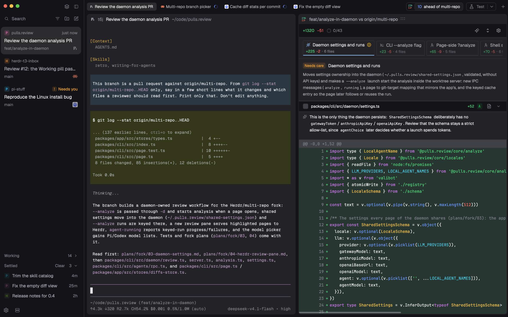

# Herdr T3

A calm, T3 Code-like window for Herdr App: a 256px sidebar on the left that switches between Lists (Spaces + Agents) and an Inbox with T3-style Settle, a slim tab bar and rounded panes with a small header. Everything sits on the theme's own colors; nothing is loud unless an agent needs you.

## What you see

Left to right, divider 1px `border`:

- **Sidebar** (256px as T3's, min 208, max 480; drag its edge to resize; `chrome` background), top to bottom:
  - **Brand bar** (40px, drags the window, room for the macOS window buttons): at the right, two 26px buttons: sidebar mode (`circle-check` icon: show Inbox; `layers`: show Lists) and hide sidebar.
  - **Lists**, one of two (a stack):
    - **Lists**: Spaces and Agents, split 1:1 (each at least 90px). Spaces: colored square avatars with the space initial, worktrees folded under their checkout with tree lines, grouped by machine once there is more than one; after the name, only unusual git info (`repo · branch ↑2 ↓1`; `main` / `master` left out). Agents: grouped by space or by priority (a sort menu), pinned agents in a `Pinned` group, sub-agents indented under their parent with tree lines; a 14px state mark flush right.
    - **Inbox**: the T3 sidebar. Cards for the agents that need you, a folded Working shelf and a folded Settled shelf at the bottom. Active goes by when each came back to you, Working by when its run started, Settled by when it was settled, ties by address; a run that stops stays on Working 2s (a blocked one leaves at once; pinned and settled ones skip it), then lands on top of Active, so a quick continuation doesn't move it, nor does a pause for you; looking at a card moves nothing (see `mods/t3-inbox`; the [standalone recipe](https://github.com/JinJieBeWater/herdr-t3-focus/blob/main/RECIPE.md) describes it fully).
      - Cards: as T3's, a title leads (`foreground`, medium) in view, when it needs you or is done, else recedes (`muted`, normal); hovering brightens it, in color only. The program icon (60% opacity) and a remote machine's mark end the third line when the card has one, else the title's.
  - **Footer** (41px, top border): a Settings row, with a 6px `accent` dot when an app update is ready, and at its right end a server icon that opens the shipped `machine-add`.
- **Work column**:
  - **Tabs** (40px, drags the window): the active space's tabs as 28px pills (radius 6, `selected` when active), program icon, name (a tab nobody named reads as its agent, else its focused pane, by the naming rule below), a spinner when working, `!` badge when blocked, a 7px `done` dot when done and unseen; close `×` on the active one. With the pulls.review extra installed, a Review bar comes next (see the README). Then the actions control, then a 26px `+` (`tab.new`: a terminal tab in the active space) at the right end, so it keeps its spot. The actions control is a 26px outlined box (radius 6, `border`, 12px `muted` text) with the primary action's 12px icon and name (140px max), a 1px divider and a `chevron-down`; with no actions, the box reads `▶ Add action` in `dim`. Window buttons on Windows. With the sidebar hidden, a sidebar toggle at the left also counts agents: blocked, working, done.
  - **Panes** (padding 2/8, gap 8), the active tab: radius 8, `background` fill, a 2px focus ring, off by default (`focus.color` is `background`; set it to `accent` to show it. The border is the same 2px in `background`, so focusing doesn't resize the terminal), even a lone pane framed. Each has a 28px header on top: program icon, agent name or terminal title (13px medium, `foreground` when focused), folder, state mark, and buttons split right, split down, zoom/unzoom, close (shown on hover).
  - 6px bottom inset; the shipped `workspace-status` bar is in the layout but hidden.
- **New menu** (`t3-new-menu`, popup 520×420 at the top): pick a space for a new terminal tab (`tab.new`), or New space (`space.new`); `⌘1…` pick spaces by number.
- **Actions menu** (`t3-tabs` with props `{ "actions": "menu" }`, a 280px popup at the pointer): one 32px row per action (icon, name, a gear on the right), a divider, then `+ Add action`.
- **Action editor** (`t3-tabs` with props `{ "actions": "edit", "id" }`, a 440×404 dialog): Name, Command and Folder (optional) inputs; Icon (play, test, lint, configure, build, debug: lucide's play, flask-conical, list-checks, wrench, hammer, bug, as T3 Code) and Run in (Tab, Right, Down) choices; Delete (when editing), Cancel, Save (needs a name and a command; Enter in an input saves).

## How it behaves

- **Terminal addresses**: pane headers show the terminal's address (dim) before its name, so terminals stay apart when programs retitle them; a name that is the address shows once. The sidebar leaves it out: there the name needs the room.
- **Names**, one rule everywhere (inbox cards, agents list, tabs, pane headers), in `mods/t3-inbox/name.js` with a copy in each mod that uses it: the Pi session (`pi.session` label), then for agents a tab someone named, then a telling terminal title (each agent's own marks taken off its own titles only: Pi's `π - … - <folder>`, OpenCode's `OC | `; not a path, not `user@host`, not the program's own name, not just the folder or space name, as Codex and an unnamed Pi set), else the program's name.
- **Agent statuses**, the same marks everywhere (agents list, tabs, pane headers, inbox cards): working: spinner in `working`; blocked: a 14px rounded `!` badge on `blocked` at 15% opacity; done: a 7px `done` dot (Inbox: green `Done`); idle: a ring in the agents list, nothing elsewhere. A parent reads with its live sub-agents, one rule in `mods/t3-inbox/tree.js` with a copy in each mod that uses it: blocked if it or any sub-agent is (a failed turn, the terminal's `error`, counts as blocked: `agents()` has no such word, so it is read from `terminals()`), else its own unread done, else working if it or any sub-agent is, else its own state; a sub-agent's done is its parent's news, not its own.
- **Sidebar mode**: the brand bar button or `cmd-shift-b` (`t3-chrome.sidebar`) runs `layout.select` on stack `sidebar-lists` (`lists` / `inbox`). With Inbox showing, a settled agent's done dot is left out of the tabs and the sidebar toggle's counts.
- **Actions**, as T3 Code's project actions but global: the primary action is the one run last, else the first. `▶` runs it; a menu row runs that action and makes it primary; the gear opens the editor. Running is `terminal.open { argv: ["sh", "-c", command], name, place, folder? }`: a new tab or a split right/down every time, named after the action; the shell stays when the command ends. With no folder it starts in the focused terminal's folder; with a mod pane focused (a review beside its agent), a terminal's in the same tab, else the space's; `~` is expanded. Actions live in `shared("t3-actions")` = `{ list: [{ id, name, command, icon, place, cwd? }], last }`, which Herdr keeps across restarts.
- **Spaces**: click switches, right-click opens the shipped `menu`, drag reorders; a checkout with worktrees shows a fold arrow at the end of its row, as an agent parent (folded, with a dim count). Git is read only when it could have changed (a new place, a finished command or turn, a machine back) and at a slow fallback while the window is in front.
- **Agents**: click runs `agent.focus`, as Inbox cards do. As in the shipped agents list, each row shows the time in its state (`<1m`, `5m`, `3h`, `2d`) before its status, and on hover a pin button in the time's slot (nothing moves); a parent shows a fold arrow before the time (folded by default; folded, with a dim count); a blocked or errored sub-agent still shows under it, one step in. Fold choices of ended agents are dropped. A done agent you are viewing stays in Done until you leave it.
- **Inbox / Settle**: hover a finished card for `✓ Settle`; hover a settled row for the undo arrow; new work (working, blocked, or a finished turn since) brings it back by itself. `cmd-shift-s` (`t3-inbox.settle`) does the same for the agent in view: finished and unpinned, it settles and moves on as the button does; settled, it comes back. No auto-settle. Dragging, as T3's sidebar (`Sidebar.drag.ts`, `Sidebar.pointer.ts`): press a card or row and move 6px to lift it (not Working cards, nor a row whose Settle change hasn't come back from the core). The lifted copy (`selected` fill, 1px `accent` border, large shadow) moves only vertically, the pressed spot under the pointer, kept inside the list and below the Pinned label; its corner becomes a badge for what letting go does: `Pin`, `Unpin`, `Settle`, `Un-settle` (accent outline and 10% fill), nothing when it stays put. Only while something is lifted, the 24px `Pinned` and `Active` labels (12px medium, a 1px rule; `accent` when the target) open with a 150ms ease-out height transition, and the Settled header shows (even empty) in `foreground`, `accent` when the target. Rows sit in lanes: a gap above each, the row and its 2px spacing, and after the last an end gap; the row folds away once the lifted one is headed elsewhere. The gap where it will land opens to the destination's row: a card + 2 in Pinned and Active (the lifted card's own height, or the last measured card), 30px in Settled. Pinned keeps a hand-made order (upper half of a pin drops above it, lower half below); Active and Settled keep their own (unsettled or settled, it goes to the top; unpinned, to its time slot). An empty Active or Settled, or a folded Settled, shows a 36px dashed placeholder instead, accent as the target. Settled's page stays one page: a row lifted out lets the next one in, a row settled in pushes the last one out. Released anywhere in the sidebar it lands at the gap; Herdr reports no release outside the sidebar, so leaving decides: off the top or bottom edge (nearest edge by the last pointer position) it lands where the badge says, as T3 keeps the last target past the list's ends; Esc (the sidebar holds the keyboard only while lifted), leaving off a side, or the row leaving the list puts it back; letting go never opens a row. Settling the agent in view moves on to the next card down, wrapping to the top past the end, as T3. Sweep: pressing a card's `✓ Settle` or a settled row's undo and moving across rows of that section marks the run with the badge; letting go settles (or brings back) them all. Pinned cards stay up top in pin order whatever their state, with a pin glyph after the space avatar, and offer no Settle button. Pins are shared state `agents.pins`, the same list as t3-agents.
- **Tabs**: click selects, double-click renames, drag reorders, right-click menu, scroll wheel goes to the previous/next tab.
- Pins, folds, sort, filter and shelf state are kept per screen (`localStorage` / shared state `agents.sort`, `space.colors`).

## Built from

- `layouts/herdr-t3.json`: `row` root → `sidebar` column [`brand` block `t3-chrome`; `sidebar-lists` stack [`lists` column [`spaces` `t3-spaces`, `agents` `t3-agents`], `inbox` `t3-inbox` with props `{ "newMenu": "t3-new-menu" }`]; `sidebar-footer` `t3-chrome` with props `{ "footer": true }`] and `work` column [`tabs` `t3-tabs`; `work-body` row [`main` `{ "tab": "active", "pane": { "header": { "content": { "mod": "t3-pane" } } } }`]; `work-bottom-inset`; `status` `workspace-status`, hidden]. Preview: `layouts/herdr-t3.svg`.
- Mods: `t3-chrome`, `t3-spaces`, `t3-agents`, `t3-inbox`, `t3-tabs`, `t3-pane` and `t3-new-menu` are reworked from Herdr's shipped `workspace-chrome`, `spaces`, `agents`, `tabs`, `pane` and `new-menu`; `t3-inbox` is new. Shipped mods used as they are: `workspace-status`, `picker`, `menu`, and icons from `mods/workspace-chrome/` and `mods/pane/close.svg`.
- `keys.json`: `layout:herdr-t3` → `cmd-shift-b`: `t3-chrome.sidebar`, `cmd-shift-s`: `t3-inbox.settle` (reaches Inbox only while it shows).
- Programs: `t3-spaces` runs read-only `git status` / `git rev-parse` (no optional locks, no fsmonitor) and `hc machine ls --json`, and on a rebuilt machine's Connect `hc machine rm` then `hc machine add`; `t3-inbox` runs `hc label <agent> settled=<ms>:<turn>`.

## Watch out

- `t3-tabs` and `t3-chrome` find the stack with `find(layout(), "sidebar-lists")`; keep the node ids `sidebar`, `sidebar-lists`, `lists`, `inbox`.
- Only the brand bar's `t3-chrome` copy listens for `nextCommand()`; the footer copy has nothing to switch.
- Git that touches the index wakes the folder watch again: always pass `--no-optional-locks -c core.fsmonitor=false`.
- A settled label takes about 0.65s to show in `terminals()`: keep a pending value.
- On macOS with no title bar, the tabs leave room for the window buttons when the sidebar is hidden or narrow (`layout().traffic_lights`).
- Actions run through `sh -c`: your shell's aliases and functions aren't there (write `zsh -ic '…'` in the command for them), and plain Windows has no `sh`. The menu and editor are `t3-tabs` itself opened as an overlay; `render()` branches on `props().actions` first.
- `mods/t3-spaces/check-sidebar.cjs` and `mods/t3-pane/check-pane.cjs` load the mods in a fake `herdr`; run them with `node` from an installed home, since they look for the shipped icons there.

## Done when

- `herdr-app check` passes for every `mods/t3-*` and `layout.switch {"name": "herdr-t3"}` shows the window above.
- `node mods/t3-spaces/check-sidebar.cjs` and `node mods/t3-pane/check-pane.cjs` print their `ok` lines.
- `cmd-shift-b` switches the sidebar between Lists and Inbox.
- `cmd-shift-s` on a finished agent in view settles it and shows the next card; again on a settled one brings it back.
- Settling a finished agent in Inbox moves it to Settled and removes its done dot from the tab; prompting it again brings it back.
- A worktree space appears folded under its checkout; a remote machine gets its own header.
- With no actions the tab bar shows `▶ Add action`; adding one through the editor shows `▶ <name> | ▾`, and `▶` opens a tab named after it running the command.
