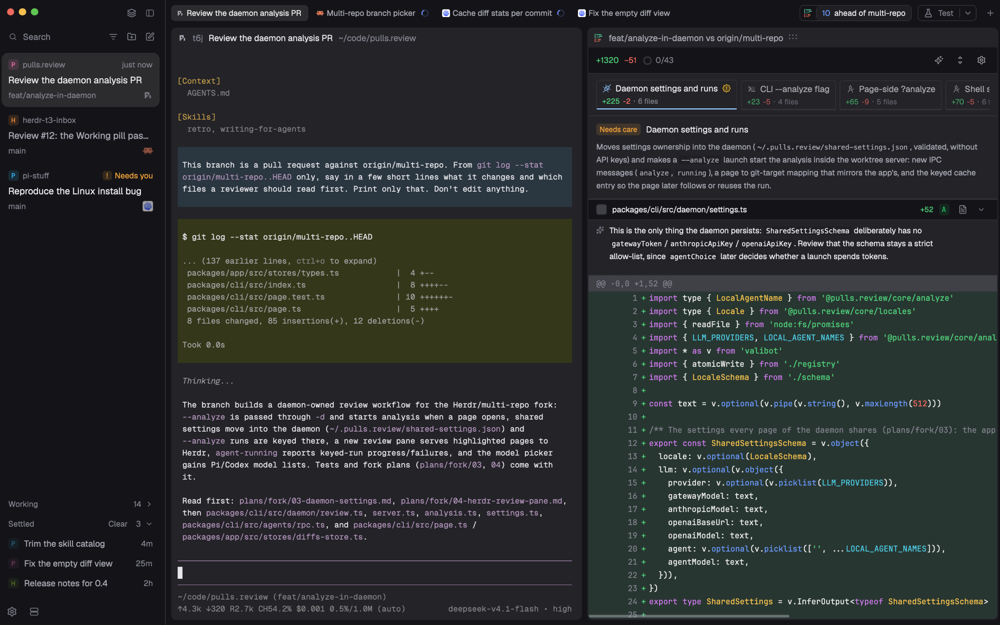

# Herdr T3

Herdr App 的一个安静、近似 T3 Code 的窗口，在 agent 越开越多时替你节约注意力。默认 Inbox 把需要你的 agent 留作卡片，工作中的折进 Working，结束的等你手动 Settle，有新工作时自动回来。Lists 则提供 Spaces + Agents。两者都包含其他机器，共用名字、置顶和状态标记。工作区有窄标签、带框窗格和 Actions 运行按钮；Files 和可选的 pulls.review 页共用右侧 space 面板。



## 你看到什么

各部分的精确尺寸、时长和边界规则在 [docs/internals/specs/](docs/internals/specs/)，一个界面一个文件；全布局共用的 token（按钮、菜单、提示、圆角、对齐规则）在 [t3-tokens](docs/internals/t3-tokens.md)。本文只写重建时首先要做对的数值。

### 窗口与表面

用 Herdr 布局 JSON 和 mod API，外观取 T3 Code 的比例。保留用户主题、布局界面字体和窗口代码字体。预览的 Geist/Geist Mono、字号 12、zoom 1.1、minimum contrast 3 只是示例，不随安装写入。

| 部分 | 几何与底色 |
| --- | --- |
| 侧栏 | 256 逻辑 px，最小 208、最大 480，外缘可拖；`chrome` |
| 品牌栏／标签栏／面板头 | 高 40，可拖动窗口 |
| 侧栏底栏 | 高 44 |
| Lists 的 Spaces／Agents | 等分，各至少 90 |
| 工作区 | `chrome`，包括窗格背后；左右内缩 8，窗格间距和底部留白 8 |
| 窗格 | `background`，圆角 8，2px 同色边框；单个也带框 |
| 窗格标题 | 除 Home 外常显，高 28，在框内 |
| space 面板 | 最右全高列；初始隐藏，与工作区同权重、最小 480；外部分隔线可拖；没有卡片：面板头和页面同为 `chrome` 一整面，从顶到窗口底，靠分隔线与工作区分开；内容离列边 12 |
| 分隔线 | 1px `border` |

无标题栏，terminal opacity 0、padding `[8, 0]`。窗格聚焦边框是 2px `background`，默认不可见且不改变终端尺寸；把布局的 `focus.color` 改成 `accent` 即可显示。分屏时非聚焦窗格的标题降为 50%，悬停恢复。布局保留但隐藏自带 `workspace-status`。

### 侧栏框架

品牌栏先给 macOS 窗口按钮留位置，接着照 T3 的侧栏开关放一个 28px 的隐藏侧栏按钮，隔 8（侧栏图标之间统一的间距）放 Herdr 的应用图标和暗色的 `Herdr`，图标和侧栏按钮的图标一样大，两者合起来是回 Home 的按钮；它只有一个样子，在 Home 和悬停时都不提亮，栏太窄时名字整个让出。侧栏隐藏时标签栏从同样的内边距开始，开关位置不动，只有图标；照 T3 收起的侧栏，标签前面不放别的东西，也没有品牌。这一行不报 agent 的状态：状态归侧栏，有 agent 需要人时由 Herdr 自己的通知提醒。品牌栏没有切模式按钮：用 `cmd-shift-l` 和布局设置在 Lists、Inbox 之间切换。窗口按钮挪到与这条栏的中线对齐；侧栏照 T3 不会窄过这一行，所以窗口窄时 `Herdr` 的末尾和下面 Inbox 筛选按钮的图标右边对齐。底栏的 32px 控件间隔 4px，依次是 Herdr Settings、布局设置（sliders）和 Clean up（trash），都是图标按钮。Clean up 运行 `t3-tabs.cleanup`，打开它的对话框。空位显示 Undo，下载好更新后多一个 `Update` 胶囊。规格：[sidebar](docs/internals/specs/sidebar.md)。

### Inbox

初始选中 Inbox。顶行是可在侧栏内显示紧凑结果列表的 Search 输入框，然后是 Filter by space、New space、New tab in…。筛选列出 All spaces，以及应用筛选前有 Inbox 条目或已被选中的非 Home space。下面 Pinned、Active 卡片在上；Working、Snoozed、Settled 是贴底的折叠收纳区，带数量，空间不够时并入卡片的滚动。折叠的收纳区仍露出当前查看的行。Settled 收纳已收起的 agent，用 Show more 分页。标题行只显示名称、数量和折叠箭头。

卡片三行齐全时高 78：space 与状态或时间（Working 加时长、Needs you、Done，否则经过多久），agent 标题，可选的分支行，行末是程序图标和远程机器标记。正在看、需要人、done 的标题是 medium `foreground`，其余 `muted`；工作中卡片平时 70%，悬停或正在看时恢复。Settled、Snoozed 是 36px 窄行，悬停把时间换成 Un-settle 或 Wake；Snoozed 带 `accent` 闹钟，`Woke` 是 `blocked` 文字。悬停卡片或 Agents 行会在右侧出现详情卡。规格：[inbox](docs/internals/specs/inbox.md)。

### Lists

Lists 把侧栏分成 Spaces 和 Agents，两者标题高 32，与 Inbox 顶行对齐。Spaces 是 32px 行，16px 标记加中粗名字，多于一台机器时按机器分组（空机器有 `New space here`）。名字旁只显示不寻常的 git 信息（`repo · branch ↑2 ↓1`，省略 `main`／`master`），worktree 带树线挂在仓库下。

机器报告退出后无法保持 agent 运行时，标题显示警告，即使仍已连接。点击打开 Herdr 的 Add machine 修复说明，不自动执行提权命令；没有报告时不显示警告。

Agents 是 36px 行：程序图标、状态持续时间（`<1m`、`5m`、`3h`、`2d`，悬停换成 pin）和状态标记；正在看和需要人的醒目。可按 space 或优先级排序，两种都有 Pinned 组。子 agent 折在父级下，blocked 或失败的仍露出。规格：[lists](docs/internals/specs/lists.md)。

### 标签栏

Lists 下标签栏显示当前 space 全部标签：高 24、圆角 6、字号 12，当前为 `foreground` 7%（悬停 4%）；每个标签有图标、名字和末尾状态槽；悬停时 `×` 盖住图标，状态槽不变（与面板头标签共用一种标签）；中键与 `×` 一样关闭。放不下先收窄，再滚动。

Inbox 下左边是面包屑：space／父级／当前查看的 agent（14px medium），就是侧栏点亮的那个 agent。右边是收紧的工具标签，不显示状态：被 zoom 藏住的 pane、当前查看的 agent 家族的其他标签、不含 agent 的标签。焦点移到程序上时，面包屑保留该 agent 并变暗，点它回去。

Herdr 原生 zoom 中的标签变为虚线分段组，每 pane 一段。标签后是一组间隔 4 的 28px 按钮：Lists 的新终端 `+`、Details（`square-menu`）、面板关时角上的 `panel-right`；Windows 和 Linux 的窗口按钮间隔 8 跟在最后。面板打开时，面板和窗口按钮移到面板头；开关在屏幕上的位置不变，开关面板的那一帧里 Details 已在最终位置。规格：[tab-bar](docs/internals/specs/tab-bar.md)。

### 详情

详情（`cmd-shift-b`）是按钮下方的原生 popup，宽 280、最高 420、圆角 16。内容是 locked 的电脑名（folder 路径作提示）；Open in，选 Finder 或已装 T3 编辑器的 split 行；全局 Actions；Review 行，行尾写现存 Review 标签正显示的范围，箭头打开 Review 的范围菜单。卡片右键选择显示哪些行。可用键盘操作：用键盘打开时第一个控件带焦点环；↑／↓ 换行（不含电脑名行），←／→ 换 split 的两半，Escape 关闭并回到终端。规格：[details](docs/internals/specs/details.md)。

### 窗格与子 agent

窗格标题依次是程序图标、有意义的名字（只是程序名、或 Inbox 面包屑已写过时省略）、目录、子 agent 按钮、状态，然后是悬停或键盘聚焦时出现的分屏、zoom、关闭控件。Inbox 标题用 `dim` 勾标已 Settle 的 agent，用闹钟加剩余时间标 Snooze 的。子 agent 按钮写 `3 ⌄`，只数活后代，有需要你的时用 `blocked` 色，有在跑、而 agent 自己没在跑时数字前加工作标记（一个窗格头最多一个工作标记）；它打开 280 宽的后代列表，按树序并带状态标记。规格：[pane](docs/internals/specs/pane.md)。

### space 面板

右侧唯一面板跨终端标签跟随 space；每个 space 记自己的 surface 标签、开关和放大状态。头部照 T3 面板标签条：每文件一个标签，通用 Files 和 Review 各至多一个，然后是 `+`、放大和 `panel-right`；空面板提供 Open a surface。面板头和各页同为 `chrome` 一整面，每行首末都在所在列内 12px。与全布局一样，ghost 按钮和标签悬停为 `foreground` 4%、on 为 7%，各主题同一比例。页面里没有横贯的分隔线，只有树列左边线，取 `border` 的 60%。规格：[space-panel](docs/internals/specs/space-panel.md)。

### Files

可把文件或文件夹行拖进终端粘贴路径，不按 Enter；引号、本机文件复制到远程终端、不支持的投递由 Herdr 处理。普通点击与 Insert 菜单项保留。

Files 只读显示 space 在其机器上的文件夹：整宽树；打开文件后左边是内容，右边可调宽的列里是树。文件头有面包屑（`›` 打开一个目录菜单，照 T3 原地换目录，顶上是 Back）、Open in 分体按钮和 Preview/Code、Wrap、Tree 开关，图标 14px，同 T3 文件工具栏。Open in 照 T3 头部的分体按钮：高 24，图标和箭头外面一圈 `input` 描边，中间一根全高分隔线，静止时没有底，悬停时只有指针下那一半变底；Actions 在栏上的 `▶ | ⌄` 是同一个控件（`shared/button.js` 的 `split()` `xs`），详情里的分体行仍无边框，同 T3 面板。内容区是主题的 `background`，文件头和树所在的列是面板的 `chrome`，交界处一根淡线，同 T3 代码区和文件树。树没有折叠箭头：目录图标开合两态，文件用 Pierre 图标、颜色取主题，忽略项变暗。搜索过滤同一棵树。内容是 Markdown 预览、原生只读 `Editor` 或图片。Herdr 在界面线程上给代码着色，新建的编辑器又从顶部开始，所以文件打开时直接着色；较大的文件在显示中被改写时先以纯文本换上，内容稳定后再着色，纯文本期间滚动过就不再自动着色；超过大小上限不自动着色，代码上方一条琥珀色提示带 **Highlight anyway**。规格：[files](docs/internals/specs/files.md)。

### 可选 Review

Review 用于 [pulls.review fork](https://github.com/JinJieBeWater/pulls.review/tree/multi-repo)（CLI `jin.review`），只支持本机仓库，读标签工作处的仓库。32px 工具栏（同 Files 文件头，中心与工作列窗格头同高）有范围菜单（带数量的 Changes、Uncommitted、Outgoing、Incoming，再是 Commits）、分支比较目标或 commit 的 SHA 加 `‹ ›`、Analyze、折叠菜单、设置和导航开关。按钮图标 14px；diff 在 `background` 上，工具栏和导航列在 `chrome` 上，同 Files；页面里不画线、不描边：工具栏、文件头和组说明下都没有分隔线，hunk 行底是 `foreground` 5%，注释卡是 4%。有两个及以上组时，工具栏下是一行组页签，当前组照面板标签点亮；导航列用 Files 的树行列出当前组的文件，带已看框，可拖进终端并共用 Files 的右键菜单。已删除文件只能复制路径、不能拖动；子组行两者都没有。右键不改当前文件和已看状态。非仓库或远程时只写 `Review`，范围无变化写 `No changes`。规格：[review](docs/internals/specs/review.md)。

### 弹层、对话框与 Home

New 和 Go to 是顶部居中的弹层，宽 576px、圆角 16px，底部是键帽提示。New 和 Go to 的两行条目高 48px。菜单、提示和按钮照 [t3-tokens](docs/internals/t3-tokens.md)。Actions 编辑器和确认框宽 512、圆角 16；确认框的执行按钮在 Cancel 后，raised 底红字。布局设置照 Herdr 自己的 Settings 对话框（880×620）。规格：[dialogs](docs/internals/specs/dialogs.md)。

Home 的默认页面：正中 Next agent、Go to、New tab 三个带键帽的按钮，无名字或计数。Home 只放一个 mod（这个页面、壁纸）时，侧栏右边一直到窗口顶边都是 Home，用 Home 自己的底色，没有框：上面 40px 的 Home 行在侧栏隐藏时放开关、回 Home 的按钮，以及放在 `chrome` 圆角块里的 Undo 通知，并画出壁纸那张图在这一行的部分，让两处看起来是一张图（[ADR 0021](docs/adr/0021-home-is-one-surface.md)）。Home 是终端或拆分时，是一张带框、无标题的窗格，上面的标签栏没有面板开关，整行从 40 收成 8，除非要放窗口按钮或隐藏侧栏的控件。规格：[home](docs/internals/specs/home.md)。

## 它怎么表现

### 名字与状态标记

卡片、Agents 行、标签、标题统一命名：Pi 在跑先用 `pi.session`；顶层 agent（存活父链上没有 agent 祖先）独占标签时，人为命名的标签优先于有意义的终端标题；多个顶层 agent 共用标签时，有意义的终端标题优先于人为命名的标签，让自带标题的 agent 各自显示、没有会话名或标题的同伴仍保留标签名；最后程序名。终端标题只去掉该程序自己的装饰（Pi `π - … - <目录>`，OpenCode `OC | `），拒绝纯路径／`user@host`／程序／目录标题，以及不再跑 agent 时残留的 agent 装饰标题。子 agent 不继承标签名。未命名标签按里面的 agent，否则按聚焦 pane 命名。

父级汇总活着的后代：任一 blocked/error 优先；然后自己的未读 done；再是自己或后代 working；否则自己的状态。子 agent 自身行把 error 写成 Failed（同一个 `!`、`ansi1` 色）。会报告状态或程序标成 agent 的活终端才算 agent；命令 shell 不算，但经过 shell 启动的 agent 算。Working 是静止的虚线圆（Lucide `circle-dashed`）、`working` 色；blocked 是 15% `blocked` 底的圆角 `!`；done 是 6px `done` 点（Inbox 写绿色 `Done`）；idle 在 Agents 里是环，其他地方不画。

Space 标记用 Project 的 favicon，没有则取名字首字母，颜色按名字哈希取 T3 色板。

### Inbox 与 Lists 的边界

`cmd-shift-l` 在侧栏显示时切模式；照 T3 的侧栏快捷键，侧栏隐藏时它不起作用。布局设置的 Sidebar shows 显隐都能切，隐藏的侧栏保持隐藏。两个模式共享名字、pin 和 Settle/Snooze 的含义；注意力策略只在选中 Inbox 时生效，无论侧栏显隐：

| 规则 | Inbox | Lists |
| --- | --- | --- |
| Settle／Snooze 控件 | 满足条件时提供 | 不提供；Settle 键无作用 |
| Snooze 中的 working | 藏进 Snoozed、不计 working 数 | 原有行和顺序照样标出工作中 |
| Settled／snoozed 未读 done | 隐去 | 隐去 |
| 关闭当前查看的 agent 整标签／最后 pane | Home | space 上一次看的标签 |
| agent 导航 | 画出的行；折叠收纳区只算当前行 | 全部分组，包括折叠的 |
| space 筛选 | 从别处带进被隐藏 agent 时可放宽 | 保持不动 |
| 标签栏 | agent 面包屑＋家族／工具，工具无状态 | 全部标签和状态 |

Snooze 子树任一处失败、或查看时开始新轮，两个模式都结束 Snooze，Inbox 从未启动也成立。Settle 后出现新的 busy/blocked 或结束轮次，所有位置立即不再把标签当作有效。

### Settle、置顶与 Undo

Active 先 blocked，其余按何时回到人手上；各收纳区按时间排。查看不改变顺序；点击 `agent.focus`，不自动 zoom 分屏。

Settle 始终手动：悬停已结束的卡片（置顶的也可）按 `✓ Settle`，或对当前查看的 agent 按 `cmd-shift-s`。它去掉 pin、写终端标签、移入 Settled；有新工作自动回来。Un-settle、对它再按 Settle 键或把它拖出来，都会把它放回 Active 顶部。

Pin 是一份与 Agents 共用的手排顺序；pin 会结束 Snooze。Settle、Snooze、Unpin 在底栏显示 `Settled, ⇧⌘Z to undo` 之类提示 5s（没绑键时只写 `Undo`）；Undo 恢复位置、标签和 pin。`cmd-z` 留给终端；Undo 的键是 `cmd-shift-z`。

拖动卡片或窄行时，徽章预告结果（Pin、Unpin、Settle、Un-settle、Wake）；Esc 取消。按住 Settle 或 Un-settle 划过多行，松手成批处理。顺序变化时各行滑动、淡入淡出。

### Snooze

不需要人处理的卡片在 Settle 前提供 clock：In 1 hour、In 3 hours、This evening、Tomorrow、Next week，或 Custom（日期时间或时长）。agent 在 Snoozed 里等到时间，醒来回原位（期间工作结束则排 Active 顶），带 `Woke` 直到在选中 Inbox 时被查看。其间权限询问会暂时露成 Needs you。子树失败、查看时开始新轮、Wake、pin、Settle 都会结束它。

### 当前行与 mod 卡片

当前行即使所在区折叠、超出 Settled 页也露出；没有自身行的子 agent 点亮最近已列出的祖先。从别处带进被筛掉的 agent 时，Inbox 筛选放宽为全部 space。

pane mod 只有通过 `shared("<mod>.program") = { icon, tint, name, inbox: true }` 明确自荐才有卡片，标题取 `<mod>.titles`、状态取 `<mod>.status`。卡片属于 space，只在聚焦它自己时亮；Settle 关闭它的 pane，而不是收进 Settled。Home 里的东西都没有卡片。

### 标签、导航与关闭

单击标签选中，双击改名，右键打开菜单，拖动排序（Inbox 只能拖不含 agent 的标签）。点击 Inbox 面包屑的 space 打开菜单（宽 `280`，顶置 New tab 后最多滚动 10 行），列出 New tab（`t3-tabs.new:<space>`）以及当前 space 下的全部 agent（含嵌套子 agent）与非 agent 终端窗格；右键行项打开对应的 agent 或窗格菜单，悬停行上的 `×` 或高亮后按 `ctrl-d` 经常规确认关闭该窗格。从标签条进入不含 agent 的标签时，面包屑保留该 space 最后看的 agent 并变暗；开了新标签之后，面包屑只有 space，直到再看某个 agent：开标签的每个入口（`cmd-t`、Lists 的 `+`、New、各菜单的 New tab）都运行 `t3-tabs.new`。

上／下 agent 按所选模式的行走，不循环；上／下标签在显示的标签间循环。关闭当前查看的 agent 整标签或最后 pane，Inbox 回 Home，Lists 回该 space 最近看的标签；后台关闭不跳。布局发起的每次关闭都先问 `hc get`：只剩自己的 shell 时立即关，否则询问 `Close terminal "<名字>"?`（`This stops the running process and clears its history.`）。

关闭确认覆盖提示中的终端和对 space 的影响。如果确认前范围扩大，就重新询问。

菜单命令和键盘选择跟随选中时的终端、窗格或标签实例。目标消失时丢弃该动作。Settle 快捷键读取按下时持有焦点的 agent。从外部选择 Review 范围时，在选中时的 space 和仓库打开。

右键不选中、不切换被点的东西；做不了的项不显示；分组顺序是去处、状态、命名与复制、worktree、结束：

| 对象 | 可用动作 |
| --- | --- |
| Agent，含面包屑父级／子 agent 行 | 顶层 Pin/Unpin；Inbox 下子树不忙时 Settle/Un-settle、符合条件 Snooze/Wake；未由 `pi.session` 命名的顶层 agent 显示 Rename（与另一顶层 agent 共用标签时显示 Rename tab）；Copy address；Send back 父级；Close pane |
| Space，含分组／面包屑／筛选行 | New tab；Rename；Copy 当前 path；仓库 New/Open worktree；linked worktree 的 Remove worktree（`ansi1`）；Close |
| 未开 checkout 虚行 | Open、Copy path |
| 已连接／重建机器 | New space here、Connect |
| Tab | New tab、Rename、Close |
| 终端／pane 头／zoom 段／mod 卡 | Split right/down、Zoom pane/Unzoom pane；终端 Copy address；把右键交程序或取回；Send back；Close pane |

菜单规则：[menus](docs/internals/specs/menus.md)。

### Spaces 与 Agents

点 space 切换；拖动在同机器内排序（`space.move`），checkout 带着展开的 worktree 一起动。checkout 没开、有两个及以上 worktree 时，它们收在一个暗色虚 checkout 下，点它打开该 checkout。点顶层 agent `agent.focus`，点子 agent 行 peek。Pin 与 Inbox 共用；Lists 没有 Settled 组，只隐去未读 done。

### Go to、New、Clean up 与 Actions

Go to（`cmd-p`）列出所有 pane，最近的在前，打开时选中之前的 pane，所以 `cmd-p`、Enter 来回切换；Enter 跨 space 聚焦，`ctrl-d` 走安全关闭。New 先列出已打开的 space，当前项排最前，再列出 `t3.projects` 记住但尚未打开的 Project。常驻的 `t3-tabs` 记录 Project。New 按机器和目录这一对值判断 Project 是否已打开。选已打开的 space 在其当前位置新建标签，选 Project 则用 `space.new` 在原机器和目录重新打开，并保留显式命名。平台修饰键加 `1…9` 选择对应行。底栏可新建 space，多机器时先问哪台。见 [New](docs/internals/specs/dialogs.md#new) 和 [storage](docs/internals/storage.md)。

**Clean up**（`t3-tabs.cleanup`）不离开 Inbox，打开一个对话框，它本身就是确认框。当前标签之外已由 core 确认为 Settled 的 agent 和停在提示符的非 agent shell 折成一块，写明数量和随之关闭的 space，展开按 space 列名字；**Close** 一起关掉，逐个复查，清空的 space 随之关闭。被落下的程序，也就是所在 space 已没有在工作的 agent、且不是你正在的 space 里仍在运行的非 agent 终端，各是一张卡片，写明 space、机器和前台进程：点卡片跳过去，点 `Stop` 或高亮后按 `ctrl-d` 当场停掉；用文字而不用 `×`，因为它不再询问。还有 agent 在工作的 space 里的程序算在用，不列出。数量和随之关闭的 space 随仍在的终端实时更新。底部说明跳过了什么：当前标签，以及你正在的 space 里的程序。两样都没有时弹出提示。见 [Clean up](docs/internals/specs/dialogs.md#clean-up) 和[清理命令](docs/internals/specs/tab-bar.md#t3-tabs-commands)。

Actions 全局一份。`▶` 重跑上次的动作，菜单运行另一个并设为主动作，齿轮编辑。动作有 Name、Command，可选 Folder 和图标，按 Run in（Tab、Right 或 Down：新标签或分屏）运行：`terminal.open { argv: ["sh", "-c", command], name, place, folder? }`，结束后 shell 保留。没填 Folder 时在聚焦终端的 cwd 运行，否则用 space 文件夹。

### Home 与设置

收起当前查看的 agent（Settle、Snooze、拖动、划选）默认回 Home，下一步交给人决定；布局设置可改为走到下一张卡片。关闭当前查看的 agent 的整个标签仍回 Home。`cmd-shift-h` 或品牌栏的标记去 Home。

Home 是按需创建、本机一个隐形 space，不属于任何 Project，各机器共用，只靠记住的 id 或确切名字 `Home\u200b` 认领，所有列表都不显示它。里面是一个 mod（默认 `t3-home`）或 shell；这个 shell 起了 agent，就原地变成普通 space，下次 Home 重新创建。

布局设置（底栏 sliders 或 `cmd-shift-,`）分两页。Home 页恰好两项存下来的偏好；Sidebar 页只有 Sidebar shows（Inbox 或 Lists），和 `cmd-shift-l` 一样读取并切换布局自己的侧栏栈，不另存：

| 偏好 | 选择与作用 |
| --- | --- |
| After putting away | Home（默认）、Next card，作用于 Settle/Snooze/拖动/划选，不作用于关闭 |
| Home shows | Default、Terminal、`mod.json` 声明 `"home":true` 的已装 mod；按 title 否则目录名排序，当前使用的即使不再自荐仍列出 |

### 可选 asciicn 壁纸 Home

装 `extras/mods/asciicn-wallpaper` 并在 Home shows 选它，Home 就是一张静态、按主题上色的 ASCII 画。内置画来自 [asciicn](https://asciicn.dev)（MIT）。右下角的切换器在悬停时出现，可以换画、给当前画取景（按整个窗口取景，隐藏侧栏或展开标签行都不会让画移动），用 `+` 添加：选图片（Windows 上没有）或打开壁纸文件夹；把图片拖到 Home 上也行。新画打开取景卡：模式（Dots、Braille、Blocks、Quadrants）、Fill/Fit、缩放和 Apply/Cancel。Home 不会空白：上一张画一直留到下一张加载好，另一明暗的画在切换前就备好，等待超过 150ms 显示进度。规格：[wallpaper](docs/internals/specs/wallpaper.md)。

### 键盘与焦点

每个控件是独立 Tab stop，Enter／Space 点击，焦点是 2px 内描 `accent` 环；悬停才显示的控件在键盘聚焦时也显示。终端保留 Tab：用 `pane.go` 到可聚焦侧栏进入键盘模式，离开 chrome 后 500ms 内结束。普通 chrome 点击不夺终端键盘；关闭、崩溃或重启不会留下无人持有的键盘模式。弹层列表、子菜单和首字母跳转见 [menus](docs/internals/specs/menus.md)。

| 键（`keys.json` 布局上下文） | 命令／行为 |
| --- | --- |
| `cmd-shift-b` | `t3-tabs.details`，切详情；侧栏用原按钮 |
| `cmd-alt-b` | `t3-tabs.panel`，隐藏／恢复space面板 |
| `cmd-b` | `t3-tabs.toggle-sidebar` |
| `cmd-shift-l` | `t3-tabs.sidebar`，Lists ↔ Inbox |
| `cmd-shift-g`／`cmd-shift-e` | `t3-tabs.review`／`t3-tabs.files`，Review／Files 开关 |
| `cmd-shift-s` | `t3-tabs.settle`，当前 Inbox agent/mod 卡 |
| `cmd-shift-z` | `t3-tabs.undo`，Undo 有效时 |
| `cmd-p` | `mod.open:t3-picker` |
| `cmd-shift-r`／`ctrl-alt-r` | `t3-tabs.cleanup` |
| `cmd-]`／`cmd-[` | `t3-tabs.next/prev`，agent，不循环 |
| `cmd-w`、`ctrl-alt-shift-x` | `t3-tabs.close-tab` |
| `cmd-shift-w`、`ctrl-alt-x` | `t3-tabs.close-pane` |
| `cmd-shift-h` | `t3-tabs.home` |
| `cmd-shift-,` | `t3-tabs.settings` |
| `cmd-t`、`ctrl-alt-c` | `t3-tabs.new`，在 Home 或没有打开的 space 时开 New |
| `ctrl-1…9`、`ctrl-alt-shift-1…9` | `t3-tabs.space:<n>`，不含 Home |
| `cmd-alt-]`／`[`、`ctrl-alt-shift-]`／`[` | `t3-tabs.space-next/space-prev` |
| `cmd-1…9`、`ctrl-alt-1…9` | `t3-tabs.tab:<n>`，显示的标签 |
| `cmd-shift-]`／`[`、`ctrl-tab/ctrl-shift-tab`、`ctrl-alt-]`／`[` | `t3-tabs.tab-next/tab-prev`，循环 |

按 Herdr 平台显示键名，非 macOS 的 cmd 是 Super。`cmd-d` 留给 Herdr 分屏。在 Files 或 Review 里，`cmd-t` 打开面板的 `+` 菜单，`cmd-w` 关当前面板标签而不关终端。popup 或对话框持有键盘时，四个关闭键只关这个弹层。
焦点在 Files 或 Review 时，两个关闭窗格的键只用来收起菜单。要用它们关闭终端窗格，需把焦点移回终端。

## 由什么构成

### 布局与 mod

创建 `layouts/herdr-t3.json`、预览 `layouts/herdr-t3.svg`、`mods/t3-*` 和 `keys.json`。节点 id 唯一，下面这些结构 id 保持稳定，布局代码靠它们查找：

```text
root: row, background=canvas, terminal_menu=t3-menu
├─ sidebar: column [256,min208,max480], chrome
│  ├─ brand: t3-chrome [40]
│  ├─ sidebar-lists: stack, active=inbox
│  │  ├─ lists: column → spaces:t3-spaces / agents:t3-agents [等分,min90]
│  │  └─ inbox: t3-inbox
│  └─ sidebar-footer: t3-chrome {footer:true} [44]
├─ work: column, chrome
│  ├─ work-view: stack, active=work-away
│  │  ├─ work-away: column
│  │  │  ├─ tabs-row: row [40], 不可拖
│  │  │  │  ├─ tabs: t3-tabs [weight1]
│  │  │  │  ├─ tabs-end: t3-tabs {part:"end",block:"tabs-end"} [自定宽]
│  │  │  │  ├─ actions: t3-actions {block:"actions",details:true} [自定宽]
│  │  │  │  ├─ window-end: t3-tabs {part:"window",block:"window-end"} [自定宽]
│  │  │  │  └─ tabs-end-inset: row [12]
│  │  │  ├─ work-body: row, padding[0,8], gap8
│  │  │  │  └─ work-main: stack, active=main
│  │  │  │     ├─ main: active tab, pane header=t3-pane [28,always,top]
│  │  │  │     └─ home-main: 相同 active-tab 框，无标题
│  │  │  └─ work-bottom-inset: row [8] → bar-measure:t3-tabs {part:"measure"}
│  │  └─ work-home: column（只放一个 mod 的 Home）
│  │     ├─ home-row: t3-tabs {part:"home"} [40], 可拖窗口
│  │     └─ home-surface: active tab, background, 无框无标题
│  └─ status: workspace-status [28,hidden]
└─ panel: column [weight1,min480,hidden], chrome
   ├─ panel-head: t3-chrome {part:"panel"} [40], padding[0,12]
   ├─ panel-body: stack, active=panel-empty
   │  ├─ files: t3-files
   │  ├─ panel-empty: t3-chrome {part:"surface-empty"}
   │  └─ review: review [可选]
floating root: tabs-keys:t3-tabs {part:"keys"}, bottom/end, 不画内容
```

sidebar、work、panel 列内部 `resizable:false`，外分隔线仍可拖。`spaces` 传 `{newMenu:"t3-new-menu"}`；`inbox` 传 `{newMenu:"t3-new-menu",home:"t3-tabs.home",menu:"t3-menu"}`。`main` 与 `home-main` 共用上述窗格框设置。浮动 `tabs-keys` 副本负责命令、Home 和每 space 面板同步；其他 `t3-tabs` 副本共用导航。

必需 mod：`t3-chrome`、`t3-spaces`、`t3-agents`、`t3-inbox`、`t3-tabs`、`t3-pane`、`t3-home`、`t3-files`、`t3-new-menu`、`t3-picker`、`t3-actions`、`t3-menu`。有对应官方 mod 的从它改，Inbox、Home 和 Files 新建。保留官方 `workspace-status` 和程序素材。UI 图标是各 mod 自己 `icons/` 里的 Lucide（24 网格、1.75 笔画）；Files 和 Review 的树用 T3／Pierre 图形。mod 不能越出自己目录 import：共享模块放在 `shared/`，由 `scripts/sync.sh` 复制。

### 安装

必需 mod 以真实文件安装（SVG 软链不加载），布局、SVG 和按 context 合并的 keys 放在 `HERDR_APP_HOME` 或 `~/.config/herdr-app`；用 `layout.switch {"name":"herdr-t3"}` 选中。`scripts/update.sh`（需要 `jq`、`rsync`）先验证已装的布局和 keys，替换自己的 mod，保留主题、focus、stack 选择、extra 块和 Review 的 `config.json`，只更新已装的 extras 和主题，合并 keys 时仓库优先并报告替换。设置、pins 和用户的壁纸都不在被替换的目录里。`scripts/sync.sh` 还会写已装目录和同级的独立仓库。

可选 Review：复制 `extras/mods/pulls-review` 和 `extras/mods/review`，按其指引装配 `jin.review`，在 `panel-body` 末尾加 `review` 页（extra 存在后 update 会自动加页）。布局默认没有 Review 栏；可以自己在 `tabs-end` 前加一个 `review-bar` 块（`pulls-review`，`{block:"review-bar"}`），id 不要用 `review`。壁纸和主题导出（`extras/mods/t3-theme-export`，一个零高的 `work` 块，给 Pi 写 `~/.cache/herdr-app-theme.json`）也是可选；配置见 [extras 使用文档](docs/user/extras.zh-CN.md)。

### Herdr 函数与程序

mod 用 `spaces/panes/agents/terminals/focused/layout/settings/window/keys`、`run`、`openOverlay/closeOverlay`、`nextCommand`、`shared/setShared`、`exec`、`readTextFile/writeTextFile`、kit 视图、输入框、`Editor` 和计时器，远程机器带 `on`；可用性以 `herdr-app check` 生成的声明为准。调用的命令包括 `agent.focus`、`pane.focus`、`terminal.peek`、`terminal.paste`、`terminal.open`、`space.new`、`space.move`、原生分屏／zoom／关闭、`terminal.park`、`layout.select/show/hide/resize` 和 `app.update`。

运行的程序：`hc`（`label`、`get`、`machine ls/rm/add`）；只读 `git`，带 `--no-optional-locks -c core.fsmonitor=false`；`sh`、`find`、`awk`、`base64`；`open`／`xdg-open`／`explorer`；壁纸另用 `osascript`／`zenity` 和 `sips`／ImageMagick；Review 用 `jin.review`。各界面的 spec 列出自己用的。

终端事实写标签（`settled`、`snoozed`），跨 mod 的事实和偏好用共享状态，各副本自己的界面状态用 `localStorage`，导航和草稿只在内存。所有键、文件和写入规则以 [storage](docs/internals/storage.md) 为唯一出处；用它说的 `shared/` 模块（store、labels、pins、layout settings）。其他 mod 和脚本可调用的命令见 [tab-bar](docs/internals/specs/tab-bar.md#t3-tabs-commands)、[files](docs/internals/specs/files.md#commands) 和 [review](docs/internals/specs/review.md)。

## 注意

- 隐藏的 mod 不画也不收命令，首次显示才启动。常驻命令和 Snooze 计时放在浮动 `tabs-keys`；隐藏时所选模式的顺序继续生效，Inbox 从未启动前它自己的顺序除外。模型和远程标签有延迟时保留最后意图，写失败要提示。
- Home 的严格认领保护普通 space：释放 Home 里的 agent space 时原地释放，不移动或删除进程。外部原生关闭可能闪一下邻居；重启丢关闭历史；原生 Home 分屏拦不住；zoom 组不能拖。
- 保留确认：关闭和 Clean up 会停终端、清历史，Remove worktree 会删除，壁纸 Delete 删源文件和缓存。Actions 运行任意 `sh -c`。窗口按钮位置只按预期内容写那一个字段；`layout.set` 会丢掉布局记住的状态。
- 图标路径写错时什么都不画也不报错；运行时拼出的路径要在 demo 窗口里看。宿主没有 blur、缩放动画和字距，用实色代替；透明 popup 仍挡输入。补上漏掉的指针离开和松开；关闭 popup 不能重新打开它，也不能关掉下面的标签。
- 改 render 或计时器、焦点或悬停、测量或滚动、Review 文本或壁纸转换前，读 [layout implementation](docs/internals/layout-implementation.md)。
- 本文与[英文版](RECIPE.md)保持一致，各 ≤60,000 UTF-8 字节（Gallery 跳过更大的 RECIPE）。只有重建出来的结果会变时才改它；数值和边界规则写进 specs 和 t3-tokens。

## 完成标准

在默认侧栏宽度下，在 Inbox 内搜索，直接打开命中的 agent。通过分支旁的图标识别链接工作树，悬停图标查看目录名和分支名。从别处跳到长收纳区中的行，再手动滚开。拖动或扫选时窗口失去焦点，行保留在原处。

在默认侧栏宽度录下切换过程。从 Home 返回，或在面板开关不同的 space 之间切换时，目标终端出现的第一帧已有最终位置、宽度和面板状态。切换已缓存的文件标签时，第一帧的选中标签、面包屑和预览指向同一文件。

1. `wc -c RECIPE.md RECIPE.zh-CN.md` 各 ≤60,000，覆盖一致，本地链接和预览图存在。`scripts/check.sh` 输出 `all checks passed`（之前跑 `scripts/sync.sh`，它会写仓库外）：共享副本、mod 检查与类型、图标、overlay、render 和 update 守卫。
2. `layout.switch {"name":"herdr-t3"}` 成功，`herdr-app status` 无缺 mod 和重绘警告。在独立 demo 窗口（`scripts/demo/stage.sh up`、`scene <name>`、`do herdr-app shot <file>`、`down`）里，默认 256px 侧栏、窄窗、浅色、深色和 zoom 的整窗截图各区域无裁切，窗口按钮位置正确。
3. Inbox：Settle、Un-settle、Undo、新工作、两种模式的 pin、拖动、划选和取消都符合前述行为。Settled 标题行只显示名称、数量和折叠箭头。Filter by space 跳过只有 shell 且无 Inbox 条目的 space，已选中的 space 在最后一个 Inbox 条目消失后仍留在筛选里。收起后的去处遵循偏好；后台动作不跳；Lists 的 Settle 键无作用；侧栏隐藏时顺序、不循环和 5s Undo 照旧。
4. Snooze working 和置顶的 agent、权限询问、失败或查看时的新轮（Inbox 未启动时也一样）、前后台到期：Needs you、`Woke` 和 pin 都符合规则；Custom 输入无效时保持打开；取消不改任何东西。
5. 面包屑的 current、held、away、fresh 状态，子 agent 和 zoom 与点亮的卡片、焦点一致。关闭前后台标签、最后 pane 和分屏 pane 按描述落点，保留未读邻居，停止程序前先问；弹层上的关闭键不关下面的标签。
6. 在 Home 的 shell 里起 agent，留下带该 agent 的普通 space，下次 Home 干净，space 编号稳定。Go to 优先显示上一个窗格和名字命中的结果，显示远程信息，支持键盘且终端保有 Tab 键。在 New 选已打开的 space，在其当前位置新建标签。关闭 space 的最后一个终端，在已打开的 space 下方找到它的 Project，并在原机器和目录重新打开。打开后只在已打开的 space 里出现一次。worktree 折叠保持分组和编号。
7. Actions 增、改、删，在各位置和目录运行：必填项、确认、上次选择、shell 保留。
8. space 面板与 Files：每条打开、替换、去重、关闭、批量、隐藏、放大和驱逐规则；本机与远程；菜单与剪贴板；禁用、缺失、长名和大量文件；面板与终端快捷键。详情：Actions 空与满、locked 机器行、选择与执行、键盘走查、分层 Escape、来源失效、冷暖打开耗时。
9. Review 范围、base、远程、commit、组、已看、`j`/`k`、Analyze、Unicode、二进制、空与失败：树和 diff 同序，不误分析，换行安全，吸顶头不透明，勾选框 alpha 正确。
10. Clean up：让一个已 Settle 的 agent 和一个空闲 shell 在范围内，再在一个只有已 Settle agent 的 space 和一个有工作中 agent 的 space 里各开一个程序，分别从底栏按钮和两组快捷键打开 Clean up。Idle 块写 2，展开能看到名字；只有第一个程序作为卡片出现在 Left behind 下，写明进程。点 `Stop` 停掉它：卡片消失，对话框还在；如果它所在的 space 已没有别的东西，该 space 会出现在 `closes` 里。关掉其余的，检查当前标签保留、失去最后一个窗格的 space 关闭。范围内什么都没有时再打开一次：不弹对话框，只弹提示。
11. 壁纸：启动时从磁盘加载；`+` 菜单和拖入；取景卡向上展开、底栏不动；四种模式、浅色纸面、EXIF 方向；任何画取景都不重新转换；以指针为中心缩放、滑条同步；Apply、Cancel、重试、两个 Home、迟到任务和 Delete，不改原图、不复活；构图经重启、缓存、主题和尺寸变化保留；切换明暗时画与背景同一帧换好；特殊文件名可用。

检查通过不能替代亲眼看和亲手用。没试过的真实点击和按键须注明未验证，只清理本次创建的 demo 资源。
