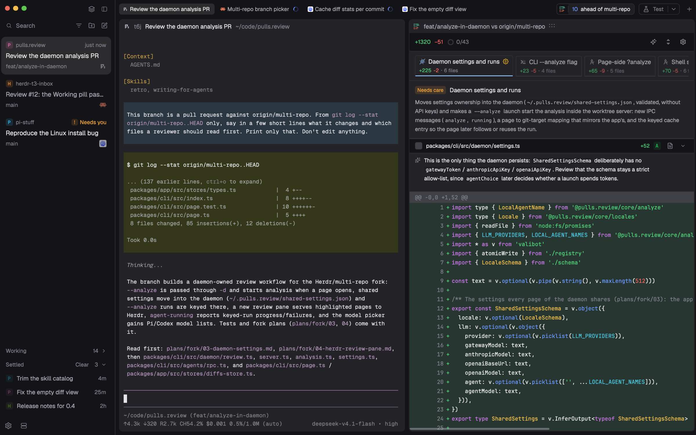

# Herdr T3

Herdr App 的一个安静、近似 T3 Code 的窗口，在 agent 越开越多时替你节约注意力。默认 Inbox 把需要你的 agent 留作卡片，工作中的折进 Working，结束的等你手动 Settle，有新工作时自动回来。Lists 则提供 Spaces + Agents。两者都包含其他机器，共用名字、置顶和状态标记。工作区有窄标签、带框窗格和 Actions 运行按钮；Files 和可选的 pulls.review 页共用右侧 space 面板。



## 你看到什么

### 窗口与表面

用 Herdr 布局 JSON 和 mod API，外观取 T3 Code 的比例。保留用户主题、布局界面字体和窗口代码字体。预览的 Geist/Geist Mono、字号 12、zoom 1.1、minimum contrast 3 只是示例，不随安装写入。

| 部分 | 几何与底色 |
| --- | --- |
| 侧栏 | 256 逻辑 px，最小 208、最大 480，外缘可拖；`chrome` |
| 品牌栏／标签栏／面板头 | 高 40，可拖动窗口 |
| 侧栏底栏 | 高 44 |
| Lists 的 Spaces／Agents | 等分，各至少 90 |
| 工作区 | `chrome`，包括窗格背后；左右内缩 8，窗格间距和底部留白 8 |
| 窗格 | `background`，圆角 8，2px 同色边框；单个也带框 |
| 窗格标题 | 除 Home 外常显，高 28，在框内 |
| space 面板 | 最右全高列；初始隐藏，与工作区同权重、最小 480；外部分隔线可拖，左右和底部内缩 8 |
| 分隔线 | 1px `border` |

无标题栏，terminal opacity 0、padding `[8, 0]`。窗格聚焦边框也是 2px `background`，默认不可见且聚焦不改变终端尺寸；把布局的 `focus.color` 改成 `accent` 即可显示。分屏时非聚焦窗格的图标、名字、目录降为 50%，悬停恢复，状态和按钮不变。布局保留但隐藏自带 `workspace-status`。

后续改尺寸、圆角、间距或颜色前读 [T3 token 基准](docs/internals/t3-tokens.md)：组件 token、按钮变体和有意不同于 T3 的地方以它为维护出处。

### 侧栏框架

品牌栏先给 macOS 窗口按钮留位置，再放官方标记（`frame/welcome/herdr.png`，20px、圆角 5、70%）和 `Herdr`（14px medium `muted`，间隔 8）。两者在悬停和 Home 时提亮；28px 按钮回 Home，无提示、不加悬停底色。放不下完整名字时整个隐藏，只留标记，不截成 `Her…`。右侧内缩 8 的 28px 按钮用 16px Lucide 图标切模式、隐藏侧栏。模式图标表示点击后去哪里：`inbox` 或 `layout-list`，隐藏按钮再隔 12。

macOS 窗口按钮初值 `[16, 12]`，与品牌栏中线对齐，距标记 16 屏幕点。无标题栏、非全屏时未缩放的 Y 为 `12 + 20 × (zoom − 1)`；只调整安装后名为 `herdr-t3` 的布局，改名副本不动。侧栏隐藏或窄时标签栏给窗口按钮留位置；Windows 的 28px 窗口按钮在标签栏末尾。

底栏内缩 8、上 4，放间隔 4 的 32px 图标按钮（圆角 8、16px 图标）：Herdr Settings 和布局 sliders 设置。空位放撤销提示。更新下载好后，右侧 32px `Update` 胶囊（12px `accent` 字、同色 15% 底）运行 `app.update`。

### Inbox

初始选中 Inbox。32px 顶行内缩 8：画成输入框的 Search 按钮，然后 space 筛选、New space、New tab（28px、16px 图标）。Search 打开 Go to，不在这里过滤。下面隔 8 是卡片。筛选弹层挂在按钮下左对齐，288 宽、圆角 8、内缩 4，26px 搜索框下有横线，32px 行、圆角 4。

Pinned、Active 卡片在上，Working、Snoozed、Settled 有内容时是贴底的折叠收纳区；空间不够时跟在卡片后，共用滚动列表。标题高 32，比行内缩 2、内边距 8，12px 淡色名称、常规字重数量、12px 箭头。折叠仍露出当前查看的行，隐藏数量不计它。Settled 分页 Show more，有可关闭终端时有 Clear；Clear 先确认，保留当前标签。

卡片圆角 6、横竖内边距 10/8，三行高 20、20、16，间隔 4、2，齐全时高 78，卡片间隔 5。首行 space 标记／名字与状态／时间（Working 加时长、Needs you、Done，否则经过多久），第二行 agent 标题，可选第三行分支、中间截断。60% 程序图标和远程机器标记在分支行末尾，没有则在标题末尾。正在看、需要人、done 的标题为 medium `foreground`，其余 normal `muted`；悬停只提亮、不移动。工作中卡片平时 70%，悬停或正在看时恢复。置顶卡片在 space 头像后带 pin。

Settled、Snoozed 是 36px 窄行，圆角 6、行间隔 1：16px space 标记（未亮时 40%）、标题和已经过／剩余时间。悬停把时间换成 Un-settle 或 Wake。Snoozed 带 `accent` 闹钟；Woke 是 `blocked` 文字，悬停后仍留在控件旁。控件和状态在角落交叉淡变，不重新排版。

悬停详情：标题、space、远程机器、分支、程序，12px、最宽 320、实色加 `shadow_xl`，挂在行右侧 4、顶部对齐。首次等 150ms，另一张刚关不到 400ms 时立即出现。第一张／最后一张 150ms 淡变并滑动 4px，立即替换不重叠。控件所在角落整体抑制详情；点击收起，拖动隐藏。程序、pin、机器标记没有单独提示。

### Lists

Lists 分成 Spaces 和 Agents。两者标题高 32，与 Inbox 顶行对齐；按钮 28、图标 16。Spaces 列表在标题下 4 开始，行高 32、行间隔 1、内边距 10、间隔 10，16px space 标记加中粗名字。多于一台机器时按机器分组；空机器有 `New space here`。只显示不寻常 git 信息（`repo · branch ↑2 ↓1`，省略 `main`／`master`），worktree 带树线挂在仓库下。

Agents 行高 36、圆角 6、行间隔 1、内边距 10、间隔 10，16px 程序槽。正在看和需要人的醒目，其余悬停前淡显，working 70%。状态前显示持续时间（`<1m`、`5m`、`3h`、`2d`，12px），悬停 150ms 交叉换成 pin。行内不放机器标记，机器在同 Inbox 的详情卡里。

可按 space 或优先级排序，两种都有共用的 Pinned。优先级标题用收纳区的 32px 样式；space 标题用项目文件夹样式，上留 8、16px 标记、中粗名字，可右键 space 菜单。折叠时显示隐藏数量和紧急状态，仍露出正在看的行。父级折叠箭头在时间前，默认折叠，带淡色隐藏数量；blocked／error 子 agent 仍缩进一级显示。自己有 pane 的子 agent 只在父级下显示一次，置顶除外。子 agent 也有详情卡，space 取父级，自己有 pane 时才显示分支。

侧栏右缘保持两列：12px 折叠箭头中线距边 22；机器 `+` 是 24px、14px 图标，中线距边 50。

### 标签栏

标签高 24、圆角 6、字号 12，当前为 `selected`。Lists 显示当前 space 全部标签：12px 程序／终端图标、名字，末尾 16px 状态槽，悬停换成 16px 关闭按钮、12px `×`。短标签至少 96px。放得下就显示全名；放不下时最长的先让步，当前降到 240、其余 144，再放不下就滚动。两种模式被裁的一端都在 16px 内渐隐。只在当前标签或可用空间改变时，以最小移动保持当前可见；滚轮滚开的不拉回。

Inbox 左边改成面包屑：space／适用时的父级／当前查看的 agent，14px medium、间隔 12、淡色斜线。space 是 `muted`、当前 agent 是 `foreground`；与父级分屏的子 agent 再隔斜线跟在后面。同标签的同级 agent 不另造切换器，用卡片或 pane 进入。右边是按图标名字收紧的工具标签，不设最小宽度或状态槽，悬停 `×` 替换图标。顺序：当前标签被 zoom 藏住的非 agent pane、当前家族其他标签、不含 agent 的标签，非空组间用 16px 高细线分开。面包屑已写的当前／父级标签不重复。

面包屑先取完整宽度，最宽到整行；靠右工具条让到零宽，保持末端可见，滚轮移动、被裁边渐隐。面包屑可用宽不足 360 时父级变 `…`，只有面包屑本身超出整行才截名字。截断的名字、或 Lists 有状态的标签，下方 4px 有 12px 提示，文字起点对齐；全名已显示就不重复。Inbox 提示没有状态。关闭提示等 500ms，只有当前标签附快捷键。

多 pane 标签进入 Herdr 原生 zoom 后，标签变为高 24、圆角 6、虚线框的分段组：每 pane 一段图标名字，被 zoom 的为 `selected`、最宽 240，其余最宽 144。Lists 在组末尾保留状态，组没有关闭、标签菜单或拖动。Inbox 的 agent 仍在面包屑，工具段只含非 agent pane。用 pane 缩放按钮或 `cmd-shift-enter` 恢复分屏，标签栏不重复放按钮。

标签后是各自定宽的 Actions、可选 Review 栏、末尾。Actions 是高 24、圆角 8、一圈描边的 `▶ <名字> | ▾`，或 `+ Add action`。Lists 末尾有 24px `+` 新标签，Inbox 改用面包屑 space。24px `panel-right` 面板开关打开时 `foreground` 加 `selected`。只保留一份开关：Review 栏有 `toggle` prop 时由它画。最后普通控件的方框距窗口边 12，与 pane 控件对齐（Windows 窗口按钮距边 2）。工作列窄于 1024 逻辑 px 时 Actions 隐去文字，无 toggle 的 Review 栏隐去计数文字。侧栏隐藏时左侧出现开关，按所选模式统计 blocked、working、未读 done。

### 窗格与子 agent

标题依次是程序图标、有意义的名字（14px medium）、隔 12 的目录、子 agent 按钮、状态、右／下分屏、zoom／还原、关闭。控件 24、图标 14，悬停或键盘聚焦时显示。名字只是程序名时省略。Inbox 里单独显示或 zoom 的 agent 名已在面包屑，标题不重复；分屏保留。Inbox 标题用 14px `dim` 勾标已 Settle，用 12px `accent` 闹钟加剩余时间标 Snooze；working/blocked 优先。Lists 不画这两种收起标记。首图标文字对齐首标签，最后控件／状态距窗口边 12。

子 agent 按钮统计所有层级活着的 agent：`3 agents ⌄`，或 `blocked` 色 `1 needs you ⌄`；高 24、12px medium、内边距 8、14px 箭头、圆角 8。弹层宽 280，在下方 4、右对齐，内缩 4、28px 行、无标题，超过十行滚动；随启动／结束改变高度，全结束就关闭。每层缩进 16。行含程序图标、名字、工作时长（`4m`、每秒更新）／`Needs you`／`Idle`，以及自己的 12px 转圈／徽章或 6px idle 环；首次状态上报前无状态文字／标记。行表示自身状态，按钮和 pane 状态汇总子树。点击／Enter 用 `terminal.peek` 并关闭，详情卡向左打开。纯跑命令的 shell 不算子 agent。

### space 面板与 Files

只有一个右侧面板，跟随当前 space，跨标签固定。开关／页面／放大按 space（包括 Home）各记，未用过的默认关闭；宽度整个窗口共用。40px 固定头列出 `panel-body` 里实际有的页：Files，加上装了才有的 Review。页签高 24、圆角 6、12px 字、14px 图标，当前 `selected`；右侧 24px 放大／还原、关闭隐藏或恢复工作列。Review 用 pulls.review 原色标记，未悬停／选中时 70%，并跟随该 space 分析状态。面板关闭时状态移到标签栏开关的图标左侧，不叠角标、不重复。

两页是同一张圆角 8、`background` 卡片；每页一条 40px 透明全宽工具栏，下面内容左、唯一导航列右；只靠细线分开，不换底色，代码行号栏也同色。加载是居中 14px 转圈加状态文字；空态是居中 24px 图标、13px medium 标题、12px 淡色提示、间隔 8；读取失败在工具栏下用 11px `ansi1` 错误条叠 `18` 透明底，带 Retry。空态也保留工具栏。

每页独立记导航开关／宽度、Wrap／Scroll。导航默认开、宽 256、最小 160、最大 560，内容至少留 256；左 6px 拖动区、40px 列头，不按断点重排。工具栏末尾 `folder-tree` 开关为 24px ghost，开时高亮。宽度稳定 300ms 才重排。切页只恢复自己的文件和阅读位置，没有跨页打开／定位。

Files 只读，根取 space 各标签中第一个有非空 cwd 的 pane，缺省回退到 space 所在机器的 `folder`。根目录或机器变化后，清空选中文件、展开目录和搜索。未选文件时工具栏只显示根名，选中后是路径面包屑，点目录在树里定位。Markdown 可 Preview／Code，其他文本是只读语法高亮 Editor，图片是预览。长行默认换行，`text-wrap` 切 Scroll，与 Review 独立。工具栏 24px ghost 按钮间隔 4，首字内缩 16。导航列头有 Search files、Collapse all／Expand all；全部展开最多列 200 个目录，Git 忽略的保持折叠。

共用树：行高 24、12px 界面字、圆角 6、内缩 2、每层 27.2、12px 箭头、16px Catppuccin 图标；悬停文字色 7%、选中 12%。单目录链压成 `a / b`。先目录后文件，不分大小写自然排序（`file2` 在 `file10` 前）；省略 `.git`、忽略项变暗。改动用 Review 色标 A／M／D／R，删除划线，含改动的折叠目录带点。虚拟列表只画可见行，不截前 N 个。方向键（←／→ 收起／到父级、展开／进入）、Home／End、Enter 移动 1px 环并打开所在行。

搜索要求空格分开的每个词都在路径中，不分大小写。最多显示 200 行并提示超出数量。在 Git 内搜索引和未跟踪非忽略文件，外部最多 20 万路径；远程过滤最多回传 1,000。不超过 1,000 候选时用 uFuzzy 排序高亮；↑／↓、Enter、Esc 同其他搜索列表。

仅本页、space、窗口都可见才刷新：回来立即读，通常本机每 5s、远程每 10s，慢读取延长。文本只在变化时重读，图片重新点选才刷新。太大、二进制、缺失、非 UTF-8 是带文件名说明的空态；真正的读取／列目录失败用 Retry。远程图片上限 512KB，文本先检查大小／NUL。完整内容和 Editor 只保留最近显示的三个 space，更早只留轻量阅读选择，回来重读。

文件／目录右键：Copy path（远程带机器）、Copy relative path、Mention in agent，本机另有 Reveal in Finder，文件还有 Open in default app。Mention 发给该 space 当前查看的 agent，粘贴 `@<相对路径> `，150ms 后恢复原文本剪贴板；非文本剪贴板不动，提示改用复制路径。目录没有默认程序打开项。

### 可选 Review 页

Review 用于 [pulls.review fork](https://github.com/JinJieBeWater/pulls.review/tree/multi-repo)，CLI `jin.review`，只支持本机仓库，从 space 中第一个有目录信息的终端 cwd 查所在仓库，没有时回退到保存的 folder。位置变化后丢弃旧 diff 和阅读缓存、重新校验仓库；只在同一仓库恢复保存的范围。文件菜单的相对路径以实时目录为准。显式 Review 请求可选另一 worktree，直到终端位置变化。40px 工具栏：范围、分支比较或 commit SHA／前后、Analyze、折叠菜单、设置、导航开关；24px ghost、12px 字、14px 图标。非仓库／远程只写 `Review`，导航禁用；范围无变化写 `No changes`。

范围菜单是带数量的 Changes、Uncommitted、Outgoing、Incoming（0 保留并禁用），分隔线后是可搜索 Commits 子菜单（列表最高 320）。分支范围显示 `head → base`，窄于 640 时 `vs base`；单 commit 显示短 SHA、`‹ ›`。Changes 另有宽 36–192 的比较目标按钮，打开 288 宽可搜索 popover，BRANCH／REMOTE 分区、28px 行、列表最高 256。搜索时不列 Automatic。本地分支不含 head，配同名远程（origin 优先）和 22×14 远程开关，再列最多 200 个最新远程独有分支、不含 HEAD；默认分支先、其余按新到旧。选择 base 打开 `base...head`，不分析；拨远程开关不关菜单。base 按 space 保存，Changes 数量和 Commits 随它。

有两个及以上组时，工具栏下是一行横贯 diff 和树的组页签，四周 8、下有线，横滚不换行。规则组和 AI 组都显示。圆角 8 描边页签两行，横竖内边距 8/2、间隔 6：上面 14px 类别图标、12px medium 名字和 critical，下方 11px 增删／文件数，已看后有 14px 进度环。当前组 12% 选中，其余悬停 7%；全二进制不画无意义的行数分隔点。点组让 diff 和树从顶部显示它。AI 组说明在 diff 顶部（13px medium 标题、12px muted、最高 160），规则组模板文字省略。

树只列当前组的目录／文件，再列子组，每子组一行 24px、类别／名字／critical／数量／已看。子组默认开、目录默认折叠；不把子组合并进唯一目录。点子组展开并滚到它的组头。文件顺序同 Files，diff、行请求、`j`／`k` 也沿用。唯一当前文件由点击、j/k、或 diff 视口顶部的文件决定；跳转展开上级。已看框在 chevron 槽后、图标前，目录／子组三态，删除文件留空槽；已看文件划线变暗。右键在共用菜单后加 Mark reviewed／Mark unreviewed；组无菜单。

只有代码和 hunk 头用窗口代码字体。换行后每行高 20，Unicode 宽字、组合符号、连接序列保持字形和安全断行；设置 Lines: Wrap／Scroll 与 Files 独立。二进制只显示 `binary` 文件头，不请求行。吸顶文件头保持不透明，主题勾选框缩透明度时保留原 alpha。Review 可见时每 15s 刷新，回来立即补读；完整数据／行／布局缓存只留最近三个 space，分析状态仍是轻量、按 space。只有点 Review 栏数量才自动分析；本布局的纯开关栏没有计数也不读 Git，所以在页内选范围、Analyze。Language／Agent／Model 是设置子菜单，选中只关子菜单。

### 弹层、对话框与 Home 外观

New、Go to 是顶部居中 popup，offset 96、宽 576、随内容最高 420、圆角 16、1px border、`shadow_2xl`，内容首帧就出现。两行条目高 48：标题 20、第二行 16、上下 6、圆角 4。带顶线的 footer 用高 20、圆角 4、12px medium 键帽。Go to 的无框搜索高 36、上下 6；New 列表最高 285，Go to 313，都随键盘高亮滚动。

普通菜单 `popover`、圆角 8、border、内缩 4，28px 行、圆角 4、14px 字、16px 图标。右键菜单在指针处，宽 220、最高 260；控件菜单下挂 4，朝窗口内侧的边对齐。提示 12px、最宽 320、圆角 6，通常在上，顶栏控件在下。主按钮 `solid/solid_foreground`、次按钮 `raised/input`，破坏性确认在次按钮上用 `ansi1` 字。禁用保留颜色、整体 64%、无悬停／点击；有底色按钮悬停 90%。Ghost 在 chrome 用 hover/selected、卡片用文字色 7%/12%，侧栏行控件只提亮，标签关闭用 `raised`。

Actions 编辑器和确认框宽 512、圆角 16、高随内容、内边距 24、20px 半粗标题、32px 字段按钮、圆角 8。确认标题可换行，Cancel 在执行动作 Close／Delete／Confirm 前；执行按钮红字 raised 底、不填红块，底部 bare 无横线。Custom snooze 宽 384，同外壳但 footer 有横线。布局设置特意跟 Herdr Settings 而非 T3：880×620、190px 左导航、`Herdr T3` 标题和 Home 分区，右页内缩 28/22，14px 标题、12.5px 淡色说明、分隔线、220×32 select。

Home 是一张带框无标题的 pane，不是 agent 看板。默认正中三个按钮，最宽 320、高 32、圆角 8：Next agent（没地方去就禁用）、Go to、New tab，左 14px 字、右键帽，无名字或计数。按钮组下补 40，让其相对整个面板居中。Home 标签栏无 tab、`+`、Actions、Review；整行从 40 收成 8，除非需要放隐藏侧栏控件／macOS 窗口按钮或 Windows 窗口按钮。离开恢复 40。到达 Home 第一帧就是无标题框和它自己的面板状态。

## 它怎么表现

### 共用名字、标记与注意力

卡片、Agents、标签、标题统一命名：Pi 在跑先用 `pi.session`；再用人为命名的标签，但只给顶层 agent，且不能与另一个顶层 agent 共用此标签；然后是有意义的终端标题，只去掉该程序自己的装饰（Pi `π - … - <目录>`，OpenCode `OC | `）；最后程序名。拒绝纯路径／user@host／程序／目录标题，以及不再跑 agent 时残留的 agent 装饰标题。子 agent 不继承标签名。未命名标签按里面的 agent，否则聚焦 pane 命名。

父级汇总活着的后代：任一 blocked/error 优先；然后自己的未读 done；再是自己或后代 working；否则自己的状态。子 agent done 是父级的消息，不单独亮 done。会报告状态或程序标成 agent 的活终端才算，命令 shell 不算，但经过 shell 启动的 agent 算。Working 用自带转圈／`working`；blocked 是圆角 `!`、15% `blocked` 底（通常 14px，Inbox 16、Agents／子 agent 行 12）；done 是 6px `done` 点（Inbox 绿色 `Done`）；idle 在 Agents／子 agent 菜单里是环，其他不画。

Space 标记优先当前所在位置（第一个终端目录，否则创建目录）的仓库根 favicon：先常见文件再页面／路由 icon 声明，不含 `.icns`，16px、圆角 25%。没有则取名字第一个字母／数字、大写，粗体等宽、字号为标记的 8.25/16，从 T3 的 18 色按名字哈希取（暗色 Tailwind 400、亮色 600），同色 14% 底；没有可用字符就文件夹。找到十分钟重查，没找到一分钟。程序标志按组件槽直接画 Herdr/mod 素材，不改原画布配色。

### Inbox 与 Lists 的边界

品牌按钮／`cmd-shift-b` 切模式，侧栏隐藏也可切且保持隐藏。共享名字、pin、Settle/Snooze 标签含义；注意力策略只在选中 Inbox 时生效，无论侧栏显隐：

| 规则 | Inbox | Lists |
| --- | --- | --- |
| Settle／Snooze 控件 | 满足条件时提供 | 不提供；Settle 键无作用 |
| Snooze 中的 working | 藏进 Snoozed、不计 working 数 | 原有行和顺序继续转圈 |
| Settled／snoozed 未读 done | 隐去 | 隐去 |
| 关闭当前 agent 整标签／最后 pane | Home | space 上一次看的标签 |
| agent 导航 | 画出的行；折叠收纳区只算当前行 | 全部分组，包括折叠的 |
| space 筛选 | 从别处带进被隐藏 agent 时可放宽 | 保持不动 |
| 标签栏 | agent 面包屑＋家族／工具，工具无状态 | 全部标签和状态 |

Snooze 子树失败、或查看时开始新轮，两个模式都结束 Snooze，Inbox 从未启动也成立。只有 Inbox 和活动窗口中的查看清除 Woke。Settle 后有新的 busy/blocked 或结束轮次，所有位置立即不再把标签当作有效，不等 Inbox 绘制。

### Inbox 排序、Settle、置顶与 Undo

Active 先 blocked、不论多久，其余按何时回到人手上，同时间按 address。Working 按本轮开始，Settled 按 Settle 时间，Snoozed 按最早醒。结束工作多留 Working 2s，避免快速续跑抖动；blocked 立即离开，pinned/settled 不等。查看不改变顺序，点击 `agent.focus`，不自动 zoom 分屏。

Settle 始终手动：悬停已结束卡片（置顶也可）按 `✓ Settle`，或当前 agent 用 `cmd-shift-s`。它去掉 pin、写标签、进入 Settled，新工作自动回来。对当前已 Settle agent 按同键、点 Un-settle、拖出来，是明确取回，排 Active 顶；其他方式清标签保持原位。Undo 恢复位置、标签、原 pin 位置，保留其间新增 pin；Settle 被拒也把 pin 放回。Clear 先确认，关闭符合条件的 settled 终端，保留当前标签。

Pin 一份手动顺序与 Agents 共用。按钮／菜单 pin 放顶，拖动选落点；pin 结束 Snooze。置顶不论状态留顶。Unpin 回时间位置并提供 Undo，只恢复 pin 及其位置、不写终端标签。

Settle、Snooze、Unpin 在底栏空位留 `Settled, Undo`／`Snoozed, Undo`／`Unpinned, Undo`（批量带数量），5s、200ms 淡变；隐藏侧栏时在标签栏。空间不足先截摘要，保留 Undo；连续同操作合计。Undo 恢复原状，不算新消息；仍在此次动作到达的 Home 时还带回 agent，去了别处则不跳。无 Undo 键，`cmd-z` 留给终端。

### Inbox 拖动、划选与动画

移动 6px 拿起符合条件卡片／窄行，Working 卡片、等待 Core 回传的 Settle 不能拿。`selected` 加阴影的副本只竖向移动，按下位置留在指针下，徽章预告 Pin／Unpin／Settle／Un-settle／Wake。仅拖动时 Pinned/Active 标题 150ms 展开到 24，空 Settled 也显示，目标标题／间隙为 accent。间隙匹配卡片＋5 或 36 窄行；空／折叠目标用 36 虚线占位。Pinned 按卡片上下半决定前后；Active/Settled 沿用自身排序，不能任意手排；Settled 进入／移出不变当前页长度。

侧栏内松手提交，不打开行；从上下边离开提交最后目标，从侧边离开／Esc／行消失／窗口失活取消。仅拖动时列表拿键盘，结束还给 pane。按住 Settle 或 Un-settle 划过同区多行再松手成批处理；Wake 同样支持。Snoozed 不接落入，因为拖动说不出时间。

换序／换区动画 150ms ease-out：移动行从旧位滑入，新行从上方 40 淡入，离开原地淡出；收纳区头、Show more、空标记也参与。拖动时或同时超过 40 行不播，放下从松手位置滑入。Lists 排序／折叠共用动画、箭头交叉淡变；Inbox 收纳区箭头直接切。按下行用 `selected`。

### Snooze

不需要人处理的卡片（含 working／pinned，不含失败轮）在 Settle 前提供 clock。菜单打开保持控件悬停稳定。预设 In 1 hour、In 3 hours、This evening（18:00，过去就不列）、Tomorrow（09:00）、Next week（周一 09:00，周日叫 Tomorrow），时间先后排序、同分钟去重。时长从点击算，固定时间若开菜单后已过则拒绝。宽至少 160；时钟左边能留窗口边 5 就下挂右对齐，否则从时钟左缘向右延伸。不开放预设配置。

Custom 提供 Date and time（36px 日历格，过去日期不可选，方向键走日期／月份，Enter/Space 选，`HH:MM`）或 Duration（非负数、−/+ stepper、Minutes/Hours/Days select）。不存在／已过时间、非正时长内联提示并保持打开；应用时重新检查 agent 是否需要人。

Snooze 写唤醒时间，当前查看的同时收起。醒来回原位，期间工作结束则排 Active 顶；带 Woke 直到活动窗口查看／点击，后台不能消费；仍工作可同时显示 Working 和 Woke。权限询问暂时露成 Needs you、不删标签，回答后再隐藏。子树失败、查看时新轮、Wake、pin、Settle 清标签。置顶在 Snooze 下保留，醒后回 pin 位置；撤销 Settle 只恢复没过期的 Snooze。

agent 菜单的 Snooze 子菜单共用预设／Custom，右侧写醒来时间。悬停 100ms 开，→/Enter 打开并高亮首项；←/Esc 只关子层，选择两层都关。旁开、首行对齐，仅左边放得下就翻左；指针斜穿其他行往子层走时，留 300ms 才切换。

### 当前行与 mod 卡片

当前行即使所在区折叠、超出 Settled 页也露出；没有自身行的子 agent 点亮最近已列祖先。从别处带进被筛掉 agent/mod 卡片时，Inbox 筛选放宽为全部并保存，但首次绘制不做、人在当前位置主动选的筛选保持。普通侧栏列表不能代码滚到当前行，这里与 T3 不同。

pane mod 通过 `shared("<mod>.program") = { icon, tint, name, inbox: true }` 明确自荐才有卡片，只有图标不算；标题取 `<mod>.titles`、状态取 `<mod>.status`。首次／done／blocked 在 Active 顶，working 在 Working。它属于 space 不属于 agent，聚焦自己才亮自己的卡，其他 mod pane 点亮旁边 agent。Home 里都无卡片。自荐同时承诺可随时关：Settle and close／Settle 键关 pane，无 Settled/Undo，回之前标签或旁边 agent，不回 Home；space 最后标签先确认。无 pin、拖动、划选；受 space 筛选。

### 标签、导航与安全关闭

Lists 标签单击选、双击改名、右键菜单，移动 6px 才拖，Esc／离开标签栏取消，仅拖动时拿键盘。Inbox 只有不含 agent 的标签能在它们之间拖。滚轮只滚、不切标签。点 zoom 段聚焦 pane 并移动原生 zoom，不改分屏结构。

Inbox 点面包屑 space 重用单独停在提示符的 shell 标签（最近看过优先），没有才新建，连点不堆空标签；`cmd-t` 始终新开任务。两者让无 agent 标签成为 fresh，面包屑只有 space，直到再看 agent。聚焦同标签程序／自荐 mod 时，保留该标签最后看的 agent、变暗，点回；从标签条／标签键进不含 agent 的工具标签，保留该 space 最后看的 agent 及家族。当前标题点击下挂左对齐 agent 菜单，chevron 只悬停／聚焦显示；held/away 标题点击回去、无 chevron。右键 space／标题／父级总是该物菜单，暗的也一样。

上／下 agent（`cmd-]`／`cmd-[`）按所选模式行走，不循环，含符合条件 mod 卡片，不逐个走没有 pane 的子 agent。Home 上 next 取首行，prev 取末行。上／下标签和数字标签按实际显示条目，上／下循环。space 键按侧栏顺序（含折叠 worktree），跳 Home 和虚拟仓库标题，项目号稳定。

关闭当前 agent 整标签／最后 pane，Inbox 回 Home，Lists 回该 space 最近看的标签；只关一个 pane、仍有其他 pane 就留在该标签。无 agent 标签也回此前标签。后台关闭不跳；无历史（重启后等）交给 Herdr。布局发起关闭先离开当前标签再销毁，避免右邻未读被误看。外部关闭／程序退出可能先闪一帧 Herdr 选择；离开视野后归还误消耗的 done/Woke，标签失败重试；人留满 3s 就算看过，邻居／done 仍可能短闪。

所有布局 ×、关闭键、右键 Close、Go to `ctrl-d` 共用检查：`hc get` 判前台是否为自己的 shell 以外程序，没答案也问；没有程序立即关。否则显示 `Close terminal "<名字>"?`、`This stops the running process and clears its history.`，多程序用复数标题和列表。Enter 确认、Esc 取消；标签唯一 pane 用标签名。space 最后 pane 用 Herdr 自己 Close space。直接 `tab.close`／`pane.close`（含官方命令面板）仍是原生命令。

右键不选中／切换被点物，做不了的项隐藏；分组顺序：去处、状态、命名／复制、worktree、结束。

| 对象 | 可用动作 |
| --- | --- |
| Agent，含面包屑父级／子 agent 行 | 顶层 Pin/Unpin；Inbox 下子树不忙时 Settle/Un-settle、符合条件 Snooze/Wake；名字来自唯一标签且不是 Pi 时 Rename；Copy address；Send back 父级；Close 自己 pane |
| Space，含分组／面包屑／筛选行 | New tab；Rename；Copy 当前 path；仓库 New/Open worktree；linked worktree 的 Remove worktree（`ansi1`）；Close |
| 未开 checkout 虚行 | Open、Copy path |
| 已连接／重建机器 | New space here、Connect |
| Tab | New tab、Rename、Close |
| 终端／pane 头／zoom 段／mod 卡 | Split right/down、Zoom；终端 Copy address（快捷键列显示 `t2` 等地址）；把右键交程序或取回；Send back；Close pane |

终端地址不进标题或侧栏，终端／标题右键才有 Copy address，mod pane 没有。

### Spaces 与 Agents 交互

点 space 切换，拖 6px 后在同机器内排序；checkout 带展开 worktree，worktree 只在同级间。抬起 `selected` 加阴影、落点间隙，松手 `space.move`，模型回传前保持意图；Esc／离开取消。仓库记折叠。checkout 没开、至少两个 worktree 时，在第一个 worktree 原位置加暗色虚 checkout；一个则普通 `repo · branch` 行。点虚行 `space.new` 只开一次，在原位替换；bare 仓库改为折叠。正在看的 worktree 折叠后仍露出，不计隐藏数量。

点顶层 Agents `agent.focus`，子行 peek；折叠子 agent 正在看则点亮父级，正在看的 done 留 Done 到离开。结束的 agent 清折叠记忆。排序菜单下方 4、右对齐、150ms 淡入、28px 行，同按钮关闭。pin 与 Inbox 共用、结束 Snooze；unpin 用全局 Undo。Settled/snoozed 在 Lists 原位保留 working 转圈，只隐 done，没有另一个 Settled 组。

### Go to、New 与 Actions

Go to（`cmd-p`／Inbox Search）一行一个 pane：agent、shell、程序、mod，没有无 pane 终端和 Home。最近的先、越近越前，再当前 space、当前机器、其他 space／tab 顺序，当前 pane 最后。所有导航入口共记最多 30 个活 pane。打开选之前 pane，`cmd-p`、Enter 来回。行是 space 标记、共用 pane 名，下方程序图标／名字、远程机器、space、活子 agent `+n`，右侧状态。匹配 space／机器、人为命名标签、pane 名、程序名／key、folder，pane 名命中优先元数据命中。Enter／点用跨 space 的 `pane.focus`，`ctrl-d` 走相同确认关闭。Footer 是 ↑/↓ Navigate、Enter Go、Ctrl-D Close pane、Esc Close，New tab 打开 New。

New 当前 space 先，同机器聚合；第二行目录，远程加 server／机器。平台键 `1…9` 选编号，提示 macOS `⌘1`／其他 `Super+1`。Footer New space 在多机器时先选机器，未就绪禁用，`← Spaces` 返回。`cmd-n` 直接用当前机器，仅无需问机器时显示提示。侧栏 New space 直接选机器，一台时立即创建。New tab 用 space 当前所在目录（首终端，否则创建目录），不固定在初始目录。

Actions 全局，不按项目。主动作是上次运行，否则第一个；`▶` 重跑，菜单选中运行并设主，行 gear 编辑，Add action 新建。编辑器必填去空白后的 Name／Command，可选 Folder、图标、Tab／Split right／Split down；不合格 Save 禁用，Delete 先问。每次运行新开有名字的标签／分屏：`terminal.open { argv:["sh","-c",command],name,place,folder? }`，结束后 shell 保留。没填 Folder 取聚焦终端 cwd、同 tab 终端 cwd、space folder，展开 `~`。列表／上次选择跨重启保留。别名／函数需显式 `zsh -ic '…'` 之类，纯 Windows 需另装 `sh`。

### Home 与设置

Settle／Snooze 当前 agent（按钮／键／拖动／划选）默认回 Home，不替人决定下一步。After putting away: Next card 改为循环走卡片，无卡片回 Home。关闭当前 agent 整标签仍回 Home，不受偏好影响；后台动作不跳。`cmd-shift-h`／品牌标记去 Home，已经在就不动。Herdr 启动回上次位置，不强制 Home。

Home 是按需创建、本机一个隐形 space，跨项目／机器共用。只靠记住的 id，或严格的本机明确名字 `Home\u200b` 认领，不看内容或普通 `Home`。Spaces／New／Inbox 筛选／Go to／space 导航都跳过。里面一个 mod（默认 `t3-home`），或主目录 shell；无标题的 split/zoom/close，正常关闭键保护最后 tab／pane。原生 split 键／命令面板仍可加 pane，加的正常关。shell 起 agent 后，原地把 space 放成普通按目录命名的 space，不挪 agent，下次 Home 新建。非 agent 忙 shell 留原 tab，旁边新建 Home tab；shell 退出可能带走 Home，按需重建。

底栏 sliders／`cmd-shift-,` 开布局设置，再次调用替换旧框；Esc 先关 select、再关 dialog，恰好两项：

| 偏好 | 选择与作用 |
| --- | --- |
| After putting away | Home（默认）、Next card，作用于 Settle/Snooze/拖动/划选，不作用于关闭 |
| Home shows | Default、Terminal、`mod.json` 声明 `"home":true` 的已装 mod；按 title 否则目录名排序，当前使用的即使不再自荐仍列出 |

打开时读 app-home `mods/`，读不了／坏 manifest 跳过。选择内容立即重整 Home，到达时也整。设置各实例立即生效、更新保留。Select 是 28px 菜单行、初始无高亮、当前带勾，箭头/Home/End/首字母、Enter/Space 选择、Esc/外部点击关闭。

### 可选 asciicn 壁纸 Home

装 `extras/mods/asciicn-wallpaper`，在 Home shows 选择。静态主题色画，不做动画；内置 Lighthouse、Mountain dusk、Nebula、Ember，来自 [asciicn](https://asciicn.dev)，MIT。SVG 图形画字，映射最近主题 `ansi0..15`／foreground、四档透明度，不是字面文字或原图精确颜色。Braille、方块、象限、阴影、半调圆点、斜线保留形状，其他字符按暗度画圆头竖条、不保留字母轮廓。

画面填满 Home 高、主体横向锚定；比 pane 窄的填宽、上下均裁。贴底，缩小高度稳定 250ms 才采纳，避免进入瞬间跳。仅右下 340×104 区域显示距角 12 的切换器，chrome/圆角8、24px 按钮：`‹`、名字（最宽160）、`›`、`+`，导入画另有 `×`。选中持久化，新 Home 也沿用。

`+` 立即开卡（再点＋／×关）：主 Choose image…、次 Import Studio file (.ans)…，可展开 Create in asciicn Studio…（开 Studio、用 .ans 存 Downloads、回来导入），辅助 Open folder。Studio：`https://asciicn.dev/studio?source=image&charset=braille&color=truecolor`。

Choose image 是图片草稿，默认 Braille，可切 Blocks／Dots，同一完整 Home 预览保留空白画布和构图。Apply 存一份 `.ans`，最终场景就绪才选中；缓存失败保留草稿／预览，重试只能在内容一致时复用自己已发布的文件，否则另存可用名。Cancel 回原选择、不保存，但保留失败 Apply 已发布的 `.ans`。原图不改，只留生成画，保存后无回到图片编辑。图片／样式／异步状态在内存，迟到结果不能覆盖新选择。

Studio `.ans` 保留已画样式，绝不提供图片样式控件；用空闲编号名复制、转换后选中。手放 `<appHome>/asciicn-wallpaper/` 的文件也出现，改动重转。Unicode、短横开头、普通隐藏名支持；恰好 `.ans`、`..ans`、`...ans` 主干不安全，拒绝。导入画 × 再次确认写明名字，取消不动，确认删 `.ans`/图块、作废在途转换、选前一张，迟到结果不复活。

macOS 用 `osascript`、Linux `zenity` 选择，等待显示 Opening…；图片转 BMP 用 macOS `sips`、Linux ImageMagick `identify/convert`，没 ImageMagick 导入 Studio 文件。Windows／没选择框用 Open folder、复制 `.ans`。不处理 EXIF 方向，先外部旋转。失败／空导入弹提示、不自动重试。更新保留 mod 目录外的用户文件，见存储契约。主题导出、可选配色是另装 extras，不是布局前提。

### 键盘与焦点

每个控件独立 Tab stop、Enter/Space 点击、2px 内描 `accent` 焦点环。悬停控件在键盘位于该行／控件时也显示。终端保留 Tab：弹层外用 `pane.go` 到可聚焦侧栏进入键盘模式，从首按钮再 Tab 走 chrome；离开全部 stops（pane 导航／终端点击／激活去处）500ms 内结束。普通 chrome 点击不夺终端键盘；关闭／崩溃／重启不留无人持有模式。

弹层箭头循环，滚动跟高亮，指针下的行不强行滚走（滚轮带高亮）。无搜索菜单初始不亮，刚开就 Enter 无事，导航／悬停后才算；离开行清亮，排序例外。Home/End 在无搜索菜单跳首尾，搜索框里仍是光标。Typeahead 750ms，重复字母循环匹配首字母。按钮再按关闭、不重新打开。可搜索 New／Go to／筛选遵各自首匹配规则。子菜单 →/Enter 开，←/Esc 只关子，键盘回父。

| 键（`keys.json` 布局上下文） | 命令／行为 |
| --- | --- |
| `cmd-shift-b` | `t3-tabs.sidebar`，切模式不展开隐藏侧栏 |
| `cmd-alt-b` | `t3-tabs.panel`，上次页开关 |
| `cmd-shift-g` | `t3-tabs.review`，Review 页开关；无键 `t3-tabs.files` 同理 |
| `cmd-shift-s` | `t3-tabs.settle`，当前 Inbox agent/mod 卡 |
| `cmd-p` | `mod.open:t3-picker` |
| `cmd-]`／`cmd-[` | `t3-tabs.next/prev`，agent，不循环 |
| `cmd-w`、`ctrl-alt-shift-x` | `t3-tabs.close-tab` |
| `cmd-shift-w`、`ctrl-alt-x` | `t3-tabs.close-pane` |
| `cmd-shift-h` | `t3-tabs.home` |
| `cmd-shift-,` | `t3-tabs.settings` |
| `cmd-t`、`ctrl-alt-c` | `t3-tabs.new`，Home 时开 New |
| `ctrl-1…9`、`ctrl-alt-shift-1…9` | `t3-tabs.space:<n>`，不含 Home |
| `cmd-alt-]`／`[`、`ctrl-alt-shift-]`／`[` | `t3-tabs.space-next/space-prev` |
| `cmd-1…9`、`ctrl-alt-1…9` | `t3-tabs.tab:<n>`，显示的标签 |
| `cmd-shift-]`／`[`、`ctrl-tab/ctrl-shift-tab`、`ctrl-alt-]`／`[` | `t3-tabs.tab-next/tab-prev`，循环 |

按 Herdr 平台显示键名，非 macOS 的 cmd 是 Super。`cmd-d` 留给 Herdr 分屏，不是 Review。键盘在 Files/Review，`cmd-w`／`ctrl-alt-shift-x` 关面板而非背后标签；popup/dialog 持键盘时，四个标签／pane 关闭键都只关 overlay。浮动 `tabs-keys` 在侧栏隐藏、面板放大时也处理布局命令。

## 由什么构成

### 布局、模块与安装

创建 `layouts/herdr-t3.json`、预览 `layouts/herdr-t3.svg`、`mods/t3-*`、`keys.json`。节点 id 唯一，下面结构 id 保持稳定，布局代码靠它们查找：

```text
root: row, terminal_menu=t3-menu
├─ sidebar: column [256,min208,max480], chrome
│  ├─ brand: t3-chrome [40]
│  ├─ sidebar-lists: stack, active=inbox
│  │  ├─ lists: column → spaces:t3-spaces / agents:t3-agents [等分,min90]
│  │  └─ inbox: t3-inbox
│  └─ sidebar-footer: t3-chrome {footer:true} [44]
├─ work: column, chrome
│  ├─ tabs-row: row [40], 不可拖
│  │  ├─ tabs: t3-tabs [weight1]
│  │  ├─ actions: t3-actions {block:"actions"} [自定宽]
│  │  └─ tabs-end: t3-tabs {part:"end",block:"tabs-end"} [自定宽]
│  ├─ work-body: row, padding[0,8], gap8
│  │  └─ work-main: stack, active=main
│  │     ├─ main: active tab, pane header=t3-pane [28,always,top]
│  │     └─ home-main: 相同 active-tab 框，无标题
│  ├─ work-bottom-inset: row [8] → bar-measure:t3-tabs {part:"measure"}
│  └─ status: workspace-status [28,hidden]
└─ panel: column [weight1,min480,hidden], padding[0,8], chrome
   ├─ panel-head: t3-chrome {part:"panel"} [40]
   ├─ panel-body: stack, active=files, background, radius8
   │  ├─ files: t3-files
   │  └─ review: review [可选]
   └─ panel-bottom-inset: row [8]
floating root: tabs-keys:t3-tabs {part:"keys"}, bottom/end, 不画内容
```

sidebar/work/panel 列 `resizable:false` 固定内部边界，外分隔线仍可拖。Spaces 传 `{newMenu:"t3-new-menu"}`；Inbox 传 `{newMenu:"t3-new-menu",picker:"t3-picker",home:"t3-tabs.home",menu:"t3-menu"}`。main/home-main 共用前述 background/border/focus/radius/gap/lone。浮动 keys 副本负责命令、Home、space 面板同步；其他 tab 副本共用导航，不各开一份确认。

必需 mod：`t3-chrome`、`t3-spaces`、`t3-agents`、`t3-inbox`、`t3-tabs`、`t3-pane`、`t3-home`、`t3-files`、`t3-new-menu`、`t3-picker`、`t3-actions`、`t3-menu`。有对应的从官方 mod 改，Inbox/Home/Files 新建。保留官方 workspace-status/转圈/程序素材；UI 自带目录 Lucide 24网格/1.75px，文件用 vendored Catppuccin。mod 不能越目录 import，改 `shared/` 源后由 `scripts/sync.sh` 分发，复用命名/状态/pin/labels、焦点/菜单/动画/按钮、侧栏/面板/存储、文件树/菜单/状态模块。

必需 mod 要真实文件（SVG 软链不加载），布局/SVG、按 context 合并 keys 放 `HERDR_APP_HOME` 或 `~/.config/herdr-app`，`layout.switch {"name":"herdr-t3"}` 选中。`scripts/update.sh` 要 `jq/rsync`，先验证旧 layout/keys，再 `rsync --delete` 自己 mod；保留主题/focus/stack 选择、支持的 extra 块、Review `config.json`，只更新已装 extras/主题，repo 键优先、报告替换。设置/pins/用户画不在替换目录。`scripts/sync.sh` 还写安装目录和同级独立仓库，不是只读检查。

Review 复制 `extras/mods/pulls-review`、`extras/mods/review`，按其指引装配 `jin.review`。在 `tabs-end` 前加不同 id `review-bar`，mod `pulls-review`，`{block:"review-bar",toggle:true}`；`panel-body` 末尾加 review 页。更新发现 extra 自动加页、保留 bar/toggle，不把页 id `review` 重用给 bar。壁纸复制自己的 mod；theme-export 是显式显示的零高 work 块，mod `extras/mods/t3-theme-export`，给 Pi 写 `~/.cache/herdr-app-theme.json`。都是可选，[extras 使用文档](docs/user/extras.zh-CN.md) 说明配置、主题、归属。

### API、进程与数据

Herdr API：`spaces/panes/agents/terminals/focused/layout/settings/window/keys`、`run`、`openOverlay/closeOverlay`、`nextCommand`、`shared/setShared`、`exec`、`readTextFile/writeTextFile`、kit views/inputs/Editor/timers。远程按 space 机器带 `on`。可用性以安装 Herdr 生成的声明（`herdr-app check`）为准，不按 Node/浏览器假设。Render 只造 view，setup/读取/input/scroll handle 创建在外。

| 部分 | 外部程序／写入 |
| --- | --- |
| Spaces | 只读 `git status/rev-parse`、`hc machine ls --json`；重建机器 Connect：`hc machine rm` 再 `hc machine add` |
| Inbox／tab 命令／Agents pin | `hc label <address> settled=<ms>:<turn>`、`snoozed=<wake-ms>` 或清空；恢复未读时写 `herdr.seen` |
| 关闭／导航 | `hc get <terminal> --json`；原生 space/tab/pane 新建/选择/移动/改名/关闭，`agent.focus`、`pane.focus`、`terminal.peek`、split/zoom/`terminal.park` |
| 布局 chrome | `layout.select/show/hide/resize`；安装布局仅 `traffic_lights` 字段，不整份 `layout.set` |
| Space 图标 | space 机器上 `git rev-parse --show-toplevel`、`sh -c` 检查、`base64`；app `cache/t3-icons/`，共享图标/颜色信息 |
| Files | `sh` 列目录、`git check-ignore --stdin`、`git status --porcelain=v2 -z --untracked-files=all`、`git ls-files -co --exclude-standard -z`、后备 `find`、远程 `awk`；文本和 app `cache/t3-files/` 图片（远程 base64），close/下次启动清理 |
| 文件菜单 | 剪贴板保存/粘贴/恢复、`pane.focus`、`terminal.paste`，支持的平台本机 `open -R`／默认程序打开 |
| Actions | `terminal.open` 执行 `sh -c`、可选目录，全局列表/上次选择 |
| Review | `jin.review`、共用只读 Git scope/base/ref helpers，本地 daemon/Review 配置，无远程 |
| 壁纸 | `osascript/zenity` 选择，`sips/ImageMagick` 转 BMP、base64 解码，`open/xdg-open/explorer` 开 Studio/目录；app-home 壁纸目录 `.ans`、生成 `.tiles/`、临时 `.preview/` |

Git 读取带 `--no-optional-locks -c core.fsmonitor=false`。Spaces 不扫未跟踪，位置/命令/轮次/重连变更才读、前台慢速兜底；Files 包含未跟踪。Files/Review 不用递归 watcher，隐藏/切换停止刷新并作废在途读取，保留最近显示的三个 space 的完整数据；驱逐才释放完整缓存，迟到结果不能补回。

终端事实写 label，跨 mod 偏好/事实 shared，每副本界面 `localStorage`，导航/草稿内存。保留 pins、settings、每 space 面板、Home id、最近 pane、发布的 `{order,view}`、全局 Actions。设置默认 `{afterAway:"home",homeMod:"t3-home"}`（Terminal 是 null）；Actions `{list:[{id,name,command,icon,place,cwd?}],last}`。Files/Review 各记 `nav.open/nav.width/lines.wrap`，Markdown 用 `t3-files.markdown`。重启丢 last-agent/关闭记忆，不丢 pins/settings/labels。

改跨帧数据/文件/迁移前读 [storage](docs/internals/storage.md)，它唯一规定位置/键/归属、label/布局写、页偏好迁移、壁纸生命周期；用 shared store/labels/pins/layout-settings helpers。壁纸分块暂存后原子发布且不覆盖，缓存失败/Cancel 保留已发布源，Unicode 路径安全、预览隔离。用户文件在更新目录外。

脚本入口：`t3-tabs.{panel,review,files,home,settings,new,next,prev,settle,undo}`、`t3-tabs.close-tab:<id>/close-pane:<id>`、`t3-tabs.pin:<address>/unpin:<address>/wake:<address>/snooze:<address>:<wake-ms>`、`t3-files.open:<path>/search:<words>`、`review.scope[:commits]`、`review.base`、`review.settings[:language|agent|model]`。保留各 popup 的关闭键 context，含 `t3-pane/t3-chrome`，否则可能关背后标签。

## 注意

- 隐藏 mod 不画、不收命令，首次显示才启动。常驻命令/Snooze 放浮动 `tabs-keys`；隐藏后所选模式顺序继续，Inbox 从未启动前自己的顺序除外。模型/远程 label 延迟时保留最后意图，写失败提示。
- Home 严格识别保护普通 space。释放 agent 所在 Home space 不移动/删除进程，到达恢复目标面板状态。原生关闭可能闪邻居，重启丢关闭历史；原生 Home split 拦不住，zoom 组不能拖，普通列表不能代码滚到行。
- 保留确认/取消：关闭/Clear 停终端清历史，Remove worktree 删除，删壁纸删源/缓存。Actions 任意 `sh -c`。窗口按钮只 expected 写，整份 `layout.set` 会丢布局点击状态。
- 图标路径错会静默空白，运行时路径必须 demo 看。mod import 只限自己目录。无 blur/scale/字距 API，用实色；透明 popup 仍挡输入。恢复漏掉的 pointer leave/release，popup 关闭不能重开或关底层标签。
- 改 render/timer、focus/hover、测量/滚动、Review 文本或壁纸转换时读 [layout implementation](docs/internals/layout-implementation.md)。它收宿主陷阱、不再造可见规格；视觉 token 和存储各有唯一出处。
- 本文与[英文](RECIPE.md)语义一致，各 ≤60,000 UTF-8 字节，Gallery 会跳过超限 RECIPE。保留名字/简介/预览/五段，主文自足，披露实现陷阱而非移走核心行为。

## 完成标准

1. `wc -c RECIPE.md RECIPE.zh-CN.md` 各 ≤60,000，功能覆盖一致、内部链接/preview 存在。`scripts/sync.sh`（计入外部写）后 `scripts/check.sh` 输出 `all checks passed`：副本、mod check/类型、图标、overlay、render/update guards。
2. `layout.switch {"name":"herdr-t3"}`，`herdr-app status` 无缺 mod/重绘警告。独立 demo：`scripts/demo/stage.sh up`、`scene <name>`、`do herdr-app shot <file>`、`down`。默认 256px 侧栏及窄/明暗/zoom 整窗截图无裁切、表面和窗口按钮正确。启动需 GitHub，离线用临时副本改本地 `repos.sh`。
3. Inbox Settle/Un-settle/Undo/新工作、两模式 pin、拖/划/取消/Clear：位置/pin 还原、新工作回来、Clear 先问且保留当前 tab、Home/Next card 遵偏好。后台不跳，Lists Settle 无作用；隐藏侧栏保持顺序/不循环、5s Undo，Lists 不动 Inbox 筛选。
4. Snooze working/pinned，权限/回答、Inbox 未启动时 Lists 失败/当前新轮，前后台到期：隐藏计数、临时 Needs you、Woke、pin 符合规则。Custom 无效输入保持打开，取消不变。
5. current/held/away/fresh 面包屑、同级/子 agent、zoom/滚动/拖动与卡片焦点一致。关前后台 tab/最后 pane/分屏 pane：Home/前标签/留原处正确，未读邻居保留、有程序先问。Overlay 上四个关闭键不关底层。
6. Home 改 mod/Terminal、shell 起 agent：普通 space 原地保留 agent，下次 Home 干净，项目编号稳定。New/Go to：之前 pane/名字命中在前、远程信息、shell 重用、机器/footer 键盘可达、终端 Tab 保留。Worktree 折/拖/checkout 缺席时分组编号正确。
7. Actions 加/改/删/运行 tab/右/下/目录：必填、确认、上次选择、shell 保留、窄栏宽度。
8. Files 本地/远程、Git/非 Git、文本/Markdown/图/二进制/缺失/失败：只读根、树/搜索/顺序/换行和空态-vs-Retry 正确。切四 space/隐藏回放验证缓存/I/O 有界。每 space 面板/page/maximize/Home 恢复，放大时快捷开关/键盘关闭有效，两页位置/宽/换行独立。
9. Review scope/base/remotes/commits/groups/reviewed/j/k/Analyze/Unicode/二进制/空/失败：树/diff 同序，无误分析，安全换行，吸顶头不透明、勾选 alpha 正确。
10. 壁纸三样式、Apply/Cancel/缓存失败重试、Studio/手动导入、Unicode/短横/隐藏名/密集阴影、转换中确认/取消删除：构图/主题/角落控件正确，不改原图、不重复自己的保存，失败 Apply 后取消保留已发布源，删后不复活。

通过代码检查不能替代可见/真实输入验证。未试真实点击须说明，只清理本次 demo 创建的资源。
