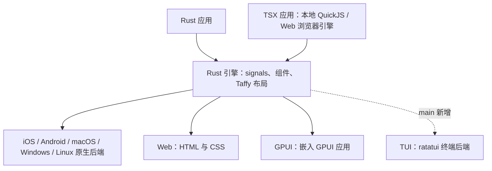

# longbridge/nsh（Native Shell）发展现状

调研日期：2026-11-10。范围：release 历史、能力与架构、活跃度与规模、真实应用/采用证据。以 v0.4.0 已发布版为基准，另行标注 main 的进展；未安装或实跑 NSH。

## 结论

- 项目**非常新**：仓库 2026-10-14 创建，首个 release v0.1.0 发布于 2026-10-17，到今天不到 4 周。
- **迭代极快**：3 周内发了 v0.1.0 到 v0.4.0 共 5 个正式版，另有每晚构建的 nightly；v0.2、v0.3、v0.4 都有 breaking change，并附迁移说明，API 还没稳定。v0.4.0 release notes 明确写着 "The compatibility baseline is still being prepared; 0.4.0 is not a frozen compatibility release" [5]。兼容文档描述的是从首个被记录为兼容的 release 开始的承诺，不能据此推断 v0.4.0 或整个 Rust API 已经冻结 [16]。
- **热度高、提交集中**：约 2.37k stars、150 forks、68 位贡献者、main 上 1214 个 commit；不过 commit 主要来自 3 位核心成员。
- **生产采用**：没有找到"已有产品在生产环境使用"的直接证据。官方只说 Longbridge 是"为自己的客户端"开发 NSH，没有说哪个 Longbridge 产品已经上线使用。App Stories 收录的 10 个应用里，6 个出自核心维护者 huacnlee，且有多个标着 "In development"。
- **选型判断（研究者意见）**：工具链和组件范围已足以开展原型、内部工具或局部嵌入试点。需要长期维护或多平台一致性的完整产品，应先验证目标平台的输入法、富文本、无障碍、媒体和打包，并预算升级迁移成本。

## 已发布能力与 main 的边界

v0.4.0 已支持纯 Rust、纯 TSX、Rust 加 TSX 三种写法；纯 Rust 应用不携带 QuickJS。TSX 的本地运行时使用 QuickJS，Web 使用浏览器自己的 JavaScript 引擎 [5][17][18]。

图省略线程与批量挂载细节。GPUI 是可选后端；各 OS 独立应用使用各自的原生后端。原生指平台的视图、文本、输入和交互基础，视觉外观由应用决定，`nsh/base` 主要提供无样式的行为和无障碍结构 [17][18][19]。

| 范围 | 2026-11-10 的证据 |
|---|---|
| 已发布后端 | v0.4.0 列出 iOS、Android、macOS、Windows、Linux、GPUI、Web，共 7 种 [17] |
| main 新增 | TUI 后端，因此当前主干 README 和官网首页写 8 平台；不能套回 v0.4.0 [20] |
| 开发工具 | CLI 创建、运行、TSX 热更新、类型检查、headless 测试、各平台打包；也能嵌入现有应用，加载签名 TSX 包并设置宿主能力边界 [17][18] |
| 更新速度 | 查询 compare API 时，main 比 v0.4.0 多 422 个 commit；为动态快照，不是质量指标 [21] |
| 已知后端差异 | v0.4.0 的 GPUI 在 macOS/Windows 上视频仅显示占位并报错，且不绘制 `filter: blur()`、`backdropFilter` 和 `mixBlendMode` [22]；Linux 也不支持后两者、缩放滚动和自定义 accessibility actions [23]；Windows 的 alert/toast 未暴露到 UI Automation [24] |

性能报告由上游自行测量，写明了设备、窗口和内存统计口径，不能把首页的 120 FPS 或小示例内存数字直接当成复杂产品的保证 [25]。本次未做性能复现。

## Release 历史

| 版本 | 发布时间 (UTC) | 要点 |
|---|---|---|
| v0.1.0 | 2026-10-17 | 首发：原生 runtime、Rust 组件、文档站与 WASM playground，GTK4 / AppKit / Win32-Direct2D 桌面后端 [1] |
| v0.1.1 | 2026-10-18 | 新增 GPUI 后端；网站迁到 nsh.dev；web 应用可以发布为静态站点 [2] |
| v0.2.0 | 2026-10-22 | 新增 `nsh/base` 无样式基础组件、受 capability 控制的标准模块（fs/net/websocket/crypto 等）、`nsh test`；主题改用 shadcn/ui tokens；**放弃 React Native 风格的 API 命名（breaking），0.1 打的包需要重新构建** [3] |
| v0.3.0 | 2026-10-26 | 新增 Editor/DiffView、DataTable、DockArea、Toast、Plot 图表；iOS 支持 Liquid Glass；Android 支持 armeabi-v7a 和 16 KB 页对齐；**有 breaking change** [4] |
| v0.4.0（latest） | 2026-11-04 | 新增 WGSL Shader 效果与转场、整套表单控件、RichEditor、更多图表；web 改为跑在浏览器自带的 JS 引擎上（gallery 首次加载从 13.03 MB 降到 4.35 MB）；**API 形状统一（breaking）**；本版有 16 位新贡献者 [5] |
| nightly | 2026-11-10 | 预发布，main 有变化就每晚重建 [6] |

仓库原名 `longbridge/native-shell`（早期 release notes 里的 PR 链接还指向这个名字，旧名现在重定向到 `longbridge/nsh`）[1][7]。第一个 commit 是 2026-10-14 的 "Initial commit: yf, a React Native-like framework in Rust" [8]。

## Repo 活跃度与规模（2026-11-10 GitHub API 快照）

| 指标 | 数值 | 来源 |
|---|---|---|
| 创建时间 / 最近 push | 2026-10-14 / 2026-11-10 07:45 UTC | [7] |
| Stars / Forks / Watchers | 2372 / 150 / 3 | [7] |
| 语言 / 许可 | Rust；仓库只带 `LICENSE-APACHE`，官网写 Apache-2.0（GitHub 识别为 NOASSERTION） | [7][9] |
| main 分支 commit 数 | 1214（按 `per_page=1` 的最后一页推算） | [8] |
| 贡献者 | 68（含 anon 和 Copilot bot） | [10] |
| 贡献最多的 3 人 | huacnlee 438、madcodelife 259、sunli829 144 | [10] |
| 已合并 PR | 1183；open PR 47 | [11] |
| Issue | 共 184，open 72 | [11] |
| 最新 commit | 2026-11-10 07:44 UTC，#1291（SVG on canvas） | [8] |

局限：stars 和 forks 是调研时刻的快照；contributors 端点按 commit 作者统计，同一人可能有多个身份；PR 和 issue 数来自 search API，大致准确；没有拿到 `stats/commit_activity`（API 返回空对象，统计还没生成）。

## 真实应用与采用证据

- **官方定位**："Longbridge builds NSH for its own clients"。最初的需求是给移动客户端做一个插件层，后来扩展成全平台框架 [12]。这说明了开发动机，**不能证明 Longbridge 的线上 App 已经在用**。
- **App Stories**（nsh.dev/apps）：共 10 个应用，收录规则是"Showcase 仓库里合并了 PR 就收录"，Featured 由维护者挑选 [13]。
  - huacnlee（核心维护者）做的有 6 个：Spotish（In development）、Omasend、Mado（Commercial）、sysmon、Disktree、Noop（215★，是其中星最多的）。
  - 社区做的有 4 个：Onley（fdaio，In development）、callme（lvwxx，In development）、StoatMD（forecho，Commercial，macOS/iOS）、Zeedle（Jordan-Haidee）。
  - 收录日期都在 2026-10-28 到 11-08 之间。
- **Directory**（社区库）：收录 3 项，都标着实验性或演示性质：WeChat 小程序平台（29★，"Not maintained long term"）、NativeScript 集成（13★，"Requires NSH patches"）、HarmonyOS 平台（1★）[14]。
- Showcase 仓库 `longbridge/nsh-showcases` 于 2026-10-28 创建，共 13 个 PR（含已关闭的）[15]。

判断：采用还停留在早期尝鲜。有两个标着 Commercial 的桌面/移动应用（Mado、StoatMD），但没找到第三方公司或大规模线上产品使用的公开证据。

## 来源

1. v0.1.0 release：https://github.com/longbridge/nsh/releases/tag/v0.1.0
2. v0.1.1 release：https://github.com/longbridge/nsh/releases/tag/v0.1.1
3. v0.2.0 release：https://github.com/longbridge/nsh/releases/tag/v0.2.0
4. v0.3.0 release：https://github.com/longbridge/nsh/releases/tag/v0.3.0
5. v0.4.0 release：https://github.com/longbridge/nsh/releases/tag/v0.4.0
6. nightly release：https://github.com/longbridge/nsh/releases/tag/nightly
7. Repo API：https://api.github.com/repos/longbridge/nsh
8. Commits API：https://api.github.com/repos/longbridge/nsh/commits?per_page=1
9. 官网（页脚的许可说明）：https://nsh.dev/
10. Contributors API：https://api.github.com/repos/longbridge/nsh/contributors?anon=1&per_page=100
11. Search API：https://api.github.com/search/issues?q=repo:longbridge/nsh+is:pr+is:merged （open PR 和 issue 用的是同类查询）
12. 文档 Introduction 中 "Native Shell and GPUI Shell" 一节：https://github.com/longbridge/nsh/blob/main/website/docs/index.md
13. App Stories：https://nsh.dev/apps
14. Directory：https://nsh.dev/directory
15. Showcase 仓库：https://github.com/longbridge/nsh-showcases
16. v0.4.0 兼容策略：https://github.com/longbridge/nsh/blob/v0.4.0/website/docs/compatibility.md
17. v0.4.0 README：https://github.com/longbridge/nsh/blob/v0.4.0/README.md
18. v0.4.0 Rust 与 TSX 写法：https://github.com/longbridge/nsh/blob/v0.4.0/website/docs/rust.md
19. v0.4.0 架构：https://github.com/longbridge/nsh/blob/v0.4.0/website/docs/architecture.md
20. main 平台说明：https://github.com/longbridge/nsh/blob/main/website/docs/platforms.md
21. main 与 v0.4.0 比较：https://api.github.com/repos/longbridge/nsh/compare/v0.4.0...main
22. v0.4.0 GPUI 差异：https://github.com/longbridge/nsh/blob/v0.4.0/website/docs/gpui.md#differences
23. v0.4.0 Linux 差异：https://github.com/longbridge/nsh/blob/v0.4.0/website/docs/linux.md#what-differs-on-linux
24. v0.4.0 Windows 差异：https://github.com/longbridge/nsh/blob/v0.4.0/website/docs/windows.md#what-differs-on-windows
25. 上游性能报告：https://github.com/longbridge/nsh/blob/main/website/docs/performance-report.md
