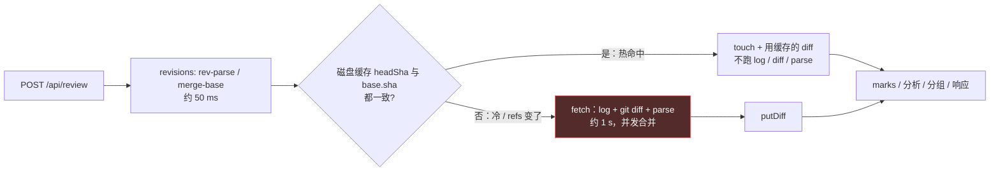

# Review pane 性能：daemon 与 Git 取数缓存方案（评估，未实施）

日期 2026-11-09。范围：jin.review daemon 的 `/api/review`、`/api/review/rows`、`/api/review/file` 背后的 Git 取数和缓存。Pane 内部计算（QuickJS 建模、列宽）不在本文范围。本文复用 [daemon 调查](review-performance-daemon-investigation.md)和[数据流报告](review-performance-data-flow.md)的实测，不重复。

基线：`projects/pulls.review@d1f982f`（下文路径省略 `packages/`），`herdr-t3@e4b2787`。标注：**[实测]** 已有或本次测得；**[推算]** 由实测分项相减或相加得到；**[待验收]** 需实施后测。

## 结论

最多三项，按顺序做：

| # | 改什么 | 热命中收益 | 冷首次打开收益 | 工程量 |
| --- | --- | --- | --- | --- |
| 1 | 先解析 base/head sha，与磁盘缓存一致就不跑 `log`、`diff`、parse；`readReview` 和 `readFullFile` 共用 | `/api/review` 只读元数据：1.31–1.46 s → 约 0.32–0.53 s **[推算]**；`/file` 每页约省 1 s **[推算]** | 无收益，反而多约 50 ms（多解析一次 sha）**[推算]**；daemon 每次启动后，每页的首次读取仍要完整 fetch 并重写缓存（版本边界，见 §1.5） | 小到中：core 约 15 行，daemon 约 20 行，3 个测试 |
| 2 | 进程内记住已解析的 diff（按 page 一份，有字节上限），并合并未命中时的并发 fetch | `/rows` 每批省掉读 body 的 91–102 ms **[实测分项]**，约 124 → 20–35 ms **[推算]**；`/file` 再省约 100 ms。`/api/review` 默认不受影响，按 §2.1 的可选扩展做了才受益 | N 个并发冷读 → 只跑 1 次 git diff，省 (N−1) × 约 1 s 和约 100 MB 瞬时堆 **[推算]**；并发频率未测 | 中：约 40 行，3 个测试 |
| 3 | `createReviewCaches` 按 cwd 记住 `repoCacheDir` | 每个 `/api/review`、`/rows`、`/reviewed` 省一次 spawn，16–36 ms **[实测分项]** | 同左 | 极小：约 3 行 |

建议 1–3 没有 HTTP API 变动，**pane 不需要跟进**。内部 TS 变动见 [§4](#4-接口变动与调用方)。跨层衔接的行宽字段见 §4a，它可独立加入同一次发布。

热命中的 `/api/review` **不会**到几十 ms。去掉约 1 s 的 git diff 后，还剩：解析 sha（约 50 ms）、读并校验整份 15.5 MB body（91–102 ms）、reviewMarks（19–30 ms）、规则分组（21 ms）、`repoCacheDir` spawn（16–36 ms）、序列化（9 ms），再加 444 KB 的 HTTP 传输。整段 HTTP 实测 1,306–1,458 ms，`fetch()` 实测 975–1,040 ms，所以：

```text
热命中预估 = HTTP − fetch + 解析 sha
           = [1306 − 1040 + 50, 1458 − 975 + 50] ≈ 316 – 533 ms   [推算，负载 5.7 下的量级，非分位数]
```



## 1. 建议 1：按 base/head sha 短路

### 1.1 现状 [源码]

- `readReview` 先 `source.fetch()`，再查缓存（`cli/src/daemon/review.ts:356-361`）。命中只省掉写缓存，响应仍用刚 fetch 的 `diff`。
- `readFullFile` 每页都跑一次完整的 `fetch()`，只为在文件列表里找一个文件和 head sha（`review.ts:433-446`）。
- `fetch()` 的身份信息来自 `resolveTarget`（`core/src/local/source.ts:44-64`）。它把解析 sha 和 `commitsBetween`（`git log %B`）绑在一起。`fingerprint()`（`source.ts:152-155`）也调它，所以这个“廉价探测”同样会跑 `git log`。

### 1.2 fetch 之前怎么拿到身份

把 `resolveTarget` 拆成两步，只把第一步暴露出来：

```ts
// core/src/local/source.ts
async function revisions(root: string, target: LocalTarget): Promise<{ base: string, head?: string }>
//   worktree: { base: HEAD 或空树 }                      head 省略：要等 diff 出来才知道
//   commit:   { base: sha^ 或空树, head: sha }           rev-parse ×2
//   range:    { base: merge-base 或 rev-parse base, head } rev-parse ×2 (+ merge-base)
async function resolveTarget(root, target, text): Promise<Resolved>  // = revisions + commitsBetween + title，结果不变

export type LocalSource = DiffSource
  & Required<Pick<DiffSource, 'fingerprint' | 'loadFile'>>
  & { revisions: () => Promise<{ base: string, head?: string }> }
```

`fingerprint()` 改为调用 `revisions()`，返回值不变，顺带少跑一次 `git log`。app 的过期检查走这里（`cli/src/rpc.ts:33` → `app/src/stores/diffs-store.ts:206`）。`DiffSource` 接口本身不动，GitHub、paste 和 app 的 RPC source 都不受影响。

### 1.3 pageKey 和真正的 sha / merge-base 不是一回事

- `pageKey`（`review.ts:262-264`）= `serializeRef({ kind: 'local', repo: cwd, target })`。`target` 是 **ref 文本**，例如 `main...feature`。它只确定“哪一页”，不确定是“哪一份 diff”。`readStatus` 和 `readRows` 用它不需要调用 git。
- 一份 diff 的身份是 **(pageKey, base sha, head sha)**：
  - `A..B`：base 就是 A 的 sha，A 前进时 head 不变而 base 变。
  - `A...B`：base 是 merge-base。只有 A 前进时它通常不变；A 合入了 B 的部分提交时，它可以在 head 不变的情况下移动。`review.ts:360` 的注释说的就是这种情况。
  - commit 页：base 是 `sha^`，根提交是空树。
- 所以命中条件必须是 `cached.headSha === at.head && cached.diff.base?.sha === at.base`，和现在 `review.ts:361` 的条件一样，只是提前到 fetch 之前判断。`at` 每次请求都重新解析，所以 amend、rebase、force-push、分支前进、base 前进都会改变 sha，从而必然未命中。不需要另外设计失效逻辑。

### 1.4 daemon 改法（`review.ts`，fork-only 文件）

新增一个函数，供 `readReview` 和 `readFullFile` 共用：

```ts
/** The page's diff entry: the cached one while its base and head shas still name it, else fetched and stored. */
async function pageEntry(source: LocalSource, cache: CacheRepositories): Promise<{ key: string, entry: PrCacheEntry }>
//   [key, at] = await Promise.all([source.key(), source.revisions()])
//   cached = await cache.diffs.get(key)
//   at.head && cached 的 head/base 一致 && verified 中有 `${key}\0${base}\0${head}` → touch，返回 cached
//   否则 diff = await source.fetch()；本进程首次见到该 key+sha 时一律 putDiff（用当前代码重写 body），
//   之后按现有 review.ts:361 的条件 touch 或 putDiff；putDiff 成功后把 key+sha 加入 verified
```

`verified` 是一个 `Set<string>`，和 §2 的内存表放在同一个 `WeakMap<CacheRepositories, …>` 条目里。这样做可行，因为 `CacheRepositories` 实例在请求之间确实复用：`server.ts:43` 每个 server 只调用一次 `createReviewCaches()`，它按 `repoCacheDir` 把 `Promise<CacheRepositories>` 存进 Map（`review.ts:228-239`），同一仓库的每次请求都 await 到同一个对象。同一仓库的多个 worktree 共用这个对象，`pageKey` 里带有 repo 路径，所以不会互相串。

- `readReview` 之后的步骤全部改用 `entry.diff`，包括 files、commits、title、base/head、`ruleBased.analyze`、`resolveGroups` 和 `servedRows`。`diff.commits` 已在缓存里，`git log` 的结果由 sha 唯一确定，所以不需要截断或另外获取 commits。
- `readFullFile` 改用 `pageEntry` 找文件，`loadFile(path, entry.diff.head.sha)` 不变。它需要新增 `cache` 参数。
- `/worktree` 页：`revisions()` 不给 head，只能先 fetch，行为和现在一样（[§5](#5-本样本不值得做的事)解释为什么不做便宜的工作树身份）。

### 1.5 正确性风险

| 风险 | 判断 |
| --- | --- |
| 缓存的 diff 和重新 fetch 的不同 | sha 相同，`git diff` 和 `git log` 的输出就确定；`title`、`label`、`ref` 由同一 key 的 target 推出。**这是新增的语义风险**：今天 `readReview` 每次都重新 fetch，旧版本 daemon 用旧 parser、旧截断阈值（`MAX_PATCH_BYTES`）或旧 `DIFF_ARGS` 写的 body，会在下一次读取时被当前代码的结果覆盖或绕开。短路之后，这类 body 会一直被服务，直到 sha 变化。`readRows` 已有同类风险，但不能拿它证明这里没有新风险。`PrCacheBodySchema` 只校验形状，不等于语义兼容。**最小边界**：上面的 `verified` 集合只让本进程写过或校验过的 key+sha 走短路。升级 daemon 必然换进程，所以每页在升级后的首次读取都会用新代码重写一次。代价是每个进程对每页多一次完整的冷读，等于今天每次读取的成本。仍有一个残留风险：版本不同的其他进程（worktree server、app）在 sha 不变时重写同一 body。目前只有 sha 变化时它们才会 putDiff（`daemon/analysis.ts:42`、`app/src/stores/diffs-store.ts:187`），所以概率低。如果不做 `verified`，上线前必须确认所有现存 body 与当前 parser 和阈值的语义一致；无法确认时继续完整 fetch，不复用未确认的旧条目 |
| 解析 sha 后、fetch 前 refs 又变了 | 未命中时 fetch 会重新解析，得到更新的 diff，这是更好的结果；命中后 refs 才变，窗口和今天一样 |
| `/file` 未命中时也会 putDiff | 新行为：`/file` 看到新 head 时会刷新缓存和 `changedSinceReviewed`，和打开这页的效果一样。这样磁盘和 pane 下一次 `/api/review` 一致。若不想要，`readFullFile` 未命中时可以只 fetch 不写，少一个分支，但两条路径会分开 |
| 冷路径多花约 50 ms | 未命中时 sha 解析了两次（`revisions` 一次，`fetch` 里一次）。不值得为它给 `fetch` 加参数 |

### 1.6 测试（`core/src/local/source.test.ts`，`cli/src/daemon/review.test.ts`）

1. `revisions()` 和 `fetch()` 的 `base.sha`/`head.sha` 在 commit、根提交、`A..B`、`A...B` 四种情况都一致。用一个参数化测试。
2. 范围页第二次读取直接返回缓存，不跑 git diff。做法：第一次读后用 `cache.diffs.put` 把条目里的 `title` 换成哨兵值，第二次读返回哨兵；提交一次新 commit 后返回真实 title。
3. `A..B` 的 base 前进、head 不变时重新 fetch。现有 `review.test.ts:181`、`:236` 的推送场景可以加一行断言。
4. 版本边界：同一 storage 换一个新的 `CacheRepositories` 实例（相当于 daemon 重启）后读同一页，哨兵被当前代码的结果覆盖；第二次读才走短路。
5. 现有 `readFullFile` 测试（`review.test.ts:252`、`:287`、`:307`、`:336`）补上 `cache` 参数后仍通过。

### 1.7 可观测验收

在隔离的测试 daemon 上做，不碰用户的 daemon。启动时设置 `GIT_TRACE=<文件>`：daemon spawn 的每个 git 命令都会记一行 `trace: built-in: git <cmd>`。

| 场景 | 期望 |
| --- | --- |
| 同一 Compare 页、refs 不动，连续 3 次只读元数据的 `/api/review` | 第 1 次 `git diff` = 1、`git log` = 1（daemon 重启后的首次读取也是如此，即使磁盘已有缓存）；第 2、3 次 `git diff` = 0、`git log` = 0，只有 rev-parse 和 merge-base |
| 用原探针（`rows: []`，读 3 次）回放 | 热命中中位数落在约 0.3–0.55 s **[待验收]**；高于 0.6 s 时先看 body 读取和 reviewMarks |
| 提交一次新 commit 或移动 base 后读 | `git diff` = 1，返回新 sha |
| 对一个大文件连续翻 3 页 `/file` | `git diff` = 0，只有 `cat-file`；每页耗时 ≈ 解析 sha + 读 body + 高亮 **[待验收]** |

## 2. 建议 2：进程内 diff 记忆，加未命中合并

### 2.1 为什么排第二，默认只服务 `/rows` 和 `/file`

分析结果 `analyzedBy` 存在 body 里（`core/src/cache/schema.ts:59-64`），而且由其他进程写入：worktree server 的 `cli/src/agents/rpc.ts:80` 和 app 的 `app/src/stores/diffs-store.ts:153`、`llm-store.ts:51` 都会写。`setAnalyzedResult` 只改 body 不改 meta（`diff-cache.ts:221`），所以 `pr-meta` 里的内容不能当作版本信号。不加变更信号就在内存里缓存分析，pane 会看不到刚完成的分析。

**body 文件自己的 stat 可以做跨进程变更信号，但现在用不了，并且有精度边界 [源码，unstorage 1.17.6]**：

- unstorage fs driver 的 `getMeta` 返回 `fsp.stat` 的 `mtime`、`ctime`、`size`（`unstorage/drivers/fs.mjs:57-60`）。但 cli 的 `flatKeys` 包装（`cli/src/storage.ts:34-41`）只编码了 `hasItem`、`getItem`、`setItem`、`removeItem`、`getKeys` 的 key，`getMeta` 经 `...driver` 原样透传。所以未编码的 `pr-body:local:…` 会被 fs driver 按 `:` 拆成目录，stat 到不存在的路径，静默返回全是 `undefined` 的对象。要用它，必须先在 `flatKeys` 补一行 `getMeta: (key, opts) => driver.getMeta?.(encode(key), opts)`，调用时用 `{ nativeOnly: true }`，避免 `storage.getMeta` 再去读一个 `key$` 的旁路文件（`unstorage/dist/index.mjs:287-300`）。
- 返回的是 `Date`，精度只到毫秒。写入用的是非原子的 `fsPromises.writeFile`（先截断再写，`drivers/utils/node-fs.mjs:9-12`），读取不加锁。可靠的做法是先 stat、再读、再 stat，两次 `(mtime, ctime, size)` 一致才缓存。剩余风险是同一毫秒内发生了一次大小不变的重写：发生时，旧的 analysis 会一直展示到下一次写入。写入 analysis 几乎必然改变 body 大小，所以概率很低，但不是零。
- 测试用的 memory driver 和 app 在浏览器里的 driver 没有 `mtime`，这时必须退回到每次都读。
- 可选扩展（不进前三）：补上 `flatKeys.getMeta`，再在 `diff-cache.ts` 的 `getBody` 里按 `(key, mtime, ctime, size)` 记住已校验的 body。这样热命中的 `/api/review` 可以再省约 91–102 ms，推算从约 0.32–0.53 s 降到约 0.22–0.43 s **[推算]**。代价是动两个 upstream 文件，并接受上面的毫秒级风险。建议先做建议 1，回放后确认 body 读取仍是主要剩余成本，再决定做不做。验收：另一个进程调用 `setAnalyzedResult` 后，下一次 `/api/review` 显示新的 analysis；热命中时 `pr-body` 的 `getItem` 次数为 0。

建议 2 的默认方案只在内存里放**不可变**的部分：给定 (pageKey, base, head)，diff 就不会再变。marks、`changedSinceReviewed`、analysis 和 `lastViewedAt` 照旧从磁盘读。工作树页的 head 是全文 hash，同样不可变。

### 2.2 数据形状

```ts
// review.ts；跟着 CacheRepositories 实例走，测试各用各的 storage，就互不串扰
const remembered = new WeakMap<CacheRepositories, {
  diffs: Map<string /* pageKey */, { base: string, head: string, diff: DiffsPayload, bytes: number }>  // Map 的插入顺序即 LRU 顺序
  fetching: Map<string /* `${pageKey}\0${base}\0${head}` */, Promise<PrCacheEntry>>
}>()
const MEMORY_BYTES = 32 * 1024 * 1024  // shortcut: weighed by the entry's JSON sizeBytes; raise if real pages thrash
```

- **每页一份**：同一 page 出现新 sha 时直接覆盖旧值。旧 sha 的 `/rows` 本来就该返回 `stale`，让 pane 重新读取。
- **字节预算**：权重直接用缓存条目已有的 `sizeBytes`（`computeEntrySizeBytes`，即 JSON 字节数），不用另外计算。它只是近似权重，不是堆占用的上界。总量超过 32 MiB 就从最早插入的条目开始淘汰。单条超过预算的不放进内存，走现在的磁盘路径，结果仍然正确。
- **常驻成本**：本次用合成数据做了隔离实验，1,274 个文件、3,323 个 hunk、15.1 MB 的纯 ASCII JSON，在 Node 24 上 `JSON.parse` 后常驻堆约 15.2 MB，约等于 JSON 字节数的 1.0 倍 **[实测，仅限该合成样本]**。这个比例不能外推成上界：真实数据有非 ASCII 字符串（V8 按双字节存储），对象、数组的数量和形状也不同，valibot 校验还会复制对象。所以 32 MiB 的权重预算**不对应**任何已证实的常驻上界。真实 Node 22 下代表性对象图的驻留量需要另测 **[待验收]**：用真实形状的 body 测 `heapUsed` 增量，再据此调整 `MEMORY_BYTES`。之前测到的约 100 MB 是 `fetch()` 的瞬时堆增量，包括原始 21 MB diff 字符串、split 的副本和 parse 中间结果。它**不是**常驻成本，不能拿来设定预算。

### 2.3 谁读、谁写

| 函数 | 改法 |
| --- | --- |
| `readReview` | 拿到条目后（热命中或 putDiff 之后）把 `entry.diff` 放进内存。只是存一个引用，不额外复制 |
| `readRows`（`review.ts:398-405`） | 先查内存：pageKey 加请求带来的 base/head 一致就直接用，**不读 body**；否则照旧读磁盘、比较，一致时放进内存 |
| `readFullFile` | 解析出 sha 后先查内存，再走 `pageEntry` |

### 2.4 并发 fetch 合并

- **key**：`pageKey + base sha + head sha`，在解析 sha 之后才知道。**不包含** colors、rows、firstRows、from，因为合并的是 diff，不是响应。高亮和分批仍按各自的请求分别做。
- **工作树页不合并**：它的身份要等 diff 出来才知道。如果文件刚改完的读取并入了改动前就开始的 fetch，pane 会拿到旧 diff，watch 也不会再触发，只能等 15 s 后的轮询。
- **失败清理**：存进 Map 并返回的必须是 `finally` 包装之后的那个 Promise，不能另外挂一条没人 await 的 `p.finally(...)`。后者在 reject 时会单独产生一个 unhandled rejection：

  ```ts
  function shared<T>(map: Map<string, Promise<T>>, key: string, task: () => Promise<T>): Promise<T> {
    const running = map.get(key)
    if (running)
      return running
    const p: Promise<T> = task().finally(() => {
      if (map.get(key) === p)
        map.delete(key)
    })
    map.set(key, p)
    return p // every caller awaits this one promise, so a rejection is always handled
  }
  ```

  并入的请求拿到同一个错误，下一次请求重试。失败的 Promise 绝不放进 `diffs`。
- 合并发生在 fetch 加 putDiff 这一段，所以同时省掉重复的 `computeEntrySizeBytes`（151 ms）、stringify（53 ms）和写盘 **[实测分项]**。

### 2.5 测试

1. 用 `vi.spyOn(storage, 'getItem')` 计数：先 `readReview` 一次，之后连续 3 次 `readRows`，`pr-body:` 读取次数为 0。现有 `review.test.ts:320` 的最后一条断言（换一个 storage 就返回 `stale`）不变，因为内存按 `CacheRepositories` 实例隔离。
2. 在测试里用 `vi.stubEnv('GIT_TRACE', file)`，对同一 commit 页并发 `Promise.all` 3 次冷读，trace 里 `git diff` 只出现 1 次，3 个结果的 sha 相同。
3. 合并失败后的清理只是一个分支，但不清理会让该页一直失败。抽出 6 行左右的 `shared(map, key, task)` 做单元测试：第一个任务 reject，并入的请求得到同一个错误，第二次调用会重新执行任务。预算淘汰可以在这里顺手用一个很小的预算测一下。

### 2.6 可观测验收

| 场景 | 期望 |
| --- | --- |
| 原样本 `/rows` 补 6 个文件（基线 124 ms **[实测]**） | `pr-body` 读取 0 次（在测试 daemon 的 storage 上计数）；耗时约 20–35 ms **[推算]**，剩下的主要是高亮和序列化 |
| 两个客户端同时冷打开同一 Compare 页 | `GIT_TRACE` 中 `git diff` = 1 |
| 打开一个大页后看 daemon 堆 | 只是记录：`heapUsed` 增量与 `sizeBytes` 的比例，用来调整 `MEMORY_BYTES`，不作为正确性的通过条件 **[待验收]** |

**是否先做**：建议 1 落地后，先回放 `/rows` 滚动和多面板场景。如果 `/rows` 的约 124 ms 在 pane 一侧不构成可感知的等待，而且没有发现同页并发冷读，建议 2 可以推迟。建议 1 不依赖它。

## 3. 建议 3：记住 `repoCacheDir`

`createReviewCaches`（`review.ts:228-239`）每次请求都调用 `repoCacheDir(cwd)`，即 spawn 一次 `git rev-parse --git-common-dir`（`cli/src/storage.ts:45-48`）。改为每个 cwd 只解析一次：

```ts
const dirs = new Map<string, Promise<string>>()
const dir = await (dirs.get(cwd) ?? dirs.set(cwd, repoCacheDir(cwd).catch((e) => { dirs.delete(cwd); throw e })).get(cwd)!)
```

已注册 worktree 的 common dir 不会变。worktree 被删掉后，后续请求会在 `reviewTree` 或 git 调用处失败，和现在一样。验收：`GIT_TRACE` 中每个 cwd 的 `--git-common-dir` 只出现 1 次。不需要新增测试。

## 4. 接口变动与调用方

| 变动 | 调用方跟进 |
| --- | --- |
| `LocalSource` 新增 `revisions()`（core，upstream 文件） | 只有 daemon `review.ts` 使用；`fingerprint()` 内部改用它。按 fork 规则单独提交，可以作为上游候选 |
| `readFullFile` 的 options 新增 `cache` | `cli/src/daemon/server.ts:251` 传入 `await caches(tree.path)`；更新 `review.test.ts` 中的 `readFullFile` 调用 |
| HTTP API（`/api/review`、`/rows`、`/file`、`/status`） | **不变**。pane（`extras/mods/review/review-load.js`）**无需跟进** |

`/rows` 和 `/file` 的顺序：**先改 `/file`**（由建议 1 覆盖，每页约 1 s 降到约 0.2 s 加高亮，属于秒级问题），**再改 `/rows`**（建议 2，每批约 100 ms 降到几十 ms，属于百毫秒级问题）。上一轮的方案 C 让 pane 给 `/file` 传 base/head：本方案不需要，`/file` 的语义仍是“这一页当前的 diff”，和现在一致。

## 4a. 跨层衔接：rows 附带 `columns`，单次读取按整个响应限额

对应 [pane 方案](review-performance-pane-proposal.md) 的 P3。这部分只评估 daemon 一侧放在哪里、工程量多大、有没有障碍；实施顺序由主汇总决定。

**`columns` 不放在 `highlight()`，放在 `rowsWithin()`（`review.ts:282-292`）。** 三个路由发出的每一行都要经过这个函数：`/api/review` 和 `/rows` 走 `servedRows → fileRows → rowsWithin`，`/file` 走 `readFullFile → rowsWithin`。在循环里 `JSON.stringify(row)` 之前写 `row.columns = columnsOf(row.tokens)`，这个字段就自动计入字节预算。不放在 `highlight()` 有三个原因：

- `highlight()` 只返回 `Token[][]`，没有 row 可以挂字段。
- `fullRows` 会在 `hunkRows` 之后用整文件的 tokens 替换新侧的行（`review.ts:150`）。如果在 `highlight()` 里算，列数就要跟着 tokens 穿过两个函数。
- `/file` 每页都会高亮整个文件。在 `rowsWithin` 里算，只需处理这次真正发出的行。

列数规则照搬 `rows.js:16-20`：`\t` 按 4 列算，落在 `[\u2e80-\ud7ff\ue000-\uffff]` 内的 UTF-16 单元再加 1。daemon 在 `highlight()` 里的截断（`MAX_COLUMNS` = 1000 字符）和 pane 的 `clipRows` 规则相同，所以 pane 再截一次不会改变 tokens，发来的列数仍然有效。

- 数据形状：内部 `Row` 增加可选 `columns?: number`（原始行尚未经过发送步骤），三个路由最终发出的 rows 都带整数 `columns`。
- pane 跟进：最小可以不改，`rows.js:20` 的 `row.columns ??=` 会直接使用这个值。删除本地计算由 pane 方案决定。
- 工程量：极小，约 8 行。需要一条规则样例测试，覆盖 ASCII、tab、中文、astral 字符、恰好 1000 字符和超过 1000 字符。`hunkRows` 和 `fullRows` 的输出不变，现有的精确 `toEqual` 断言（`review.test.ts:37`、`:46`）不受影响。
- 障碍：没有明显障碍。代价是每行多约 13 B，以及两个仓库各有一份规则，靠共用的样例防止漂移。

**单次读取预算按整个响应算，约 1 MiB。** 现在的 `readBudget()`（`review.ts:278-279`）只给 rows 4 MiB，元数据不计入（`:276` 的 shortcut）。本样本首批响应 1,007,818 B，其中元数据 443,705 B、rows 约 564 KB **[实测相减]**，当时先触发的是 token 上限，不是字节上限。最小改法：

- `readBudget(bytes)` 增加一个参数，`/rows` 和 `/file` 传 1 MiB。
- `readReview` 先拼好不含 rows 的元数据（files、groups、commits），量出它的 JSON 字节数，再把 `1 MiB − 元数据字节` 交给 `servedRows`。量一次约多 9 ms（之前实测 377 KB 序列化 9 ms）。负数按 0 算，这时首个文件以 `clipped` 返回空 rows，pane 会照现有逻辑再走 `/rows`。
- 3,000 rows 和 10,000 tokens 两个限额保留，但要改 `:272-276` 的注释：实测已推翻“一次 render 内能建好”的说法。
- 本样本代入 [推算]：rows 的预算是 1,048,576 − 443,705 ≈ 605 KB；现有 564 KB 加上 `columns` 的约 37 KB 约为 601 KB，刚好放得下，整个响应约 1.0 MiB。元数据更大的页面，首批 rows 会自动变少。但元数据本身不分页，它自己超过 1 MiB 时（约 3,000 个以上文件 [推算]），这个预算保不住整个响应。那是 §5 里“元数据分页”的触发条件。
- 工程量：小，约 6 行。要更新 `review.test.ts:311`。它断言 9,000 行、每行 1000 字符的文件在一次读取里有 `rows.length > 1000`，按 1 MiB 预算只能放大约 1,000 行，需要把阈值改小。`:267`、`:291` 的 `< LIMIT` 和 token 断言不受影响。
- 验收：用原探针取首批（`firstRows: true`），本样本目标响应 ≤ 1 MiB；每批 `/rows` 和 `/file` 同样核对最终序列化的完整响应，而不是只相加各行字节数。JSON 包装和分隔符也要计入，元数据自身超标的例外单独报告。QuickJS 里的解析时间由 pane 一路验收。

HTTP 契约只多了一个 rows 字段，单批变小之后所需的补读，pane 的 `clipped`/`/rows` 逻辑已经支持。两项都与 §1–§3 独立，可以和建议 1 合在同一个 daemon 版本里发布。

## 5. 本样本不值得做的事

| 不做 | 原因 |
| --- | --- |
| 工作树页的便宜身份（status 或 mtime 指纹） | 本样本是 Compare 页；工作树页没有改动时也必须先 diff 才能得到 hash。要可靠识别未跟踪文件和权限变化，不比现状简单 |
| 不加变更信号就在内存里缓存 analysis，或把 `analyzedBy` 从 body 拆到单独的 key | 有跨进程写入；用 stat 做信号的可选方案见 §2.1；拆 schema 要改 upstream 的缓存格式并做迁移 |
| 跳过读 body 时的 valibot 校验 | 合成实验里 15 MB 的 `JSON.parse` 只要 12–14 ms，说明实测 91–102 ms 中多半是磁盘读、destr 和校验 **[推算]**。但缓存文件被多进程、多版本共用，校验是信任边界，不能省 |
| 给 `/file` 缓存整文件高亮 tokens（`review.ts:431` 的 shortcut） | 本样本主要是 json 和 md，最大 hunk 两侧高亮只要 11 ms **[实测]**；建议 1 之后再看是否值得 |
| 截断或单独获取 commits | commits 只有 20 KB，占响应 4.5% **[实测]**；建议 1 之后热命中已经不跑 `git log` |
| 元数据分页、改成流式 | 444 KB 远低于 8 MiB；那是 pane 的解析问题，不在 daemon 的取数范围 |
| 把 parse 放进 worker thread | 建议 1 之后热路径已经没有 parse；冷路径每次 head 变化才发生一次 |
| `analyzePage` 也改用短路（`daemon/analysis.ts:29-45`） | 它只在开始分析时跑一次，不是热路径 |
| 给 git 加超时 | 属于健壮性问题，不影响性能，另案处理 |

## 6. 方法与限制

- 源码引用来自 `git show d1f982f:<path>`。调用方用 `git grep d1f982f` 核对过：`readReview`、`readRows`、`readFullFile` 只在 `server.ts` 和 `review.test.ts` 中调用；`createLocalSource` 只在 daemon 的 `review.ts` 和 `cli/src/rpc.ts` 中调用；`DiffCache.get`、`putDiff` 的其他调用方见 `app/src/stores/diffs-store.ts:187,226`、`daemon/analysis.ts:38-43`。
- 新实测只有一项：在 `/tmp` 生成合成 JSON，`node --expose-gc` 运行 3 次，结果一致，之后脚本已删除。没有读业务内容和缓存文件，没有请求真实 daemon，也没有启停进程。
- 其余数值都来自前两份报告（负载 5.7 下的墙钟时间）。热命中 0.32–0.53 s 和 `/rows` 20–35 ms 都是推算，需按 §1.7、§2.6 验收。内存常驻只有合成样本的 1.0 倍这一个观测，真实驻留量未测。
