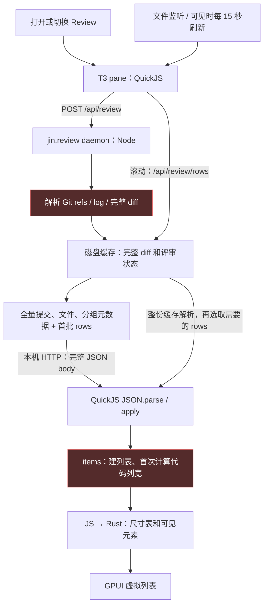
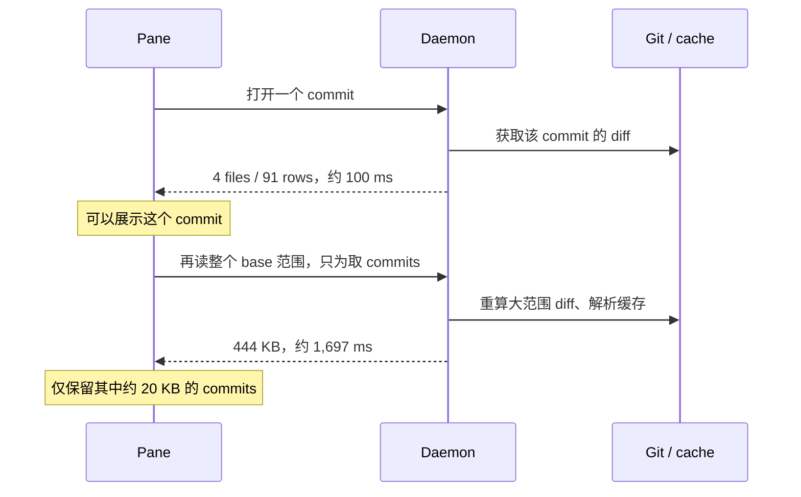

# Review pane 当前数据流、性能证据与决策

2026-11-09。用户要求先调查当前情况和架构、用 show-me 解释，再决定优化范围。本阶段未修改或部署实现。

结论：当前样本已经复现两种不同的成本：daemon 对未变提交范围重复获取整个 diff，形成秒级等待；QuickJS 在 Render 中首次测量一批代码的列宽，触发 50 ms 执行预算。当前数据没有达到 8 MiB HTTP 响应上限或 10,000 项尺寸数组上限。

## 基线和样本

| 对象 | 本次核对 |
| --- | --- |
| T3 | `a0802e9`；`main.js`、`review-load.js`、`commits.js`、`rows.js`、`files.js` 与安装目录逐字相同 |
| Herdr | 安装的 `herdr-app 0.1.14`；宿主源码 `~/my/personal/fork/herdr-app@1d838e2`，限制来自其中的 `vendor/gpui-kit` |
| jin.review | 在用 `0.3.4-fork.8`；源码在 `~/my/personal/projects/pulls.review@d1f982f`；`fork/pulls-review@85d05f2` 是旧 checkout，未用于当前架构结论 |
| 当前 Review | 从 `~/.config/herdr-app/shared.json` 的 `review.shown` 读取留存的 root/base；没有切换用户窗口 |
| 规模 | Compare 页，113 commits、1,274 files、7 groups；最大且首个组 628 files |

这是留存的真实 Review 场景；不是已确认用户唯一或最差的复现。提交数、文件数和代码量是三个不同维度，不能只用“113 个提交”代表负载。

## 当前架构

Pane 是 GPUI 的 JavaScript 描述，宿主在 QuickJS 中运行它，再由 Rust 绘制原生元素；没有浏览器 DOM 或 WebView。HTTP 工作在宿主后台执行，响应整体收齐后，`response.json()` 在 QuickJS 中同步执行 `JSON.parse`。因此请求异步，不等于响应处理和界面建模也在后台。

一手来源：安装目录的 `~/.config/herdr-app/AGENTS.md`；宿主 `vendor/gpui-kit/crates/shell/src/engine/quickjs/standard/fetch.rs:18,242,618` 和 `scheduler.rs:1336`；[pane 读取](../../extras/mods/review/review-load.js)、[列表建模](../../extras/mods/review/main.js)、[服务端调查](review-performance-daemon-investigation.md)。

已经存在的优化：diff 和提交菜单都只画可见部分；文件树也已虚拟化；代码宽度有行缓存和文件片段缓存；滚动补行使用独立 `/rows`，分析轮询使用 `/status`。这些历史问题不再作为本次新发现。**绘制虚拟化仍会先为当前组建立列表模型，首次宽度缓存也要先计算。**

## HTTP：等待发生在哪里

使用同一真实 root/base、固定颜色、顺序发请求；只读取 Review，没有 analyze 或 reviewed 写入。正常 `/api/review` 读取会触及 daemon 自己的缓存和访问时间。

| 操作 | 返回体 | 实测耗时 | 说明 |
| --- | ---: | ---: | --- |
| 全范围，只有元数据，第 1/2/3 次 | 每次 443,705 B | 1,458.51 / 1,306.46 / 1,369.77 ms | 无 rows，热态仍慢；中位数 1,369.77 ms |
| 打开最新单提交，4 files / 91 rows | 18,354 B | 99.51 ms | 一次请求；重复读取 193.61 ms |
| 为这个提交再取 base 的提交列表 | 443,705 B | 1,696.84 ms | 丢弃文件和分组，只使用 commits；这是后台额外开销 |
| 全范围，带首批 2,865 rows | 1,007,818 B | 1,728.95 ms | 9,185 tokens，约 22.3 万文本字符 |
| 独立补行，6 files / 2,052 rows | 292,900 B | 124.25 ms | 已走 `/rows`，没有再回传全量元数据 |
| 分析状态 | 17 B | 3.99 ms | `/status` |

443,705 B 中，commits 为 20,165 B、files 为 326,837 B、groups 为 96,248 B。当前样本中提交列表数据占比约 4.5%；文件和分组占约 95.4%。

自动调用链见 [review-load.js:90](../../extras/mods/review/review-load.js#L90) 和 `loadBaseCommits()`；时序表是按该调用链分别请求所测，未把后台 1.70 s 算成单提交首屏的阻塞时间。

服务端源码先执行 `source.fetch()`，之后才检查缓存，因此相同 base/head 不会免去 Git 取数。独立 daemon 调查用当前源码拆解：原始 diff 约 21 MB，缓存 body 约 15.5 MB；`git diff` 约 765–1,040 ms，`source.fetch()` 热态合计约 975–1,040 ms；`/rows` 每次读、解析、校验整份缓存约 91–102 ms。它解释了元数据读取和补行的量级，详细方法及限制见[服务端报告](review-performance-daemon-investigation.md)。这些是本机观测，不是跨机器性能承诺。

## QuickJS：已复现的渲染超时

使用安装的 `herdr-app check`，把当前 pane 源码复制到临时目录，子类注入本次真实响应，关闭请求、发布状态和定时加载。原始 `apply()`、`items()`、`columns()`、`contentWidth()` 和尺寸桥保持不变。检查器使用自己的内存共享状态，本实验是统一视图，未操作真实窗口。

| 对照 | 结果 |
| --- | --- |
| 只有元数据，在 Render 中建列表 | `items` 12.463 ms；1,223 items；commitRows 0.186 ms；尺寸桥 0.063 ms |
| 加入同次首批 2,865 rows，在 Render 中建列表 | 两次独立调用都 `interrupted`，栈落在 `columns → contentWidth → items` |
| 同一份首批数据，仅把建模测时放到预算更宽的 init 中 | `items` 105.063 ms，1,353 items；JSON.parse 28.898 ms，首次 apply 12.375 ms |
| 同一份首批数据，实验性提前算好列宽，再在 Render 中建列表 | 提前量宽 130.616 ms；Render 内 items 22.265 ms；commitRows 0.483 ms；尺寸桥 0.174 ms |

`items()` 中首次量宽在 [main.js:181](../../extras/mods/review/main.js#L181)，逐 token 的替换和宽字符匹配在 [rows.js:20](../../extras/mods/review/rows.js#L20)。缓存避免后续重复计算，但当前首批仍会在 Render 中支付首次成本。

这个对照说明：**当前 3,000 rows / 10,000 tokens 预算没有保证首次计算能在 50 ms 内完成；字符量和计算所处的阶段也需要纳入设计。** 把量宽提前的实验消除了该隔离调用的中断，代价仍然存在于提前计算阶段。这是方案依据，不是已完成修复，也不代表完整画面已经达标。

原生探针为输出计时而主动 `throw Error('[profile-only] ...')`，因此这些测时进程退出 1；正常出现的 `[profile-only]` 与真正的 `interrupted` 在输出中有明确区别。一次尝试完整 `super.render()` 还遇到检查器默认主题的颜色组合错误，该结果没有用于当前故障结论。`check` 不执行完整窗口布局和后续虚拟行绘制，本文未据此声称测过完整帧率或真实输入延迟。

## 各层限制不能互相替代

| 层 | 当前限制或行为 | 当前是否触发 |
| --- | --- | --- |
| daemon rows | 每次 4 MiB / 3,000 rows / 10,000 tokens，文件/分组/提交元数据未计入这个预算 | 有分批，但仍不能保证绘制预算 |
| 宿主 fetch | 请求、响应各最多 8 MiB；30 s；整体收齐后返回，无流式 body API | 本样本首批约 0.96 MiB，未达上限 |
| QuickJS Render / Layout | 单次约 50 ms | **已复现 interrupted** |
| QuickJS Event / Task | 单次约 500 ms | 本次分离后的 parse / apply / 预计算未触发 |
| JS → Rust 尺寸数组 | `item_sizes` 数组最多 10,000 项 | 当前 1,354 项，含尾部空白，未触发 |
| 虚拟列表 count | 同一 render 所有虚拟列表合计最多 1,000,000 项；与尺寸数组限制不同 | 未触发 |
| QuickJS heap | 每 runtime 256 MiB，不是每 pane 256 MiB | 未测堆占用或上限 |

限制的一手来源：当前 daemon `packages/cli/src/daemon/review.ts:272`；宿主 `standard/fetch.rs:10,242,618`、`sandbox.rs:405,436`、`mod.rs:8899,8981`。这些宿主路径都相对于前述 `vendor/gpui-kit/crates/shell/src/engine/quickjs/`。

虚拟列表减少的是实际绘制元素，当前 `hunks` / `full` 会保留已加载的行；它没有把 Review 的内存保留量限制为一个屏幕。内存是否是用户当前主要症状，尚无实测证据。

## 会放大负载的触发规则

以下是源码确认的行为，未做真实鼠标或高频点击压测：

- 文件监听按 root 过滤忽略路径，没有按 page 类型过滤；所以 Compare/commit 页也可能因为工作树普通文件变化再读整页。此类内容的 base/head 未变时，重复取数没有改变 diff 的价值。见 `review-load.js:16–36`。
- 在途同页请求会合并成“完成后再读一次”；切换到另一页则立即发起读取，旧响应只通过 `loadId` 丢弃。pane 没有撤销旧请求，宿主 fetch options 也没有 `signal`。快速切多个提交时，丢掉旧响应不等于取消 daemon 已经开始的计算。见 `review-load.js:69–81`、宿主 `standard/fetch.rs:37–75`。
- 后台 `/api/review` 没有跨请求的在途合并，重复读还会造成重复的 Git 工作和瞬时内存分配。服务端详细证据见伴随报告。

## 待用户决定的实施范围

| 范围 | 对应问题与改法 | 代价和验收 |
| --- | --- | --- |
| **A. 先保证 pane 的渲染预算** | 把新 rows 的首次宽度计算移出 Render，沿用已有行缓存和文件片段缓存；按有界批次处理，保持 Render 只做汇总和可见元素构造 | 主要改 pane；保留现有 UI 和完整 Review 内容。需要真实默认宽度、split/unified、滚动和切提交回放，不能只靠上述探针 |
| **B. 再消除重复取数** | 对 commit/compare 按实际 base/head sha 复用快照；合并同一快照在途请求；基础提交列表按版本复用；让监听只使受影响的内容失效；`/rows` 使用有字节上限的已解析缓存 | pane + daemon；要严格处理 refs 更新、amend、base 移动和 `/worktree` 失效规则；内存缓存驻留大小需单独测量，不能把约 100 MB 的瞬时 fetch 堆增量当作准确驻留成本 |
| **C. 改 Herdr 的宿主传输或渲染能力** | 流式响应、可撤销请求、原生 diff/文本测量等 | 需要进入宿主工程。现有证据支持先做 A+B；是否进入 C，应由剩余实测瓶颈决定 |

建议 **A+B**：A 处理已复现的渲染中断，B 处理秒级等待与重复后台工作。单做一项，另一类成本仍在。提高 8 MiB 上限不影响本样本；提高 Render 时间预算只允许同一次计算更久地占用界面线程。提交或文件数量硬截断会改变可见内容，不作为默认优化方案。

## 复现与交付边界

HTTP 探针的运行命令为 `node /private/tmp/herdr-review-perf.geNHwM/probe.cjs --assert-responsive`，已连续读取三次，输出 `metadata-only median 1369.77 ms; review responsiveness budget 500 ms`，随后断言失败。500 ms 是本调查为“元数据响应及时”选定的检查阈值，不是项目既有 SLA。真实 QuickJS 复现命令为 `herdr-app check /private/tmp/herdr-review-perf.geNHwM/native`，未预计算宽度时两次都在 `columns()` 中断。

上述临时探针和包含业务路径、内容的响应已清理；未把原始 diff、提交消息、session 或源码副本写入持久报告。复现同类实验的方法：

1. 从 `shared.json` 的 `review.shown` 取得当前 root/base，在脚本内部读 daemon.pid 的端口和 session。
2. 向 `/api/review` 顺序 POST 三次 `{ path: root, page: base, colors: { foreground: '#eeeeee' }, rows: [], firstRows: false }`，只打印字节数、数量和耗时。
3. 再取一次 `firstRows:true`；记录 rows、tokens 和字符量。
4. 临时复制当前 review mod，子类调用 `super.init()`，注入响应，覆盖请求和共享发布；在 Render 中直接调用原始 `items()`，用宿主检查器复现中断。
5. 单独在较宽的 init 预算中测量相同 `items()`；另一个对照只在 init 中用原始 `contentWidth()` 预热各 hunk 的列宽，再测 Render 内 `items()`。

本阶段只新增研究文档。未改实现、未同步安装、未启停用户的 daemon、未触发分析、未改 reviewed。没有运行代码全量门禁或截图验收；这些属于后续获选实施方案的验收。也未测真实鼠标、高频连续切换、split 布局、窗口整体帧率、QuickJS 堆占用，或比该样本更大的提交范围。
