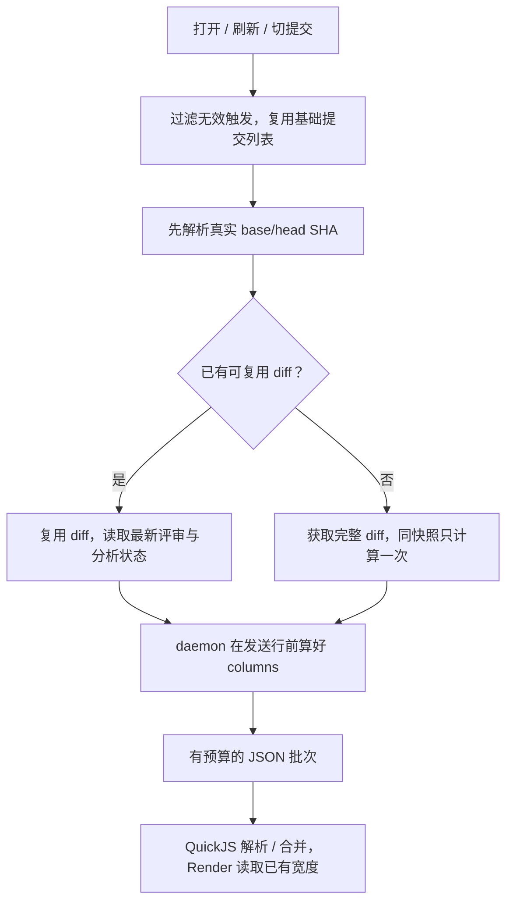

# Review 性能优化方案：两路评估汇总

2026-11-09。回应“再分两路评估，给出真正有用的性能优化方案，然后 show-me”。本轮评估实现方案，未修改或部署实现。

## 推荐的完整方案

**同时解决界面同步计算和重复取数。直接让 daemon 生成列宽，复用 SHA 相同的 diff，并减少无效读取。** 单端“把量宽提前”可以做小修，但不是本次整体方案的完成线。

| 顺序 | 具体改动 | 对用户的收益 | 边界与工程量 |
| --- | --- | --- | --- |
| 1 | daemon 在 `rowsWithin()` 发送行前生成 `columns`；pane 使用现有行宽缓存字段；收紧 rows 批次并计入整个响应大小 | 移除 QuickJS 逐字符量宽，处理已复现的 Render 中断和长行批次停顿 | 主要改 daemon，小；pane 读取代码不改，现有兜底保留 |
| 2 | 先解析真实 base/head，再决定是否完整 fetch；`readReview` 和 `/file` 共用；同快照在途工作可合并 | 未变范围不再反复执行约 1 s 的 Git 工作，全文翻页也受益 | 小到中；热元数据约 0.32–0.53 s 是推算，首次冷读不变快 |
| 3 | 普通工作树文件变化只刷新 `/worktree`；切提交时复用已有基础提交列表 | 减少后台整页请求、444 KB 响应解析，以及每次有效切换后的额外 base 读取 | 只改 pane，小；保留 refs 监听、15 s 刷新、分析状态轮询 |

1、2 可以独立开发，3 可并行。交付按这三项共同回放；不是先把多种缓存、队列和宿主改造全部铺开。

图中 SHA 短路适用于 commit/Compare/branch 等可解析提交范围；`/worktree` 的身份仍需实际读取工作树后确定，不套用这条快捷路径。marks 和 analysis 是可变状态，不能因 SHA 相同而冻结。

## 评估基础

两名本机独立评估者分别负责 pane 的计算与交互，以及 daemon 的 Git 取数与缓存。本文负责跨层排序、接口依赖和验收，不把两路建议简单相加。

基线为 `herdr-t3@e4b2787`、`pulls.review@d1f982f`、`herdr-app@1d838e2`。T3 从上轮测量基线 `a0802e9` 到本轮基线，`extras/mods/review/`、`shared/` 和 `scripts/` 无变化；daemon 和宿主 HEAD 均未变。因此本轮复用[原调查的有效实测](review-performance-data-flow.md)，没有重复访问业务仓库或真实 daemon。

当前样本为 Compare 页，113 commits、1,274 files、7 groups。它同时包含较多提交、文件和代码，不代表提交数单独造成全部开销。

| 已测操作 | 基线 | 它能说明什么 |
| --- | ---: | --- |
| 全范围元数据，热态三次的中位数 | 1,369.77 ms | 已有磁盘缓存没有避免重复 Git 取数 |
| 首批 rows 建模，预算较宽的隔离调用 | 105.063 ms | 超过 Render 的 50 ms 硬预算；真实 Render 两次中断 |
| 实验中提前算宽后的 Render 建模 | 22.265 ms | 证明量宽所在阶段影响中断；提前计算本身仍耗时 130.616 ms |
| 打开小提交 | 99.51 ms | 异步 HTTP 等待与界面线程卡住是两类问题 |
| 为小提交另取基础提交列表 | 1,696.84 ms | 后台重读约 444 KB，只使用其中约 20 KB 的 commits |
| 独立补行 | 124.25 ms | `/rows` 已经存在，但仍反复解析整份缓存 |

这些数值来自不同隔离调用，不能相加当作一条完整交互的耗时。方案中的性能目标是后续验收条件，尚未测得。

## 方案取舍的共同标准

“不再触发 50 ms 中断”和“交互顺滑”分别验收。把约 131 ms 的量宽工作整体挪进允许 500 ms 的回调，只能证明计算阶段影响中断；完整方案还需要减少工作量或分成能及时让出界面线程的小批次。

性能收益也按操作区分：

- **冷打开**：首次遇到新的提交范围，仍需要获取和解析 diff。热缓存方案不承诺消除这次成本。
- **同页热刷新**：base/head 未变时，检查是否复用 diff，同时保留评审标记与分析结果更新。
- **切提交**：分别测当前提交可见时间与补取基础提交列表的后台工作，避免把两者相加成前台阻塞。
- **滚动补行与全文**：检查每页是否重复读完整缓存、重复获取整个 diff；同时检查 pane 的累计建模成本和内存。

后续实施的完成条件是回放原场景，以及 split/unified、默认窗口宽度、长行和连续切提交场景。阶段计时和测试断言用于定位原因，完整窗口和交互回放用于判断用户的问题是否消失。

## 渲染路线：生产端算一次，界面直接用

[pane 独立评估](review-performance-pane-proposal.md)补测了当前 QuickJS 中的字符扫描：合成数据中，合并截断和量宽、减少 `match` 分配，约 35–47 ms 可降到 12–17 ms；中文密集时计数约快 2–3 倍。但该数据不是原场景，不能拿它证明已经修好。原场景的新数据处理仍被推算为约 70–130 ms，这也是不把单端小修选作最终方案的原因。

整体实施时，列宽在 daemon 的 `rowsWithin()`、`JSON.stringify(row)` 之前生成，由三种取行接口一起返回。daemon 一路核对后纠正了最初的 `highlight()` 放置点：它只返回 tokens，全文视图之后还会替换 tokens；在最终发送行处算，才能覆盖实际输出且只处理本批行。采用原有规则：tab 为 4 列，现有 BMP 宽字符额外加 1 列；split、unified、全文视图使用同一份值。pane 沿用 `row.columns`，不再为新到达的长文本量宽。新 daemon 给现有 pane 返回该字段即可受益；旧 daemon 仍走现有计算。`clipRows` 截断和本地计算兜底保留，本轮无需新增版本协商。

JSON 解析还在界面线程，行数、token 数和 rows 字节数都不能替代整个响应的预算。以本样本**总响应约 1 MiB、到达处理不超过 50 ms**作为首轮验收条件，随后按实测调整批次。`/api/review` 先量出约 444 KB 元数据，再把剩余额度给 rows；`/rows`、`/file` 按同一总量目标分批。新增字段、JSON 包装和分隔符都要计入，并核对最终序列化大小。这不是给所有规模保证 1 MiB 上限，元数据自身更大的场景需要另测。数据到达和下一次 Render 可能连续发生，完整输入延迟仍要在窗口里测。

## 取数路线：先跳过重复 Git，再决定驻留缓存

[daemon 独立评估](review-performance-daemon-proposal.md)给出的第一步不改 HTTP API：`LocalSource.revisions()` 只解析真实 base/head SHA；daemon 的 `pageEntry()` 在两者都一致时复用磁盘里的 diff，供 `readReview` 和 `readFullFile` 共用。`pageKey` 只有 ref 文本，不能单独代表内容身份；工作树页继续走原路径。

对本样本，热元数据请求从 1.31–1.46 s 降至约 0.32–0.53 s 是按独立阶段计算的**推算**，尚未实施验证。冷首次打开仍要做完整 Git 工作，还会多一次 SHA 探测；因此它首先解决反复刷新和回访，不承诺把第一次打开变成瞬时。

该步骤的验收重点是确定的工作量：同一范围热读时 `git diff` 与 `git log` 都为 0 次；base 移动、amend、rebase 后重新获取；`/file` 连续翻页不再每页重取整个范围。进程重启后的第一读还要确认磁盘条目与当前解析逻辑语义兼容，不能只靠 JSON schema 形状校验。

同快照在途合并可随本步骤处理，合并的是 diff 计算，不是不同颜色和分页参数的整个响应。已解析 diff 的驻留缓存排在回放之后。每批 `/rows` 当前约 100 ms 的整份缓存读取值得消除，但是否先做取决于真实滚动与并发回放。驻留预算按 JSON 字节只能近似计重，需要在真实 Node 22 和代表性对象图上测量；合成数据不能提供整个堆占用的上界。

## 验收和停止条件

下列时间是本次评估提出的目标，不是既有 SLA，也不是已经达成的结果。

| 操作 | 必须观察的行为 | 首轮目标 |
| --- | --- | --- |
| 真实首批，split 与 unified | Render 不再扫描 token 文本；横向滚动仍能到达 CJK、tab 和长行行尾 | 重建 Render ≤ 25 ms；普通 Render ≤ 8 ms；到达处理 ≤ 50 ms，另外记录完整输入延迟 |
| 未变 SHA 的重复读取 | 第 2、3 次 `git diff` 与 `git log` 均为 0；标记与分析仍更新 | 热元数据中位数约 0.3–0.55 s，超过 0.6 s 继续查剩余成本 |
| base 移动、amend、rebase、daemon 重启 | 正确失效，返回实际新 SHA；旧解析版本的缓存不能永久命中 | 数据正确优先，允许一次冷读 |
| Compare 页上 agent 只改普通文件 | 不再因这些文件变化重读；refs 和分析状态变化仍更新 | 60 s 内只剩约 4 次兜底刷新，无其他有效触发时 ≤ 5 次 |
| 已有基础提交列表时切提交 | 不额外读取 base；刷新时仍能发现新提交 | 每次有效切换的额外 base 请求为 0 |
| 持续补行、长行、3 万行全文 | 限批次后没有长任务或累计建模中断；观察内存与重复 body 读取 | 不满足时才补已解析 diff 缓存或改累计列表构造 |

暂不把宿主流式传输、提高 8 MiB/50 ms 上限、提交硬截断、全量元数据分页和通用异步队列放进本轮实现。它们没有比上述改动更直接的当前证据。`repoCacheDir` 记忆只省约 16–36 ms，可在相关函数改动时顺带做，不作为主要性能成果。

本轮只产出方案和证据说明。没有新增真实样本测量，没有运行产品代码全量检查、安装同步或窗口验收；两路各自清理了合成实验的临时文件。删除项：无。
